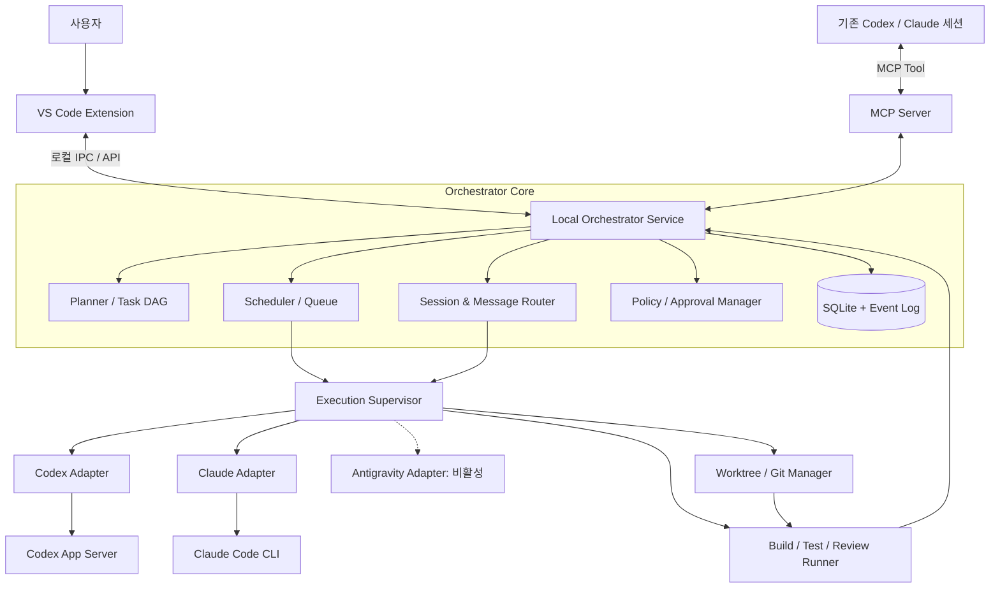
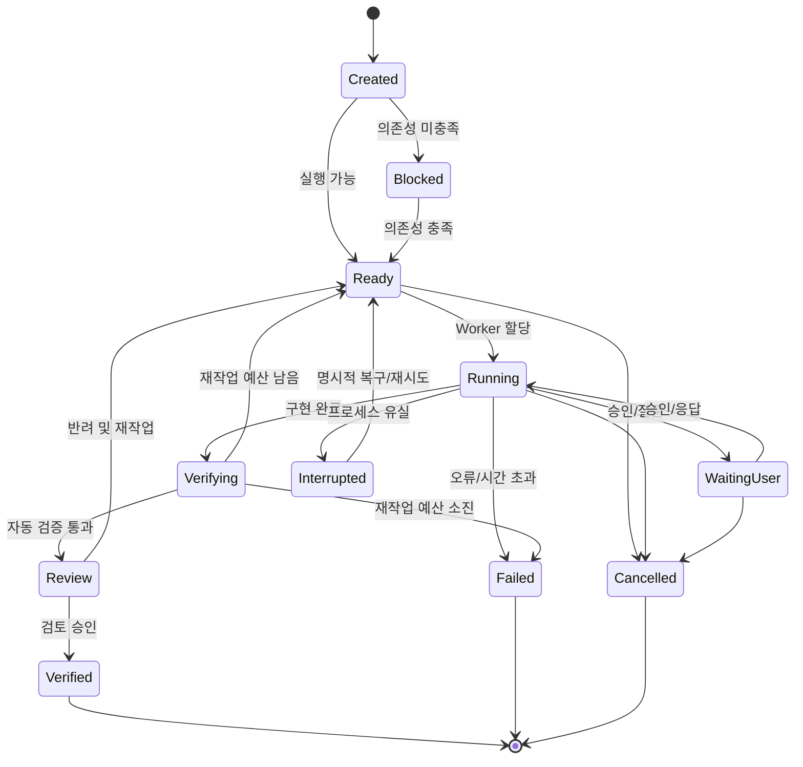
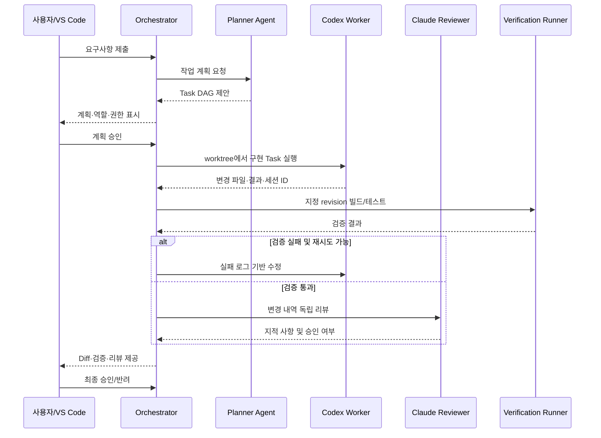

# VS Code 기반 멀티 에이전트 코딩 오케스트레이터 — 구조 및 기능 분석

> **문서 유형:** 기술 조사·요구사항·초기 아키텍처 제안서  
> **작성 기준일:** 2026-10-15  
> **목적:** Codex와 Claude Code의 기존 CLI/실행 엔진을 활용하는 로컬 우선(Local-first) 멀티 에이전트 코딩 도구의 개발 범위 정의  
> **범위:** VS Code GUI, 작업 오케스트레이션, 에이전트 간 위임, 세션 관리, Git 격리, 검증·승인, 운영 안정성  
> **비범위:** Antigravity의 소비자용 로그인에 대한 비공식 자동 연동 구현, 독자적인 LLM 추론 서비스 개발

---

## 1. 요약 및 설계 방향

### 1.1 목표

일반적인 AI 채팅 통합 툴이 아닌, **여러 코딩 에이전트가 실제 저장소에서 작업을 분담·수행·검증하도록 조정하는 오케스트레이터**를 만든다.

핵심 사용 시나리오는 다음과 같다.

1. 사용자가 VS Code에서 구현 요구사항을 제출하거나, 기존 Codex/Claude Code에서 하위 작업을 위임한다.
2. Planner가 실행 가능한 작업 목록과 의존성을 제안한다.
3. 사용자가 계획을 검토·수정하고 실행을 승인한다.
4. Scheduler가 작업별 에이전트와 격리된 Git worktree를 할당한다.
5. 구현 에이전트가 파일을 변경하고 결과를 구조화해 보고한다.
6. 오케스트레이터가 빌드·테스트·정적 분석을 **별도 검증 단계**에서 수행한다.
7. Reviewer가 결과를 검토하고, 실패 시 한도 내에서 수정 작업을 재개한다.
8. 사용자가 Diff와 검증 결과를 확인한 후 통합 또는 반려한다.

### 1.2 핵심 설계 원칙

- **엔진과 UI 분리:** VS Code 확장은 프런트엔드, 로컬 Orchestrator Service는 실행·상태 관리 담당.
- **공식 실행 인터페이스 우선:** Codex App Server 및 Claude Code CLI를 우선 사용. 비공개 확장 IPC 의존은 피한다.
- **Provider 중립적 Task 모델:** 작업 상태·의존성·결과 형식은 Codex/Claude의 내부 형식과 독립적이어야 한다.
- **메시지보다 작업 단위:** 긴 대화를 복사하기보다 목표·제약·관련 파일·검증 결과를 담은 구조화된 Handoff 사용.
- **작업 격리:** 동시 Writer가 같은 Git worktree를 수정하지 않도록 강제.
- **완료와 검증 분리:** 에이전트의 완료 주장만으로 성공 처리하지 않는다.
- **인간 승인:** 위험한 도구 실행, 통합, 원본 브랜치 변경에는 사용자 승인 경계가 있어야 한다.
- **복구 가능성:** VS Code 종료나 프로세스 장애 후에도 작업 기록을 잃지 않아야 한다.
- **최소 기능으로 출발:** Council/Consensus나 자동 모델 선택보다 위임·작업 수집·worktree·검증을 먼저 구현한다.

---

## 2. 선행 프로젝트의 구조와 참고 기능

> 아래 내용은 앞선 조사에서 확인한 공개 README·문서에 근거한 **설계 참고 요약**이다. 특정 릴리스의 전체 동작, 코드 품질, 보안성, 라이선스 적합성을 독립적으로 검증한 결과는 아니다. 실제 구현에 차용하기 전에는 최신 소스와 라이선스를 재확인한다.

| 프로젝트 | 주된 성격 | 참고할 기능 | 그대로 도입하지 않을 부분 |
|---|---|---|---|
| [OpenRig](https://github.com/mvschwarz/openrig) | 지속형 에이전트 런타임 및 팀 조정 | 세션·작업 상태 영속화, 에이전트 간 메시징, 복구 | tmux 중심 UX를 그대로 채택할 필요 없음 |
| [Claw Orchestrator](https://github.com/Enderfga/claw-orchestrator) | 다중 모델 워크플로 및 검증 루프 | Planner/Coder/Reviewer, 검증 계약, 재작업 제한 | 복잡한 자율 루프는 후순위 |
| [AgentFlow](https://github.com/harun-yardimci/agentflow) | Task DAG·CLI 작업 실행 | 작업 의존성, 병렬 실행, 수동 승인, 작업별 격리 | 초기에 시각적 워크플로 편집기 불필요 |
| [Agent Orchestrator](https://github.com/Augani/agent-orchestrator) | Coordinator + Worker | 작업 계약, 역할 할당, 작은 컨텍스트 캡슐 | 특정 Provider를 영구적 상위 Coordinator로 고정하지 않음 |
| [Agent Hub](https://github.com/uncle-tyson/Ur-Agent-Team) | MCP 기반 위임·결과 회수 | 동기/비동기 위임, 작업 ID, 결과 조회, 실행 큐 | 비공개 세션 제어에 의존하지 않음 |
| [Veyra](https://github.com/dontcallmejames/veyra-vscode) | VS Code 내 협업 UX | 통합 작업 화면, Diff 검토, Checkpoint, Rollback | 초기부터 모든 대화 UI 재구현 불필요 |
| [Daintree](https://github.com/daintreehq/daintree) | 사람이 통제하는 Agent Fleet | worktree, 브랜치·Diff·터미널 가시성 | 별도 Desktop 앱 대신 VS Code 통합 |
| [Tasker](https://marketplace.visualstudio.com/items?itemName=emberstone.tasker-ai) | 작업 보드·역할 기반 실행 | Kanban, 모델 배정, 승인 및 재작업 | 유료 기능 구성 자체를 모방할 필요 없음 |

### 2.1 세 가지 기능 계층

1. **Workflow Orchestration:** 작업 분해, 의존성, 스케줄링, 실패 시 재작업 (AgentFlow·Claw 계열).
2. **Agent Runtime & Coordination:** 세션 수명주기, 위임, 메시징, 결과 수집, 복구 (OpenRig·Agent Hub 계열).
3. **Human-in-the-loop IDE:** 작업 가시화, Diff, 승인, 중단, 수동 개입 (Veyra·Daintree·Tasker 계열).

**설계 결론:** 세 계층을 모두 지원하되, 작업·세션·승인 상태의 **단일 원본(Source of Truth)**은 VS Code Webview가 아니라 Orchestrator Service가 가져야 한다.

---

## 3. 논리 아키텍처



### 3.1 주요 구성 요소

| 구성 요소 | 책임 | 권장 구현 |
|---|---|---|
| VS Code Extension | 작업 목록, 계획 편집, 로그, Diff, 승인 및 취소 | TypeScript / TreeView / Webview / OutputChannel |
| Local Orchestrator Service | 작업 상태, Scheduler, Provider 호출, 장기 실행 | 별도 Node.js 프로세스(서비스화는 선택) |
| MCP Server | 기존 Codex·Claude에서 작업 위임 및 결과 조회 | Orchestrator Service의 제한된 기능 노출 |
| Provider Adapter | 모델/CLI별 인증·실행·출력 이벤트 정규화 | 독립 인터페이스 + capability discovery |
| Task Scheduler | DAG 검증, 선행 작업 해제, 동시성 및 우선순위 | 저장 가능한 상태 머신 및 bounded queue |
| Session Manager | 프로세스·세션 ID·작업 상태 추적, 재개/중단 | Native ID + 내부 UUID 매핑 |
| Workspace Manager | worktree 및 branch 수명주기, 잠금, 변경 추적 | Git 명령 + 안전한 상태 검증 |
| Verification Runner | 빌드·테스트·정적 분석 실행 및 결과 저장 | 명시적 명령 allowlist / 제한된 실행 환경 |
| Policy Manager | 사용자 승인, timeout, 자원 제한, 권한 경계 | 명시적 정책 및 감사 이벤트 |
| Persistence | 작업, 이벤트, 세션, 결과, 설정 | SQLite(WAL 등 동시성 고려) + 파일 로그 |

### 3.2 실행 호스트 원칙

- 로컬 프로젝트에서는 로컬 환경에 설치된 CLI와 Git 저장소를 사용한다.
- VS Code Remote SSH 환경에서는 **해당 프로젝트의 Workspace Extension Host**에서 실행 엔진을 운영하는 것이 자연스럽다.
- 실행 경로·인증 상태·CLI 버전·Git 루트는 **프로젝트/호스트별로 탐지**하며 임의로 공유하지 않는다.
- VS Code UI 프로세스가 종료되어도 작업을 계속할 필요가 있다면, 서비스는 Extension Host 수명주기와 분리해 실행한다.

---

## 4. 기능 요구사항

우선순위 정의:

- **P0 / MVP:** 최초 실사용에 필수.
- **P1 / V1:** 자동 협업이 안정적으로 작동하기 위해 필요.
- **P2 / V2:** 고급 워크플로·확장성 기능.

### 4.1 작업·계획·스케줄러

| ID | 우선순위 | 요구사항 | 수용 기준 |
|---|---|---|---|
| TASK-01 | P0 | Task CRUD 및 상태 관리 | GUI/API에서 작업 생성·수정·조회·취소 가능 |
| TASK-02 | P0 | 작업별 Provider/모델/역할 지정 | 실행 전 대상 Adapter와 설정을 확인 가능 |
| TASK-03 | P0 | 동시 실행 수 제한·작업 큐 | 한도 초과 시 대기, 순서대로 실행 |
| TASK-04 | P1 | Planner의 자동 Task 분해 | 구조화된 계획 초안을 생성하고 사용자가 수정 가능 |
| TASK-05 | P1 | DAG 의존성 및 병렬 실행 | 순환 의존을 거부하고 ready 작업만 실행 |
| TASK-06 | P1 | 작업 실패·재시도·취소 정책 | retry budget, timeout, terminal state 준수 |
| TASK-07 | P2 | 런타임 동적 Task 생성 | 중복·순환·권한을 검증한 뒤 DAG 수정 |
| TASK-08 | P2 | 자동 모델/에이전트 라우팅 | 사용자가 정책을 수정·비활성화 가능 |

### 4.2 에이전트 간 협업·위임

| ID | 우선순위 | 요구사항 | 수용 기준 |
|---|---|---|---|
| DELEG-01 | P0 | 다른 에이전트에 작업 위임 | Task ID를 반환하고 해당 Provider에서 실행 |
| DELEG-02 | P0 | 비동기 결과 조회 | 호출자가 종료하지 않고 나중에 결과 조회 가능 |
| DELEG-03 | P0 | 작업 상태 조회·취소 | 요청자와 GUI에서 동일 상태 확인 |
| DELEG-04 | P0 | 위임 깊이·동시성 제한 | 재귀 위임 폭주와 무한 순환 방지 |
| DELEG-05 | P1 | 실행 중 추가 메시지/질문 | Provider capability에 따라 지원/미지원 명시 |
| DELEG-06 | P1 | Handoff 및 구조화된 산출물 | Provider와 무관한 요약·변경 파일·검증 결과 전달 |
| DELEG-07 | P2 | 방송·토론·합의(Council) | 복수 응답을 구분해 취합·비교 가능 |

MCP 노출 후보: `delegate_task`, `get_task_result`, `list_tasks`, `cancel_task`, `get_agent_status`.

위임 요청의 입력은 반드시 `task_id`, `parent_task_id`, `provider`, `workspace`, `requested_permissions`, `deadline/timeout` 등을 포함해 추적 가능해야 한다.

### 4.3 세션·컨텍스트·지속성

| ID | 우선순위 | 요구사항 | 수용 기준 |
|---|---|---|---|
| SESS-01 | P0 | 새 세션 생성 및 Provider 세션 ID 저장 | 내부 UUID와 Native ID를 연결해 추적 |
| SESS-02 | P0 | 실시간 이벤트·종료 상태 수집 | 출력·오류·도구 이벤트를 Task와 연결 |
| SESS-03 | P0 | VS Code 재시작 후 작업 기록 유지 | DB에 작업·결과·로그가 남음 |
| SESS-04 | P1 | Native 세션 재개 | 지원 Provider에서 기존 세션을 명시적으로 재개 |
| SESS-05 | P1 | 프로세스 생존 여부 확인·장애 복구 | 유실 세션은 `Interrupted`로 기록, 중복 재실행 방지 |
| SESS-06 | P1 | Context Capsule 생성 | 관련 파일·목표·제약·선행 결과만 선별해 전달 |
| SESS-07 | P2 | 타 Provider Handoff | 원본 세션 직접 이관 대신 구조화된 Context 생성 |

**Context Capsule 예시**

```yaml
handoff:
  objective: "I2C 드라이버 구현"
  repository: "firmware"
  base_revision: "<git-commit-sha>"
  relevant_files:
    - "drivers/i2c.c"
    - "include/i2c.h"
  completed_work:
    - "I2C API 인터페이스 정의"
  decisions:
    - "타임아웃 100ms"
  unresolved:
    - "NACK 처리 확인 필요"
  verification:
    build: passed
    tests: "7/8 passed"
  next_action: "NACK 처리 수정 및 재검증"
```

### 4.4 Git 및 작업 환경 격리

| ID | 우선순위 | 요구사항 | 수용 기준 |
|---|---|---|---|
| GIT-01 | P0 | 작업별 별도 worktree/branch 생성 | 동시에 실행해도 파일 충돌 없이 수정 |
| GIT-02 | P0 | Writer 소유권 잠금 | 같은 worktree 동시 Writer 금지 |
| GIT-03 | P0 | base commit 및 dirty 상태 검증 | 시작 전 상태 저장, 예기치 않은 변경 감지 |
| GIT-04 | P0 | 변경 파일 및 Diff 표시 | 사용자가 VS Code Diff Editor에서 검토 |
| GIT-05 | P0 | 사용자 승인 없는 원본 branch 변경 금지 | 자동 merge/push 금지 정책이 지켜짐 |
| GIT-06 | P1 | Integration worktree 운영 | 병렬 결과 통합 시 충돌과 테스트 처리 |
| GIT-07 | P1 | Cherry-pick/Merge 및 충돌 처리 | 충돌 시 사용자/통합 Task에 명확히 전달 |
| GIT-08 | P1 | 변경 집합의 revision 추적 | 검증 대상과 승인 대상 코드가 일치함 |

**주의:** Git worktree는 파일 변경 충돌을 줄이지만 OS 파일 접근을 격리하는 보안 샌드박스는 아니다. 모든 Provider의 실행 디렉터리·도구 권한·외부 파일 접근을 별도로 제한해야 한다.

### 4.5 독립 검증과 재작업

| ID | 우선순위 | 요구사항 | 수용 기준 |
|---|---|---|---|
| VERIFY-01 | P0 | 작업별 빌드·테스트 명령 지정 | 종료 코드, 로그, 실행 시간 저장 |
| VERIFY-02 | P0 | `Completed`와 `Verified` 분리 | 에이전트 종료만으로 검증 성공 처리하지 않음 |
| VERIFY-03 | P0 | 승인/반려 가능한 검토 상태 | 사용자가 Diff와 검증 기록을 기반으로 결정 |
| VERIFY-04 | P1 | Reviewer 역할의 독립 실행 | 구현 결과와 검증 명세를 읽어 리뷰 |
| VERIFY-05 | P1 | 실패 로그 기반 자동 수정 루프 | 최대 재시도 횟수·시간 한도 준수 |
| VERIFY-06 | P1 | 고정된 Acceptance Contract | 작업 에이전트가 검사 정책을 임의 완화 불가 |
| VERIFY-07 | P1 | 검증 revision 고정 | 리뷰·테스트 뒤 코드 변경 시 재검증 필요 |

예: `clang-format` 검사, `cmake --build`, 단위 테스트, `clang-tidy`, 커스텀 펌웨어 빌드. 보드 플래싱·실물 장치 테스트 등 외부 장치 영향을 주는 동작에는 별도 승인과 자원 잠금이 필요하다.

### 4.6 VS Code GUI 및 관측성

| ID | 우선순위 | 요구사항 | 수용 기준 |
|---|---|---|---|
| UI-01 | P0 | Agent/Task Explorer | 현재·완료·실패·대기 작업 식별 가능 |
| UI-02 | P0 | 실시간 출력·오류 확인 | Task별 필터링 및 타임스탬프 제공 |
| UI-03 | P0 | 실행 중단과 승인 UI | 작업 취소와 위험 작업 승인 수행 가능 |
| UI-04 | P0 | 내장 Diff Editor 연결 | 변경 파일 비교 및 최종 승인 연결 |
| UI-05 | P1 | DAG/Task Board 표시 | 의존성·병렬 진행을 시각적으로 확인 |
| UI-06 | P1 | 작업 상세·세션 및 컨텍스트 | 역할/모델/세션 ID/검증 결과 확인 |
| UI-07 | P1 | VS Code 재연결/Reload | 종료 후 GUI 재연결 시 작업 기록 표시 |
| UI-08 | P2 | Provider 공식 세션 열기 | 공식적으로 지원하는 URI/세션 경로만 사용 |
| UI-09 | P2 | 성능·사용량 통계 | 불명확한 사용량은 0 대신 Unknown 표기 |

권장 VS Code API: `TreeView`, `Webview`, `OutputChannel`, `vscode.diff`, `QuickPick`/알림, `SecretStorage`(필요한 경우). 공식 확장의 비공개 세션 UI를 강제로 제어하지 않는다.

### 4.7 안정성·보안·정책

| ID | 우선순위 | 요구사항 | 수용 기준 |
|---|---|---|---|
| SAFE-01 | P0 | 작업 실행 권한 정책 | 명령 실행·네트워크·파일 변경에 대한 명시적 허용 범위 |
| SAFE-02 | P0 | 재귀 위임·작업 생성 상한 | 깊이·동시 실행·전체 Task 수 제한 |
| SAFE-03 | P0 | timeout/cancel/kill 및 프로세스 정리 | 하위 프로세스 잔존·좀비 방지 |
| SAFE-04 | P0 | 로그 비밀정보 마스킹 | 토큰·환경 변수·민감 경로를 출력에서 제거 |
| SAFE-05 | P0 | 승인 없는 merge/push/배포 금지 | 부작용이 있는 작업은 승인 필요 |
| SAFE-06 | P1 | 상태 변경 이벤트 영속화 | 장애 후 이벤트 및 현재 상태 재구성 가능 |
| SAFE-07 | P1 | CLI/프로토콜 버전 감지 및 호환성 검사 | 지원하지 않는 API는 명확한 오류 반환 |
| SAFE-08 | P1 | MCP 인증·권한 및 요청 범위 제한 | 임의 작업 생성·프로젝트 간 접근 방지 |
| SAFE-09 | P1 | 프롬프트 인젝션 방어 경계 | 외부 파일/출력의 지시를 운영 정책으로 승격하지 않음 |
| SAFE-10 | P2 | 실행 호스트·원격 환경 확장 | 프로젝트별 실행 위치와 인증 상태 격리 |

---

## 5. Task 상태 머신 및 스케줄링



상태 이름은 구현 시 조정할 수 있지만 **Task 수행 완료와 검증 성공 상태는 반드시 분리**한다.

### 5.1 Scheduler 규칙

1. DAG를 검증하고 순환 의존성을 거부한다.
2. 선행 작업이 모두 충족된 Task만 `Ready`로 전환한다.
3. 동시 실행 상한, Provider 상한, 호스트 자원과 workspace lock을 확인한다.
4. 실행 시작 전 작업 ID·시도 번호·base revision·worktree를 고정한다.
5. Provider 출력에서 이벤트를 정규화하고 실행 완료를 판정한다.
6. 검증과 승인 결과가 확정될 때만 후속 Task를 해제한다.
7. 실패 시 중복 실행 가능성을 검사하고 retry budget 내에서 재시도한다.
8. 사용자가 취소하면 예약 작업과 실행 프로세스를 함께 정리하고 모든 상태를 기록한다.

---

## 6. Provider Adapter 설계

Adapter는 **공통 인터페이스와 Provider별 지원 기능(Capability)** 을 구분해 설계한다. 모든 Provider가 동일한 중간 제어·승인·세션 포크 기능을 제공한다고 가정하면 안 된다.

```typescript
interface AgentCapabilities {
  resumeSession: boolean;
  steerRunningTask: boolean;
  streaming: boolean;
  interactiveApproval: boolean;
  modelSelection: boolean;
  usageReporting: boolean;
}

interface AgentAdapter {
  readonly id: string;
  detect(): Promise<AgentCapabilities>;
  startTask(task: TaskSpec): Promise<AgentSession>;
  sendMessage(sessionId: string, text: string): Promise<void>;
  cancelTask(sessionId: string): Promise<void>;
  subscribe(sessionId: string): AsyncIterable<AgentEvent>;
}
```

> 예시 인터페이스이며, 기능 미지원은 묵시적으로 무시하지 않고 명시적 오류/Capability 분기로 처리한다.

### 6.1 Provider별 기본 전략

| Provider | 우선 연동 경로 | 세션/출력 | 주의점 |
|---|---|---|---|
| Codex | 공식 `codex app-server` | JSON-RPC 및 이벤트 스트림, thread 관리 | 프로토콜 버전·기능 변경 검증 필요 |
| Claude Code | 공식 CLI headless mode | Stream JSON, 세션 ID 및 재개 | CLI 옵션·공유 세션 충돌·약관 범위 확인 |
| Antigravity | **Adapter 구조만 예약, 기본 비활성화** | 공식 CLI 기능은 별도 연구 | 소비자용 구독의 외부 자동 오케스트레이션 관련 ToS 확인 전 연결 금지 |

기존 공식 VS Code 확장과 **엔진/인증을 공유할 수 있는 것**이 **현재 열린 확장 세션을 임의로 제어할 수 있는 것**을 의미하지는 않는다. 세션 연동은 공식적으로 제공되는 기능만 활용한다.

### 6.2 정규화된 실행 이벤트

모든 Adapter가 다음 정도의 공통 이벤트 모델을 제공하도록 설계한다.

```typescript
type AgentEvent =
  | { type: 'session_started'; taskId: string; sessionId: string }
  | { type: 'message_delta'; taskId: string; text: string }
  | { type: 'tool_started'; taskId: string; name: string }
  | { type: 'tool_completed'; taskId: string; name: string; success: boolean }
  | { type: 'approval_required'; taskId: string; requestId: string }
  | { type: 'usage'; taskId: string; units?: number; source: string }
  | { type: 'completed'; taskId: string; success: boolean }
  | { type: 'error'; taskId: string; code: string; message: string };
```

Provider 원본 이벤트는 디버깅을 위해 보존하되 GUI는 정규화된 모델을 우선 사용한다.

---

## 7. 동작 시나리오

### 7.1 자동 구현 워크플로



### 7.2 Codex에서 Claude에 직접 위임

1. Codex가 MCP `delegate_task` 호출.
2. MCP 서버가 호출자 권한과 위임 한도 검사.
3. Orchestrator가 Task ID를 생성하고 큐에 등록.
4. Claude Adapter가 격리된 작업 위치에서 실행.
5. Codex는 `get_task_result` 또는 별도 이벤트로 완료 확인.
6. 변경 파일과 리뷰 내용을 Context Capsule로 전달.
7. 원본 브랜치 적용은 사용자 승인 규칙에 따른다.

### 7.3 펌웨어 프로젝트 예시

사용자 요청: **새 I2C 드라이버 구현**

- Planner: 헤더/API 계약, 구현 범위, 테스트 범위, 목표 보드를 확인.
- Codex: API 계약에 맞춰 드라이버 구현.
- Claude: 계약을 기준으로 호스트 기반 단위 테스트 및 독립 코드 리뷰.
- Integration: 두 Worktree 결과를 통합한 별도 브랜치에서 빌드·테스트.
- Verification: 타깃 툴체인 빌드와 정적 분석. 실제 보드 플래싱은 별도 승인.
- 사용자: Diff 및 검증 로그 확인 후 통합 승인.

**병렬화 전제:** 인터페이스 계약이 확정되어야 구현과 테스트가 충돌 없이 병렬 진행될 수 있다.

---

## 8. 영속 데이터 모델(초안)

| 엔터티 | 주요 필드 | 용도 |
|---|---|---|
| `projects` | id, repo_path, execution_host, base_branch | 프로젝트별 실행 환경 |
| `plans` | id, project_id, objective, status | 사용자 요구 및 계획 |
| `tasks` | id, plan_id, parent_id, provider, role, status, priority, attempt | 작업 상태 및 위임 관계 |
| `task_dependencies` | predecessor_id, successor_id | DAG |
| `sessions` | id, task_id, provider_native_id, pid, state | Provider 실행 세션 |
| `workspaces` | id, task_id, path, branch, base_commit, lock_owner | Git 격리 |
| `artifacts` | id, task_id, kind, path, revision, checksum | 변경·결과물 추적 |
| `verifications` | id, task_id, commit, command, exit_code, log_path | 독립 검증 |
| `approvals` | id, task_id, action, status, requester, resolved_at | 승인 감사 |
| `events` | seq, task_id, session_id, type, payload, timestamp | 이벤트 리플레이·진단 |

민감한 인증 토큰이나 원문 비밀정보는 이 DB에 저장하지 않는 것을 기본으로 한다. 기존 CLI의 공식 인증 메커니즘을 재사용한다.

---

## 9. VS Code UI 권장 구성

| 화면/영역 | 우선순위 | 표시·조작 기능 |
|---|---|---|
| Agent Explorer (사이드바) | P0 | 작업 트리, Provider, 상태, 중단·재실행 |
| Task Detail | P0 | 목표, 제약, 실행 이력, 이벤트, 결과 |
| OutputChannel | P0 | 표준 출력·오류·도구 이벤트·검증 로그 |
| Diff Review | P0 | 파일별 변경, 승인/반려, 검증 revision |
| Approval UI | P0 | 부작용 있는 명령, 통합, 질문 응답 |
| Task Board / DAG | P1 | 선행 의존성, 병렬 실행, 실패 경로 |
| Session Panel | P1 | Native session ID, 컨텍스트, 후속 지시 |
| Provider Settings | P1 | CLI 탐지, 모델, 권한, timeout, 병렬 한도 |
| Metrics | P2 | 실행 시간, 성공/실패, 호출량(제공되는 경우) |

초기에 복잡한 Webview 에디터를 만들기보다 **TreeView + OutputChannel + 내장 Diff Editor + 작은 승인 UI**로 시작한다.

---

## 10. 개발 단계 및 완료 기준

### Phase 0 — 기술 검증 (Spike)

- [ ] Codex App Server 시작, 새 스레드 생성, 실행 이벤트 수신.
- [ ] Claude CLI 실행, JSON 스트리밍, 실행 종료·세션 ID 파싱.
- [ ] 양쪽 Provider에서 작업 디렉터리 지정·취소·오류 처리가 가능한지 확인.
- [ ] VS Code 로컬 및 Remote SSH 환경에서 프로세스 실행 위치 확인.
- [ ] CLI 인증/구독 관련 허용 범위를 최신 공식 약관 기준으로 재확인.

**완료 기준:** 두 Provider가 간단한 읽기 전용 작업을 실행하고 결과를 내부 이벤트로 통합할 수 있다.

### Phase 1 — MVP (P0)

- [ ] Codex Adapter + Claude Adapter.
- [ ] 작업 큐, 상태 머신, 실행/중단.
- [ ] MCP 위임·상태 조회·결과 수집.
- [ ] 작업별 worktree 생성·정리 및 Writer 잠금.
- [ ] 로그·결과 영속화, VS Code Agent Explorer.
- [ ] 변경 Diff 및 사용자 승인.
- [ ] 빌드/테스트 명령 실행과 결과 저장.
- [ ] timeout, 최대 동시성, 위임 깊이 제한.

**완료 기준:** Codex가 Claude에게 리뷰를 위임하고, 사용자가 VS Code에서 결과·Diff·검증 로그를 확인한 뒤 수동으로 승인할 수 있다.

### Phase 2 — V1 (P1)

- [ ] Planner 기반 Task 자동 분해.
- [ ] DAG 스케줄링과 병렬 실행.
- [ ] 역할별 Provider/모델 선택.
- [ ] Context Capsule/Handoff.
- [ ] 독립 리뷰 및 실패 시 제한된 재작업.
- [ ] 서비스 재시작 후 복구·중복 실행 방지.
- [ ] Integration worktree 및 충돌 처리.
- [ ] Task Board·의존성 시각화.

**완료 기준:** 단일 기능 요구에서 구현→빌드/테스트→독립 리뷰→재작업→사용자 승인 흐름을 수행한다.

### Phase 3 — V2 (P2)

- [ ] 세션 간 Provider Handoff 고도화.
- [ ] Council / Consensus 및 비교 리뷰.
- [ ] 자동 모델/역할 선택과 실행 성능 분석.
- [ ] 시각적 DAG 편집 및 재사용 템플릿.
- [ ] 다중 프로젝트/원격 실행 호스트.
- [ ] **Antigravity Adapter는 공식 허용 범위를 확인한 경우에만** 활성화 검토.

**완료 기준:** 고급 기능이 P0/P1 실행 안정성이나 승인 정책을 훼손하지 않는다.

---

## 11. 초기에 제외할 기능

- 5~10개 이상의 대규모 자율 에이전트 조직 운영.
- 독립 Manager 에이전트를 여러 계층으로 자동 생성하는 구조.
- 모든 대화의 다중 라운드 토론·투표를 기본 실행 경로로 강제.
- 전용 Git Diff Editor의 재구현.
- 사용자 승인 없는 자동 merge/push/deploy.
- 초기부터 10개 이상의 Provider 지원.
- Drag & Drop 기반 범용 비주얼 워크플로 빌더.
- Antigravity의 비공개 IPC·OAuth 토큰 추출을 통한 연결.

배제 이유는 단순히 구현 비용 때문만이 아니다. 관측·테스트 가능한 최소 실행 경로를 먼저 확보해야 기능 결합 시 발생하는 장애를 진단할 수 있기 때문이다.

---

## 12. 기술적 위험과 열린 결정 사항

| 주제 | 위험·불확실성 | 제안 대응 |
|---|---|---|
| Codex 프로토콜 변화 | App Server 메시지/기능 변경 | 버전 감지, Contract Test, Adapter 격리 |
| Claude CLI 세션 | CLI와 공식 확장 동시 접근 충돌 | 세션별 잠금, 사용 중인 Native ID 중복 재개 금지 |
| 구독 약관 | 서드파티 제품에서 CLI 구독 로그인 이용 범위 | 최신 공식 약관 확인, 제품 배포와 개인 로컬 사용 구분 |
| Google Antigravity ToS | 외부 오케스트레이터 자동 호출의 정책 제한 | Adapter 비활성화, 공식 경로 확인 전 연동 금지 |
| Worktree 격리 오해 | Git 격리는 보안 샌드박스가 아님 | 파일·네트워크·명령 실행 권한 별도 제한 |
| 비결정적 에이전트 동작 | 재작업 및 충돌·중복 실행 | idempotency key, 상태 로그, 사용자 승인 |
| 검증 우회 | 에이전트가 테스트 명세 수정 | Acceptance Contract 분리, revision 고정 |
| 프롬프트 인젝션 | 저장소 파일·도구 결과에서 부적절한 명령 유입 | 외부 콘텐츠와 정책을 분리, 권한 상승 금지 |
| 리소스 고갈 | 병렬 세션 폭주, 빌드 충돌 | Provider별 동시성·시간·CPU/메모리 한도 |
| Remote SSH | CLI가 다른 호스트에서 실행 | 프로젝트별 capability 탐지 및 실행 호스트 명시 |

### 사전 결정이 필요한 항목

1. **항상 실행되는 Daemon이 필요한가?** VS Code가 닫혀도 계속 코딩해야 한다면 독립 서비스가 필요하다.
2. **통합 정책은 무엇인가?** MVP에는 수동 승인 후 통합이 적합하다.
3. **MCP 위임 권한의 기본값은 무엇인가?** 하위 에이전트는 부모 권한을 자동으로 확대할 수 없도록 한다.
4. **프로젝트별 빌드·테스트 정의를 어디에 둘 것인가?** 저장소 내부 설정 vs 사용자 로컬 설정, 둘의 우선순위 필요.
5. **Provider가 직접 파일을 수정해도 되는가?** 읽기 전용/쓰기 가능 역할을 구분하고 worktree 범위에 적용한다.

---

## 13. 최종 권고

**가장 가치가 높은 MVP는 다음 네 기능의 안정적인 조합이다.**

1. **Codex ↔ Claude 양방향 비동기 위임:** MCP 호출, Task ID, 결과 수집.
2. **Provider 세션 및 작업 상태 추적:** 실행·중단·장애·재연결.
3. **Git worktree 격리와 사용자 Diff 승인:** 동시 코딩의 충돌 위험 관리.
4. **독립 빌드/테스트 검증:** `작업 완료`와 `성공적으로 검증됨`의 분리.

이후 Task DAG와 자동 재작업을 추가하면 **단순 멀티터미널 도구에서 실제 코딩 오케스트레이터로 확장**할 수 있다.

### 참고 링크

- [OpenRig](https://github.com/mvschwarz/openrig)
- [Claw Orchestrator](https://github.com/Enderfga/claw-orchestrator)
- [AgentFlow](https://github.com/harun-yardimci/agentflow)
- [Agent Orchestrator](https://github.com/Augani/agent-orchestrator)
- [Agent Hub / Ur-Agent-Team](https://github.com/uncle-tyson/Ur-Agent-Team)
- [Veyra](https://github.com/dontcallmejames/veyra-vscode)
- [Daintree](https://github.com/daintreehq/daintree)
- [Tasker — VS Code Marketplace](https://marketplace.visualstudio.com/items?itemName=emberstone.tasker-ai)
- [VS Code Extension API](https://code.visualstudio.com/api)
- [OpenAI Codex](https://github.com/openai/codex)
- [Claude Code 공식 문서](https://code.claude.com/docs/en/overview)
- [Google Antigravity FAQ](https://www.antigravity.google/docs/faq/)

---

**문서 상태:** 기능 요구사항·초기 아키텍처 초안. 구현 전 각 Provider의 최신 API/CLI 계약, 라이선스 및 ToS를 별도로 검증해야 함.
