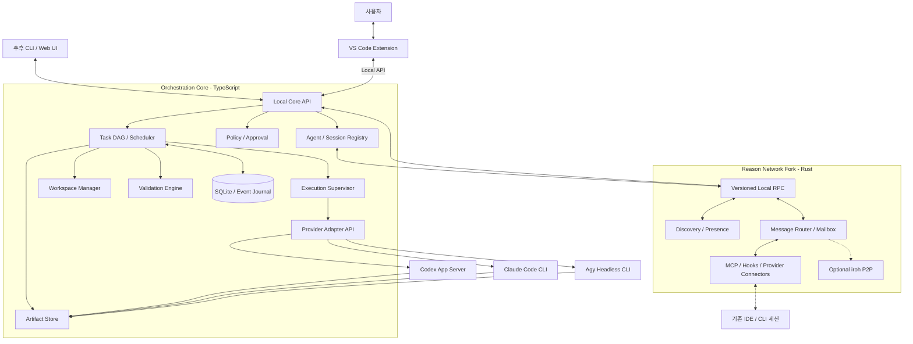
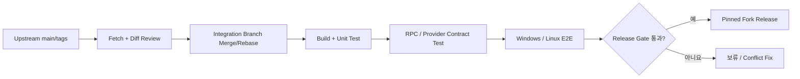
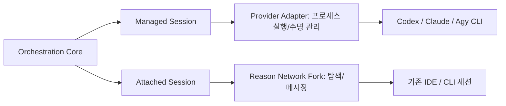
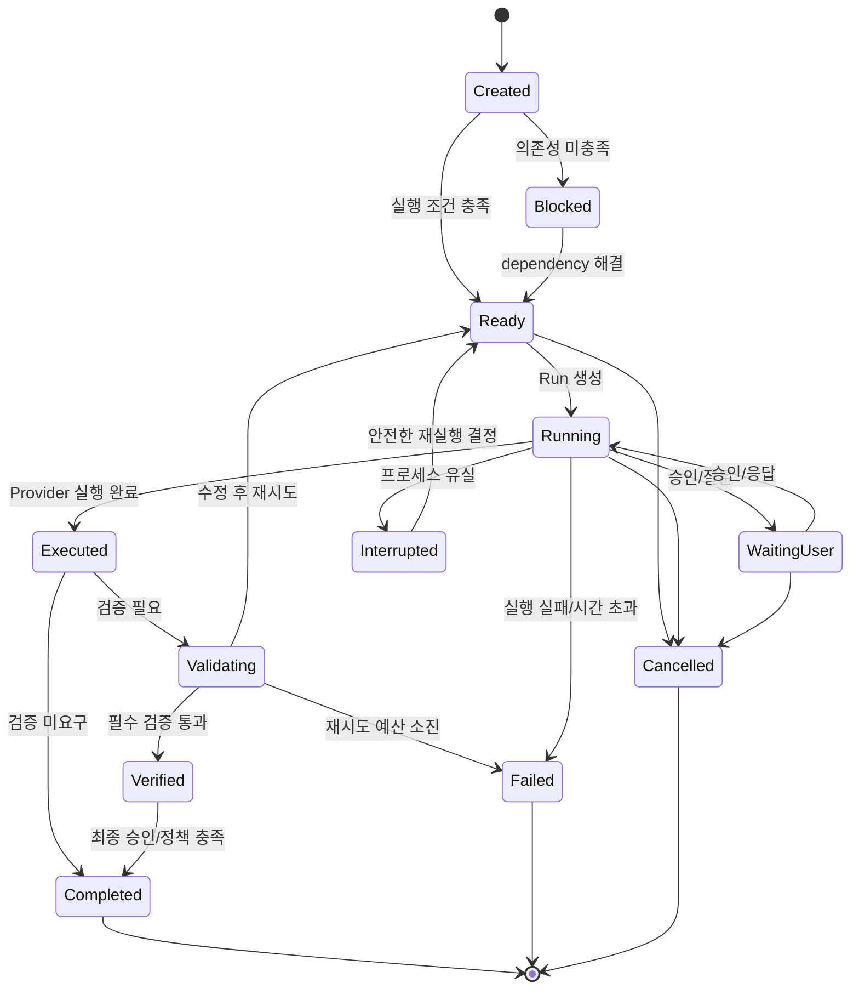
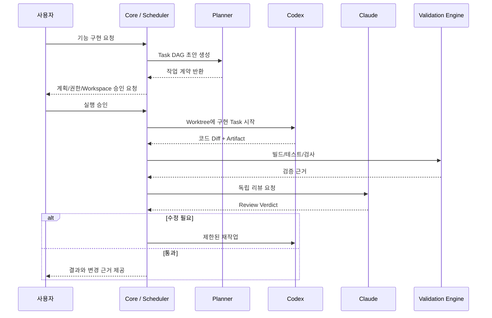
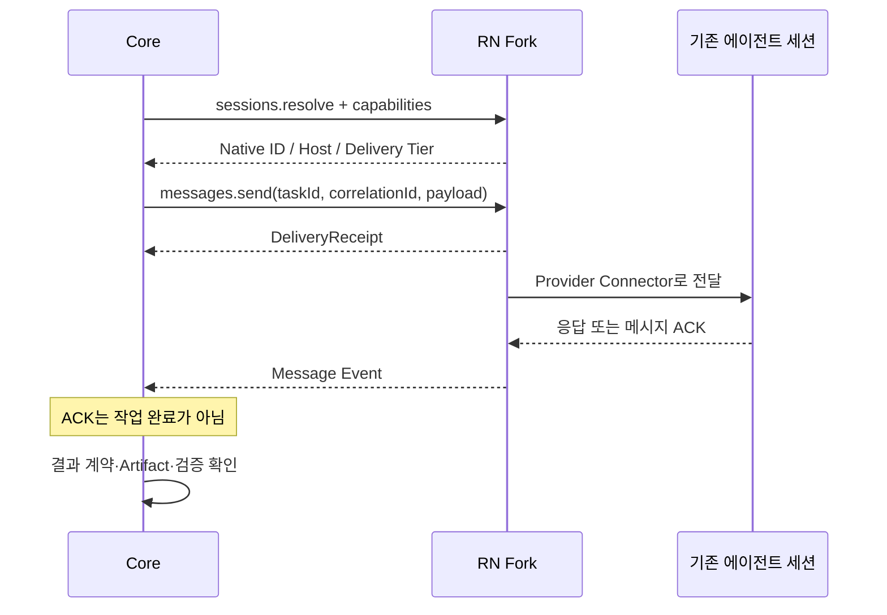

# TelosWeaver: 범용 멀티 에이전트 오케스트레이터 — 아키텍처 및 기능 명세 (v1.2)

> **프로젝트명:** TelosWeaver (`telos-weaver`)  
> **문서 유형:** 기술 설계·기능 요구사항·구현 로드맵  
> **최초 작성:** 2026-10-15  
> **개정일:** 2026-10-22  
> **버전:** 1.2 — 범용화, Reason Network Fork, Agy 정식 통합 대상화  
> **상태:** 설계 제안 / 구현 전 기술 검증 필요  
> **초기 인터페이스:** VS Code Extension (향후 CLI·Web UI 추가 가능)  
> **초기 Provider:** OpenAI Codex, Anthropic Claude Code, Google Antigravity CLI(`agy`)

## 변경 이력

| 버전 | 날짜 | 주요 변경 |
|---|---|---|
| v1.0 | 2026-10-15 | 코딩 중심 Task DAG, 세션·위임·Git Worktree, 빌드·테스트·리뷰, VS Code GUI 설계 |
| v1.1 | 2026-10-22 | Reason Network 선택적 Sidecar 평가, 실행/통신 계층 분리, 메시지 전달과 작업 완료 구분, 세션 정체성 및 PoC 추가 |
| **v1.2** | **2026-10-22** | **범용 Task·Workspace·Artifact·Validation 모델 도입; Reason Network를 Fork 기반 핵심 통신 인프라로 변경; Codex·Claude·Agy를 초기 Provider로 정의; Fork 업데이트·호환성·PoC 설계 확장** |

### v1.2 주요 결정

1. **제품의 범위는 범용 멀티 에이전트 오케스트레이션이다.** 코딩은 중요한 사용 사례지만 작업 모델의 기본 전제가 아니다.
2. **Reason Network를 Fork하여 프로젝트가 직접 관리하는 핵심 통신 컴포넌트로 채택한다.** 원본 Upstream을 지속 추적하되 검증된 리비전만 배포한다.
3. **Codex·Claude Code·Agy 모두 초기 실행 Provider다.** 독립 프로세스를 생성하는 *Managed Session*을 먼저 구현한다. 기존 공식 IDE 세션에 접속하는 *Attached Session*은 Provider별로 별도 검증한다.
4. **통신과 실행은 여전히 분리한다.** Reason Network Fork는 Session Discovery·Message Transport·Presence·MCP/Hook 계층이며 Task DAG·실행 감독·검증을 소유하지 않는다.
5. **구현 가능성이 확인되지 않은 항목은 지원한다고 쓰지 않는다.** 공개 문서 확인 사항, 설계 결정, PoC 필요 사항을 구분한다.
6. **본 문서는 기술적 구현·신뢰성·운영 위험을 다룬다.** 서비스 이용약관 또는 계정 제재 가능성은 설계 범위에 포함하지 않는다.

---

## 목차

1. 프로젝트 목표와 범위
2. 참고 프로젝트와 설계 반영
3. 전체 아키텍처
4. 범용 Task·Artifact·Workspace·Validation 모델
5. Reason Network Fork 통합 및 Upstream 운영
6. Codex·Claude·Agy Provider Adapter
7. Scheduler·위임·상태 머신
8. 기능 요구사항 및 수용 기준
9. VS Code UI
10. 영속 데이터 모델
11. 대표 실행 시나리오
12. 개발 단계 및 완료 기준
13. 통합 PoC 체크리스트
14. 기술적 위험과 대응
15. v1.1 대비 변경점
16. 핵심 설계 결론 및 참고 자료

---

## 1. 프로젝트 목표와 범위

### 1.1 목표

서로 다른 AI 에이전트가 **계획 → 작업 분해 → 위임 → 실행 → 메시지 교환 → 결과 수집 → 검증 → 승인/재작업**을 일관된 작업 모델로 수행하게 하는 로컬 우선(Local-first) 오케스트레이터를 구축한다.

사용자는 VS Code에서 다음을 수행할 수 있어야 한다.

- 작업을 생성하고 Planner가 제안한 Task Graph를 수정한다.
- Codex·Claude·Agy 또는 향후 Provider 중 실행 주체를 지정한다.
- 하나의 에이전트가 다른 에이전트에게 동기·비동기 하위 작업을 위임하게 한다.
- 같은 작업의 진행·메시지·Artifact·실패·재시도·승인 상태를 확인한다.
- 문서, 분석 결과, 코드, 구조화 데이터 등 여러 형식의 결과를 수집한다.
- 기존 IDE 확장에 열린 세션을 발견해 협업 대상으로 선택한다(지원되는 범위에서).
- VS Code 종료/재접속 후에도 백엔드가 유지하는 작업을 확인한다.

### 1.2 대표 사용 사례

| 시나리오 | 예시 작업 | 주요 결과 |
|---|---|---|
| 코딩 | API 설계 → 병렬 구현/테스트 → 리뷰 → 통합 | Git 변경 집합, 테스트 로그 |
| 기술 조사 | 자료 수집 → 독립 분석 → 교차 검토 | 근거와 출처를 포함한 보고서 |
| 문서 작성 | 목차·초안 → 기술 감수 → 문체·형식 검토 | Markdown, DOCX, PDF 등 파일 |
| 데이터 분석 | 입력 검증 → 변환 → 통계 → 결과 검증 | CSV, JSON, 표, 차트·리포트 |
| 업무 자동화 | 실행 계획 → 스크립트 실행 → 결과 검사 | 실행 로그, 파일, 구조화 상태 |
| 의사결정 지원 | 복수 에이전트의 독립 평가 → 비교·합의 | 검토 의견과 의사결정 기록 |

### 1.3 범위와 비범위

**초기 범위**는 로컬/Remote SSH 실행, Codex·Claude·Agy CLI 관리, Reason Network Fork, Task·Workflow·Artifact·Validation, MCP 기반 위임, VS Code GUI, 운영 복구를 포함한다.

**초기 비범위**는 자체 LLM 추론 엔진, 모든 Provider의 비공개 IDE 프로토콜을 무조건 지원하는 기능, 독자적인 문서 에디터·Git Diff Editor, 대규모 조직용 과금·관리 기능, 완전한 시각적 노코드 워크플로 편집기다.

### 1.4 설계 원칙

- **Provider-agnostic:** Task / Role / Provider / Model을 별개 필드로 둔다.
- **UI-independent:** 작업의 단일 원본(Source of Truth)은 Orchestration Core의 DB다.
- **Capability-based:** Provider별로 지원하지 않는 기능을 모호하게 에뮬레이션하지 않는다.
- **Artifact-first:** 긴 모델 대화보다 구조화된 Task Contract·산출물·검증 기록을 교환한다.
- **Separation of concerns:** RN Fork의 `DeliveryReceipt`와 Core의 `TaskResult`는 다른 개념이다.
- **Explicit authority:** 메시지 수신은 도구 실행·파일 수정·배포 승인으로 자동 승격되지 않는다.
- **Recoverable:** 작업 시도(Run), 세션, 이벤트, 검증 대상 버전을 구분해 영속화한다.
- **Minimal upstream delta:** RN 원본에 패치를 무작정 누적하지 않고 독립 모듈·확장 포인트를 사용한다.

---

## 2. 참고 프로젝트와 설계에 반영할 특성

아래는 공개 README/설계 문서를 참고한 기능 분석이며 해당 프로젝트를 직접 실행해 검증한 결과는 아니다.

| 프로젝트 | 참고할 강점 | 적용 범위 |
|---|---|---|
| [OpenRig](https://github.com/mvschwarz/openrig) | 지속형 에이전트·세션·메시징 | 세션 상태 보존, 작업 재개 |
| [Claw Orchestrator](https://github.com/Enderfga/claw-orchestrator) | Planner/Worker/Reviewer 및 자동 수정 루프 | 검증 계약, 재시도 상한 |
| [AgentFlow](https://github.com/harun-yardimci/agentflow) | DAG, 의존성, 동시 실행, 승인 | Scheduler/Workflow |
| [Agent Orchestrator](https://github.com/Augani/agent-orchestrator) | Coordinator–Worker 및 Context Capsule | 작업 계약·컨텍스트 절약 |
| [Agent Hub](https://github.com/uncle-tyson/Ur-Agent-Team) | MCP 위임·비동기 결과 조회 | Delegation API |
| [Veyra](https://github.com/dontcallmejames/veyra-vscode) | VS Code에서 협업/검토 | 세션·Diff·승인 UI |
| [Daintree](https://github.com/daintreehq/daintree) | 여러 에이전트 관리 및 작업 격리 | Agent Explorer·Workspace UX |
| [Tasker](https://marketplace.visualstudio.com/items?itemName=emberstone.tasker-ai) | Task Board·역할 설정 | 시각적 작업 관리 |
| **[Reason Network](https://github.com/reason-machines/reason-network)** | **세션 발견, 메시지 라우팅, MCP/Hook, 로컬·P2P 통신** | **Fork 기반 Communication Infrastructure** |

**적용 방향:** Workflow 및 실행·검증은 자체 설계로 구현하고, 기존 에이전트 세션 발견과 상호 통신에는 Reason Network를 수정·재사용한다.

---

## 3. 전체 아키텍처

### 3.1 논리 구조



> 다이어그램의 Core–RN RPC는 **자체 Fork에서 설계·구현할 인터페이스**다. 원본 Reason Network가 이 도식 그대로의 안정적 공개 API를 제공한다고 가정하지 않는다.

### 3.2 계층별 책임

| 계층 | 책임 | 구현 제안 |
|---|---|---|
| Client | 계획 작성, 모니터링, 로그·Artifact·승인·개입 | VS Code TreeView / Webview / OutputChannel |
| Orchestration Core | DAG, 상태 머신, Task 정책, 실행 감독, 결과 판정 | TypeScript, 독립 Node.js 프로세스 |
| Provider Execution | 새 세션 실행, 스트리밍, 종료·취소, 모델/권한 옵션 | Codex App Server / Claude CLI / Agy CLI |
| Communication | 기존 세션 탐지, 주소 해석, Presence, 비동기 메시지 | **수정된 Reason Network Fork (Rust)** |
| Workspace | 디렉터리·Git Worktree·Sandbox·원격 작업 환경 | 타입별 Workspace Provider |
| Artifact | 파일, 응답, 코드 Diff, 리포트, 데이터 보관·참조 | 파일 시스템 + SQLite 메타데이터 |
| Validation | Schema, 파일·명령 검사, Agent Review, 사용자 승인 | Validator Plugin 및 Validation Contract |
| Persistence | Task/Run/Session/Message/Artifact/Approval/Event | SQLite + 필요 시 별도 Blob Store |

### 3.3 필수 경계

- Reason Network는 **메시지를 전달하는 시스템**이고, Orchestration Core는 **일을 끝내는 시스템**이다.
- `message delivered`는 `task completed`가 아니다. 대화 응답도 자동으로 `verified`가 되지 않는다.
- CLI 프로세스가 정상 종료해도 요구사항을 충족하지 못할 수 있다. `execution finished`와 `validation passed`를 분리한다.
- Reason Network Fork가 중단되면 기존 세션 메시징은 정지하거나 대기할 수 있지만, **Core가 생성한 Managed Run은 기본적으로 계속 추적·취소·복구할 수 있어야 한다.** 이는 RN Fork가 핵심 통신 인프라라는 결정과 모순되지 않는다.

### 3.4 실행 위치와 배포

- 초기에는 Windows의 VS Code와 Remote SSH 연결을 지원하는 것을 목표로 한다.
- 실제 CLI와 Workspace가 존재하는 호스트에서 Execution Supervisor가 실행되어야 한다.
- Reason Network Fork의 Daemon은 호스트별로 인스턴스를 가질 수 있고, Host ID/실행 위치를 명시한다.
- UI 재시작과 백엔드 작업 수명을 분리하려면 독립 서비스 프로세스가 필요하다.
- P2P/원격 기능은 Core의 로컬 RPC와 별도 Capability로 둔다.

---

## 4. 범용 도메인 모델

### 4.1 Task / Agent / Provider / Model 분리

| 개념 | 의미 | 예시 |
|---|---|---|
| Task Type | 어떤 형태의 일을 하는가 | `coding`, `research`, `document` |
| Agent Role | 어떤 책임으로 수행하는가 | `planner`, `worker`, `reviewer` |
| Provider | 어떤 실행 엔진을 쓰는가 | `codex`, `claude`, `agy` |
| Model | Provider 내부의 모델 선택 | CLI에서 지원하는 모델 ID |
| Session | 대화/도구 실행 컨텍스트 | Codex thread, Claude session, Agy conversation |
| Run | Task를 실행한 특정 시도 | Run UUID, attempt number |
| Workspace | 파일과 도구를 실행할 작업 위치 | 임시 폴더, Git worktree |
| Artifact | 생성·검증·전달할 결과 | Markdown, JSON, Diff, 파일 |
| Validation | 결과가 요구사항을 충족했는지 확인 | 테스트, 스키마, 리뷰 |

### 4.2 Task 유형

| 유형 | 용도 | 기본 Workspace | 검증 예시 |
|---|---|---|---|
| `general` | 질의·요약·간단한 의사결정 | `none` | 명시적 결과 또는 사용자 승인 |
| `research` | 자료 수집, 비교, 근거 검토 | `directory` | 출처·항목·형식 검사 |
| `analysis` | 데이터·로그·문서 분석 | `directory` | Schema, 수치 Assertion |
| `document` | 보고서·문서 작성 | `directory` | 파일 존재·형식·내용 검토 |
| `coding` | 구현·테스트·리팩터링 | `git-worktree` | 빌드·테스트·Diff 리뷰 |
| `automation` | 명령·외부 도구 실행 | `sandbox` 또는 `remote` | 성공 조건·부작용 확인 |
| `review` | 독립 결과 평가 | `none` 또는 읽기 전용 Workspace | 구조화 판정 |
| `custom` | 사용자가 정의하는 작업 | 명시적 지정 | Custom Validator |

위의 기본 Workspace는 **템플릿**이며 절대 규칙이 아니다. `research`도 Read-only Git 저장소를 대상으로 실행할 수 있다.

### 4.3 Task Contract 예시

```typescript
// 설계 제안: 실제 구현 시 zod/JSON Schema로 런타임 유효성 검사
interface TaskSpec {
  id: string;
  parentId?: string;
  planId?: string;
  type: 'general' | 'research' | 'analysis' | 'document'
      | 'coding' | 'automation' | 'review' | 'custom';
  objective: string;
  constraints?: string[];
  dependencies: string[];
  agent: {
    provider: string;   // 'codex' | 'claude' | 'agy' 등 등록된 Provider ID
    model?: string;
    role?: string;
  };
  workspace: {
    mode: 'none' | 'directory' | 'git-worktree' | 'sandbox' | 'remote';
    location?: string;
    readOnly?: boolean;
  };
  inputArtifacts: string[];
  expectedOutputs: ArtifactSpec[];
  validation: ValidationContract[];
  permissions?: string[];
  timeoutMs?: number;
  retryLimit?: number;
}
```

### 4.4 Artifact 모델

```typescript
interface ArtifactSpec {
  type: 'text' | 'file' | 'document' | 'dataset'
      | 'code' | 'diff' | 'structured';
  contentType?: string;
  required?: boolean;
}


interface Artifact {
  id: string;
  taskId: string;
  runId: string;
  type: 'text' | 'file' | 'document' | 'dataset'
      | 'code' | 'diff' | 'structured';
  location?: string;     // 저장된 파일/URI, 접근 정책 적용
  contentType?: string;
  checksum?: string;
  revision?: string;     // Git revision 또는 파일 버전
  createdBy: string;
  createdAt: string;
}
```

- Artifact는 생성 결과와 검증 결과를 연결할 수 있어야 한다.
- 대용량 파일은 메시지 본문이 아니라 Artifact ID·Checksum·접근 가능한 URI로 전달한다.
- 원격 Host에 전달하는 경우 파일 경로가 실제로 접근 가능한지 별도 판정한다.
- 동일 Artifact가 후속 작업의 입력으로 사용되면 변경 여부를 검증한다.

### 4.5 Workspace 프로파일

| 프로파일 | 격리·운영 규칙 |
|---|---|
| `none` | 별도 파일 작업 공간 없는 질의; 임시 출력 정책만 적용 |
| `directory` | Task별 디렉터리, 수명·정리·Writer 소유권 관리 |
| `git-worktree` | Task별 Worktree/Branch/Base Commit, Diff·병합 제어 |
| `sandbox` | OS/컨테이너 등 실제 격리 수단 적용; 프로파일만으로 안전하다고 간주하지 않음 |
| `remote` | Host, 자격 증명, 경로, Artifact 전달 전략이 필수 |

Git Worktree는 다른 브랜치 간 파일 충돌을 줄일 뿐 보안 격리 수단은 아니다. 원본 브랜치 병합·Push·외부 시스템 변경은 별도 권한 정책의 대상이다.

### 4.6 범용 Validation Contract

```typescript
interface ValidationContract {
  id: string;
  kind: 'schema' | 'file' | 'checksum' | 'command'
      | 'assertion' | 'ai-review' | 'human' | 'custom';
  target?: string;          // Artifact ID, 파일 또는 실행 대상
  parameters?: Record<string, unknown>;
  required: boolean;
}
```

| 방식 | 판정 예시 |
|---|---|
| Schema | JSON 구조가 지정된 필수 필드·타입을 만족 |
| File/Checksum | 파일 생성, 타입, 크기, Checksum 일치 |
| Command/Script | 빌드·테스트 실행 및 로그·종료 상태 |
| Assertion | 수치 범위·포함 항목·비즈니스 룰 |
| AI Review | 다른 에이전트의 구조화된 평가·근거 |
| Human | 사용자 승인 또는 반려 |
| Custom | 도메인별 플러그인 검증 |

**검증 계약의 소유권은 Core에 있다.** 실행 에이전트가 자신의 검증 조건을 임의로 완화할 수 없고, 검사 이후 Artifact가 변경되면 검증을 무효화한다.

---
## 5. Reason Network Fork 통합 설계

### 5.1 원본 프로젝트와 채택 범위

- 원본: [reason-machines/reason-network](https://github.com/reason-machines/reason-network)
- 설계 및 소스 확인: [README](https://github.com/reason-machines/reason-network), [DESIGN.md](https://github.com/reason-machines/reason-network/blob/main/DESIGN.md), [Cargo.toml](https://github.com/reason-machines/reason-network/blob/main/Cargo.toml)
- 2026-10-22 기준 공개 릴리스 페이지에서 확인된 최신 릴리스: **v0.12.3 (2026-10-21)**. Upstream `main`은 릴리스보다 앞서갈 수 있으므로 별도로 추적한다.
- 원본은 공개 자료상 Rust/Tokio, SQLite, MCP/Hook 기반 세션 연결, 로컬 IPC 및 선택적 iroh P2P를 사용한다. 실제 동작·프로토콜 안정성은 PoC 대상이다.
- 공개된 원본 소스에는 `MIT OR Apache-2.0` 라이선스 표기가 있다. Fork 내 배포물과 의존 패키지의 고지 요건은 별도 점검한다.

**채택 모델:** 외부 바이너리를 선택적으로 호출하는 Sidecar에서, 프로젝트가 유지·빌드·배포하는 **Fork 바이너리**로 변경한다. 런타임 프로세스는 여전히 독립 Daemon으로 구성해 Orchestration Core(Rust/TypeScript)의 경계를 유지한다.

### 5.2 Reason Network Fork의 소유 책임

**Fork에 포함할 기능**

1. Session Discovery: CLI·IDE Provider 세션 발견, 상태·위치 확인.
2. Session Registry/Presence: 주소, Host, Native Session ID, 최근 활동, Capability.
3. Message Router: 송신·수신, 보관, 전달, 재전송, 수신 확인.
4. Provider Connector: Codex, Claude, Agy별 MCP/Hook/실행 세션 연결.
5. Local RPC: Orchestration Core를 위한 버전 관리된 로컬 인터페이스.
6. 원격 Transport: Upstream iroh P2P 활용, 이후 필요 시 호스트 간 전달.
7. Task Messaging Metadata: Task ID·Correlation ID·TTL·Idempotency Key.

**Fork에 넣지 않을 기능**

- DAG와 작업 스케줄러
- 역할별 모델 선택 정책
- 파일/워크트리 생성과 산출물 보관
- 빌드·테스트 또는 다른 Validator의 성공 판정
- 사용자 작업 승인, 자동 재작업, Task 결과의 단일 원본 관리

이 경계는 Upstream과 장기간 병합 가능한 구조를 유지하기 위한 핵심 원칙이다.

### 5.3 Fork 코드 구조 제안

```text
reason-network-fork/
  upstream-compatible/           # 가능하면 원본 디렉터리 구조 유지
  src/
    ...                           # 원본 코드
    orchestrator_integration/     # 신규/수정 모듈 경계(예시)
      rpc/
      task_envelope/
      provider_agy/
      session_identity/
      capabilities/
  tests/
    integration/
    protocol_contract/
  patches/                       # Upstream과 충돌 위험이 있는 변경 목록
  docs/
    fork-delta.md
    upstream-sync.md
    rpc-schema.md
```

이는 **의도한 모듈 분리 방향을 보여주는 예시**이며 현재 원본 저장소의 실제 파일 배치가 아니다. 실제 Fork 작업에서는 먼저 Rust 크레이트·모듈 의존도를 점검한 뒤 별도 파일·모듈에 변경을 모은다.

### 5.4 Local RPC 확장

원본 로컬 IPC를 그대로 안정된 외부 API라고 가정하지 않는다. Fork에서 명시적으로 다음 계약을 도입한다.

| RPC 메서드(제안) | 입출력 목적 |
|---|---|
| `health.get` | Daemon 상태·Fork 빌드·Upstream Base·RPC Schema 버전 |
| `providers.list` | Provider 상태·세션 탐색 지원 여부 |
| `sessions.discover` | Host/Provider/상태 등으로 검색 |
| `sessions.resolve` | 주소를 실제 Native Session과 호스트로 검증 |
| `sessions.capabilities` | `push`, `turn`, `pull`, Resume 등 Capability 조회 |
| `messages.send` | 고정 대상 세션에 Envelope 전송, Receipt 반환 |
| `messages.status` | 전달 상태·거부·대기·타임아웃 조회 |
| `messages.subscribe` | 메시지/Presence 이벤트 스트리밍 |
| `providers.agy.probe` | Agy 탐지·버전·세션 Capability 진단(추가 구현) |

프로토콜은 **요청/응답 JSON Schema, `protocolVersion`, `requestId`, 에러 코드, 이벤트 일련번호**를 포함해야 한다. Transport는 Windows Named Pipe와 Unix Domain Socket을 우선 고려한다. Webview가 Daemon에 직접 접근하게 하지 않고 Core가 접근을 중재한다.

### 5.5 메시지 Envelope와 전달 상태

```typescript
interface SessionIdentity {
  provider: string;
  hostId: string;
  nativeSessionId: string;
  generation?: string;
}


// Core와 RN Fork 사이의 공통 계약 초안
interface AgentMessageEnvelope {
  messageId: string;
  taskId?: string;
  runId?: string;
  correlationId: string;
  idempotencyKey: string;
  sender: SessionIdentity;
  recipient: SessionIdentity;
  contentType: 'text/plain' | 'application/json';
  payload: string;
  artifactRefs?: string[];
  expiresAt: string;
}

type DeliveryState =
  | 'accepted' | 'queued' | 'delivered'
  | 'held' | 'refused' | 'expired' | 'failed';
```

**전달 보장 설계**

- 내부 메시지 ID와 실행 Run ID를 구분한다.
- 네트워크 또는 프로세스 재시작에 대비하여 중복 메시지 검출 및 TTL을 적용한다.
- 메시지 전달의 재시도는 **실제 명령 재실행과 동일하지 않다.** 부작용 있는 Task의 재실행은 Core가 결정한다.
- RN 메시지 Receipt를 Task 성공 판정에 사용하지 않는다.
- `push` / `turn` / `pull` 전달 특성은 Provider별 Capability로 모델링한다.
- 구조화 결과 보고는 Core MCP의 `report_task_result`, Managed Adapter의 완료 이벤트 또는 별도 승인된 수신 채널로 회수한다.

### 5.6 Session Identity 정책

```text
Task ID (논리 작업, 불변)
  └─ Run ID (각 시도마다 신규 UUID)
       ├─ Provider ID / Model / Role
       ├─ Native Session ID (Codex thread / Claude session / Agy conversation)
       ├─ RN Address + observed fingerprint / epoch
       ├─ Host ID + cwd + Workspace ID
       ├─ Process ID 또는 attached endpoint
       └─ correlation_id / idempotency_key
```

Reason Network가 사용하는 사람이 읽기 쉬운 세션 주소는 **메시지 전달 위치**일 뿐 영구 실행 ID가 아니다. 주소가 재사용되거나 다른 세션에 재바인딩되면 Core가 재검증하기 전까지 자동 명령을 보류한다.

### 5.7 Upstream 유지·갱신 전략



**개발 운영 규칙**

1. `upstream` 원격을 유지하고 원본 Release Tag·`main` 상태를 주기적으로 확인한다.
2. 배포 기준은 태그 또는 SHA에 고정하며, 테스트하지 않은 `main`을 자동 배포하지 않는다.
3. 원본 변경 수용은 별도 Integration Branch에서 진행하고, 충돌·API 차이를 기록한다.
4. `fork-delta.md`에 원본 대비 패치 목록과 변경 이유를 유지한다.
5. CLI/IPC/Provider Hook에 대한 Contract Test 및 Windows·Linux 실행 테스트를 통과해야 Fork Release로 승격한다.
6. 필요 시 DB Schema 마이그레이션, 데이터 백업, 바이너리 롤백 경로를 함께 배포한다.
7. 자동 갱신 대신 **자동 확인 + 자동 테스트 + 명시적 배포 승인**을 기본으로 한다.
8. 원본 개선 사항 중 범용적으로 유용한 것은 가능하면 Upstream PR로 환원해 장기적인 병합 부담을 줄인다.

**버전 메타데이터 필수 기록:** `upstream_tag`, `upstream_commit`, `fork_commit`, `rpc_schema_version`, `build_target`, `build_timestamp`.

### 5.8 Fork 장애와 코어의 연속성

RN Fork가 오케스트레이터의 **표준 Communication Infrastructure**라는 결정은 유지한다. 다만 단일 장애로 Managed Task까지 종료되는 구조는 피한다.

- RN 종료 시 세션 탐색·기존 세션 메시징은 `Unavailable/Degraded`로 표기한다.
- 실행 중인 Codex/Claude/Agy Managed Run의 취소·종료·최종 결과 추적은 Execution Supervisor가 수행한다.
- 통신을 기다리는 작업은 무한히 대기하지 않고 Timeout/Retry 정책을 적용한다.
- 새 메시지의 재송신은 idempotency 확인 후 처리한다.
- Core와 Fork의 DB는 **별도 소유**로 두고 서로의 내부 SQLite 파일에 직접 쿼리하지 않는다.

---

## 6. Provider Adapter: Codex / Claude / Agy

### 6.1 공통 Provider 계약

```typescript
interface AgentCapabilities {
  startManagedSession: boolean;
  attachExistingSession: boolean;
  resumeSession: boolean;
  streamEvents: boolean;
  steerRunningTask: boolean;
  interactiveApproval: boolean;
  modelSelection: boolean;
  structuredOutput: boolean;
  usageReporting: boolean;
  discovery: boolean;
}

interface AgentAdapter {
  readonly id: string;
  detect(): Promise<{ available: boolean; version?: string; capabilities: AgentCapabilities }>;
  startTask(task: TaskSpec): Promise<{ runId: string; nativeSessionId?: string }>;
  resumeTask?(runId: string, message: string): Promise<void>;
  cancelTask(runId: string): Promise<void>;
  events(runId: string): AsyncIterable<AgentEvent>;
}
```

`attachExistingSession`은 Managed Session 실행 지원과 별도로 정의하며, Provider가 제공하지 않는다면 `false`로 반환한다. Reason Network Fork에서 메시지를 전달할 수 있다는 사실과 해당 세션의 실행·완료를 제어할 수 있다는 사실도 분리한다.

### 6.2 초기 Provider 비교

| Provider | Managed Session 실행 경로 | 세션·결과 확인 | Attached Session 목표 | 검증이 필요한 사항 |
|---|---|---|---|---|
| **Codex** | `codex app-server` | JSON-RPC, thread/turn 이벤트 | 기존 Codex 세션 탐색·메시징 | 확장 세션 식별, 외부 서버와의 세션 공유·중복 사용 |
| **Claude Code** | `claude -p` + Stream JSON | CLI 세션 ID 및 이벤트 | 기존 Claude 세션 탐색·메시징 | Socket/Hook 방식의 실제 동작, 동시 세션 충돌 |
| **Antigravity** | `agy` Headless CLI | NDJSON 이벤트, `conversation_id` | 기존 Agy 확장 세션 탐색·메시징 | 공식 IDE 세션 제어 API, 세션 공유, 실시간 승인 |

### 6.3 Agy Managed Session — 구현 가능 범위

Google의 [Antigravity CLI Headless 문서](https://www.antigravity.google/docs/cli/headless/)에는 다음 기능이 공개되어 있다.

| 기능 | 공개 인터페이스 | 판단 |
|---|---|---|
| 단발 작업 | `agy -p "..."` | 구현 가능 |
| 기계 판독 결과 | `--output-format json` | 구현 가능 |
| 실시간 진행 이벤트 | `--output-format stream-json` | 구현 가능 |
| 동일 프로세스 다중 턴 | `--input-format stream-json --output-format stream-json` | 구현 가능 |
| 대화 재개 | `--conversation <id>` / `--continue` | 구현 가능 |
| 모델·에이전트 선택 | `--model`, `--agent` | CLI가 지원하는 선택지만 허용 |
| 추론 수준 | `--effort` | CLI 버전·모델별 검증 |
| Schema 지정 | `--json-schema` | 구조화 출력에 활용 |
| 도구·Subagent 이벤트 | `step_update`의 `tool_info`, `subagent_info` | 이벤트 기반 상태 관측 가능 |
| 사용량 수집 | `usage` 필드 | 세션 누적/턴별 데이터 구별 필요 |
| 작업 환경 제한 | `--sandbox`, 도구 Permissions | 실제 격리·허용 정책 검증 필요 |
| 대화형 승인 응답 | Headless 입력의 `control_response` 미지원 | **실시간 상호 승인 제약** |
| 기존 공식 VS Code 세션 제어 | 공개된 충분한 외부 API 확인 안 됨 | **별도 PoC** |

**예시: 단발 실행**

```bash
agy -p "Summarize this project" --output-format stream-json
```

**예시: 지속형 NDJSON 세션**

```bash
agy --input-format stream-json --output-format stream-json
```

```json
{"event":"user","message":{"content":"Analyze the provided requirements."}}
```

Headless 지속형 세션은 `stdin` 입력을 닫기 전까지 살아 있을 수 있다. **각 턴의 `result` 이벤트를 소비한 다음 다음 프롬프트를 전송해야 하며**, 프로세스 종료만 기다리는 구현은 교착·무한 대기를 유발할 수 있다.

**Agy 종료·권한 처리 주의 사항**

- Headless 도구가 승인되지 않아 소프트 거부될 때 CLI가 Exit Code `0`으로 종료할 수도 있다. **Exit Code만 성공 기준으로 삼지 않는다.** `result.status`, 오류/진단 메시지, 도구 실행 로그 및 Validation 결과를 함께 확인한다.
- Headless 프로토콜의 `control_request`/`control_response`는 지원되지 않는 것으로 문서화되어 있다. 따라서 GUI 승인 UI를 만들었다고 실시간 CLI 도구 승인에 자동 연결할 수 없다.
- 권한은 작업 시작 전에 허용 범위를 결정한다. 포괄적 자동 승인은 기본값으로 사용하지 않는다.
- `result.usage`는 세션 누적일 수 있으므로 턴별 통계를 계산할 때 차분과 중복을 관리한다.
- 유효하지 않은 모델/입력/스키마나 프로토콜 오류는 사용자에게 명시적 실패로 노출한다.

### 6.4 Agy Attached Session — 구현 전 검증 과제

**독립 CLI 실행이 가능하다는 사실이 기존 공식 VS Code 확장 세션을 제어할 수 있다는 증거는 아니다.** Reason Network Fork에서 다음 기술 과제를 검증한다.

| PoC 항목 | 확인할 점 | 실패 시 동작 |
|---|---|---|
| AGY-ATT-01 | 확장이 실행한 Agy 세션의 안정적 Native ID 탐지 | 기존 세션 목록 비활성 |
| AGY-ATT-02 | 세션 상태·호스트·작업 디렉터리 식별 | 식별 불충분 시 대상 지정 금지 |
| AGY-ATT-03 | 공식 공개 경로로 메시지 전달 가능한지 | 독립 Managed Session 제안 |
| AGY-ATT-04 | Busy/Idle 상태에서 전달 시점 확인 | 수신 보장 불가 표시 |
| AGY-ATT-05 | 세션 결과/완료 이벤트 수신 가능 여부 | 외부 응답을 수동 검토로 처리 |
| AGY-ATT-06 | 공식 확장과 CLI 사이 동시 접근 충돌 여부 | 세션 Lock·중복 제어 금지 |
| AGY-ATT-07 | CLI 및 확장 업데이트 후 호환성 | Capability 자동 비활성 |

**구현 순서:** Agy Managed Adapter 완성 → RN Fork에 Agy Discovery 추가 → Read-only Message PoC → Attached Session 기능별 단계적 활성화.

### 6.5 Provider 공통 이벤트

```typescript
type AgentEvent =
  | { type: 'session_started'; runId: string; nativeSessionId?: string }
  | { type: 'text_delta'; runId: string; text: string }
  | { type: 'tool_started'; runId: string; tool: string }
  | { type: 'tool_completed'; runId: string; tool: string; success: boolean }
  | { type: 'subagent_event'; runId: string; details: unknown }
  | { type: 'approval_required'; runId: string; actionId: string }
  | { type: 'usage'; runId: string; units: Record<string, number | null> }
  | { type: 'turn_finished'; runId: string; outcome: 'success' | 'error' | 'cancelled' }
  | { type: 'error'; runId: string; code: string; message: string };
```

원본 Provider 이벤트는 스키마 버전과 함께 보존하고, UI·Scheduler에는 정규화한 이벤트만 노출한다. 실행 완료를 검증 성공과 같은 이벤트로 합치지 않는다.

### 6.6 Managed Session과 Attached Session 구분



**Managed:** Core가 작업을 시작·중단하며 결과 이벤트에 접근. **Attached:** 기존 실행 세션의 소유자가 따로 있을 수 있으며 메시지 도달과 작업 완료를 구분해야 한다. Attached는 초기부터 동일한 완전 자동 실행 보장을 주장하지 않는다.

---

## 7. Task Scheduler, 위임 및 상태 머신

### 7.1 Task 상태



- `Executed`: Provider가 자신의 턴/프로세스를 끝냄.
- `Verified`: 필수 Validator가 특정 Artifact 버전에 대해 통과함.
- `Completed`: 해당 Task의 검증 및 승인 정책이 모두 충족된 최종 상태. 검증 없는 Task의 경우에도 정책이 지정되어 있어야 한다.
- 실제 DB에서는 실행 `Run` 상태와 논리 `Task` 상태를 별도 필드로 저장한다. `Interrupted` 이후 무조건 재실행하지 않는다.

### 7.2 Scheduler 규칙

1. Task/Dependency DAG의 순환을 검사한다.
2. Ready 조건과 선행 결과·Artifact 접근 가능성을 확인한다.
3. Provider별 한도, Workspace Lock, 도구 권한, Timeout·Retry Budget을 확인한다.
4. 각 실행에서 새로운 Run ID를 발급한다.
5. Managed Adapter에 작업을 전달하고 이벤트를 저장한다.
6. 실행 결과의 Artifact를 등록하고 Validation Contract를 실행한다.
7. 필수 검증과 승인 통과 후에만 의존 작업을 해제한다.
8. 실패·타임아웃·부작용 있는 실행의 재시도를 구분한다.
9. 취소가 요청되면 Agent 프로세스·자식 프로세스와 예약된 후속 작업을 정책에 따라 정리한다.

### 7.3 Delegation API와 MCP

초기 MCP Tool 제안: `delegate_task`, `get_task_result`, `list_tasks`, `cancel_task`, `get_agent_status`, `report_task_result`.

| 방식 | 동작 |
|---|---|
| Orchestrator-driven | Scheduler가 선행 Task·의존성을 보고 실행 |
| Agent-driven | 실행 중인 에이전트가 MCP `delegate_task`로 새 하위 작업 요청 |
| Managed request | 새 Provider Run을 생성해 확정적 실행 결과 수집 |
| Attached message | RN Fork로 기존 세션에 메시지를 전달; 응답 계약은 별도 검증 |

Agent-driven 호출에는 부모 Task·호출자·요청 권한·최대 깊이·동시성·TTL을 포함한다. 부모의 권한을 자식이 자동으로 확대하지 못하게 한다.

### 7.4 Context Capsule 및 Handoff

```yaml
handoff:
  objective: "Compare implementation options"
  input_artifacts:
    - "art-requirements-001"
  decisions:
    - "Local-first execution"
  completed_work:
    - "Requirements extracted"
  unresolved:
    - "Verify remote connection behavior"
  outputs:
    - "art-analysis-007"
  validation:
    status: "pending_review"
  next_action: "Independent technical review"
```

Provider 간 내부 대화 기록을 무조건 변환하지 않고, 목표·결정·검증·Artifact 참조를 구조화해 전달한다.

---
## 8. 기능 요구사항 및 수용 기준

**우선순위:** P0 = 최초 실사용에 필수 / P1 = 자동 협업 및 유지보수 안정화 / P2 = 고급·확장 기능. **기존 v1.1 요구사항 ID는 가능한 한 유지하고 새 범용 요구사항을 추가했다.**

### 8.1 작업·워크플로 (`TASK-*`)

| ID | 우선순위 | 요구사항 | 완료 조건 |
|---|---|---|---|
| TASK-01 | P0 | Task CRUD·상태 관리 | UI/API에서 생성·수정·조회·취소 가능 |
| TASK-02 | P0 | Task별 Provider/Model/Role 설정 | 실행 전 Adapter/설정 검증 |
| TASK-03 | P0 | Queue 및 동시성 제한 | Provider/Host별 제한 초과 방지 |
| TASK-04 | P1 | Planner 자동 작업 분해 | 구조화 계획 제안 후 사용자 편집 가능 |
| TASK-05 | P1 | DAG 의존성·병렬 실행 | 순환 의존 거부, Ready Task만 시작 |
| TASK-06 | P1 | 실패·재시도·취소 정책 | 상한과 최종 상태 준수 |
| TASK-07 | P2 | 런타임 동적 Task 추가 | 권한·중복·순환 검사 |
| TASK-08 | P2 | 자동 Provider/Model 라우팅 | 사용자 수동 설정·비활성화 가능 |
| **TASK-09** | **P0** | **범용 Task Type 지원** | 코딩 외 Research/Document/Analysis Task 실행 |
| **TASK-10** | **P1** | **Task별 실행 프로파일 지정** | Workspace/권한/결과 계약 분리 가능 |

### 8.2 에이전트·Provider (`AGENT-*`, `SESS-*`)

| ID | 우선순위 | 요구사항 | 완료 조건 |
|---|---|---|---|
| **AGENT-01** | **P0** | **Provider/Model/Role 개념 분리** | 동일 Role에서 다른 Provider 선택 가능 |
| **AGENT-02** | **P0** | **Codex·Claude·Agy Managed Adapter** | 세 CLI에서 실행·결과·오류 수집 |
| **AGENT-03** | **P1** | **Capability Discovery** | 미지원 기능 명시적 차단 |
| **AGENT-04** | **P1** | **기존 세션 탐색·선택·메시징** | 지원 Provider의 세션을 확인해 메시지 전달 |
| SESS-01 | P0 | 실행 세션·Native ID 보존 | 내부 UUID와 Native ID 매핑 |
| SESS-02 | P0 | 스트리밍·종료 이벤트 수집 | Run별 출력/오류/도구 이벤트 조회 |
| SESS-03 | P0 | 실행 기록 영속화 | VS Code 재접속 시 상태 복구 |
| SESS-04 | P1 | Native 세션 재개 | 지원되는 Provider에서 Resume 확인 |
| SESS-05 | P1 | 프로세스 유실·복구 | `Interrupted` 전환, 중복 실행 금지 |
| SESS-06 | P1 | Context Capsule | 관련 입력·결정·Artifact만 전달 |
| SESS-07 | P2 | 타 Provider Handoff | 작업 문맥 구조화 및 새 Run 시작 |
| SESS-08 | P1 | 세션 ID·주소·Host 매핑 | RN 주소와 Native Session ID 구별 |
| SESS-09 | P1 | 주소 재사용 감지 | 잘못된 세션에 자동 전송 방지 |

### 8.3 위임과 통신 (`DELEG-*`, `COMM-*`)

| ID | 우선순위 | 요구사항 | 완료 조건 |
|---|---|---|---|
| DELEG-01 | P0 | 다른 Provider에 Task 위임 | Task ID 반환 및 실행 큐 등록 |
| DELEG-02 | P0 | 비동기 결과 조회 | 나중에 동일 Task 결과 조회 가능 |
| DELEG-03 | P0 | 조회·취소·상태 동기화 | MCP와 GUI의 상태 일치 |
| DELEG-04 | P0 | 위임 깊이 및 폭주 제어 | 최대 깊이·실행 개수 준수 |
| DELEG-05 | P1 | 실행 중 메시지 전달 | 지원 Capability에 따라 처리 |
| DELEG-06 | P1 | Handoff와 Artifact 참조 | Provider 간 결과 유실 없이 전달 |
| DELEG-07 | P2 | Council / Broadcast | 독립 결과 구분·비교 가능 |
| DELEG-08 | P1 | 기존 세션 대상으로 메시징 | 대상 정체성 검증 후 전달 |
| DELEG-09 | P1 | Message ACK와 Task 완료 구분 | 전달 성공만으로 Completed 불가 |
| COMM-01 | **P0** | **Reason Network Fork 연결** | 자체 RPC로 건강 상태·기능 조회 |
| COMM-02 | P1 | 세션 발견·필터링 | Provider/Host/상태/Delivery Tier 조회 |
| COMM-03 | P1 | 대상 고정 메시지 전송 | Message ID와 Receipt 저장 |
| COMM-04 | P1 | `push`/`turn`/`pull` 인지 | 지원 수준·전달 지연 반영 |
| COMM-05 | P1 | 전달/실행/검증 상태 분리 | 세 상태별 기록과 UI 구분 |
| COMM-06 | P1 | 주소 재바인딩 확인 | Fingerprint 불일치 시 전송 보류 |
| COMM-07 | P1 | TTL·중복 메시지 제어 | Replay와 만료 전송 방지 |
| COMM-08 | P0 | Fork/RPC 버전 검증 | 비호환 시 명확한 오류와 Degraded 상태 |
| COMM-09 | P2 | 호스트 간 전달 | 원격 세션·데이터 접근 규칙 적용 |
| COMM-10 | P1 | 대용량 Artifact 간접 참조 | 파일 대신 Artifact ID 전송 |

### 8.4 Workspace·Git (`WS-*`, `GIT-*`)

| ID | 우선순위 | 요구사항 | 완료 조건 |
|---|---|---|---|
| **WS-01** | **P0** | **Workspace Profile 선택** | none/directory/git-worktree 실행 가능 |
| **WS-02** | **P1** | **비Git 파일 Workspace 관리** | 디렉터리 잠금·정리·Artifact 추적 |
| WS-03 | P1 | Sandbox/Remote 프로파일 | 실행 위치·권한·자원 관리 |
| GIT-01 | P0 | Worktree/Branch 생성·정리 | 병렬 Writer 간 파일 충돌 방지 |
| GIT-02 | P0 | Writer Lock | 동일 Worktree에서 Writer 1개만 허용 |
| GIT-03 | P0 | Base Commit·Dirty 검사 | 변경 원점 기록 및 예상 외 수정 감지 |
| GIT-04 | P0 | 변경 파일·Diff 표시 | VS Code Diff Editor 연결 |
| GIT-05 | P0 | 원본 Branch 반영 승인 | 자동 Merge/Push 정책 강제 |
| GIT-06 | P1 | Integration Workspace | 병렬 결과 통합·검증 |
| GIT-07 | P1 | Merge/Cherry-pick·충돌 처리 | 실패 시 통합 Task로 전달 |
| GIT-08 | P1 | Revision 단위 결과 추적 | 검증·승인 대상 동일성 보장 |

### 8.5 Artifact·Validation (`ART-*`, `VAL-*`, 기존 `VERIFY-*`)

| ID | 우선순위 | 요구사항 | 완료 조건 |
|---|---|---|---|
| **ART-01** | **P0** | **범용 Artifact 등록·조회** | 파일·텍스트·JSON·Diff 등 저장·조회 |
| **ART-02** | **P1** | **Task 간 Artifact 참조** | 후속 작업에서 동일 Artifact 식별 |
| **ART-03** | **P1** | **Checksum·Revision·메타데이터** | 변경/손상 검사, 생성 Run 추적 |
| **VAL-01** | **P0** | **범용 Validation Contract** | Task 유형별 검증 규칙 실행 |
| **VAL-02** | **P1** | **사용자 정의 Validator** | 표준 인터페이스에서 확장 |
| VERIFY-01 | P0 | Command/Build/Test Runner | 명령·로그·Exit Code·시간 저장 |
| VERIFY-02 | P0 | 실행 완료와 검증 통과 구분 | `Executed`만으로 `Verified` 불가 |
| VERIFY-03 | P0 | 승인/반려 | 검증 근거에 따라 사용자 판단 |
| VERIFY-04 | P1 | 독립 Reviewer | 별도 Run에서 평가 수행 |
| VERIFY-05 | P1 | 오류 기반 자동 재작업 | Budget 안에서 수정·재검증 |
| VERIFY-06 | P1 | 검사 정책 고정 | 실행 Agent가 계약 완화 불가 |
| VERIFY-07 | P1 | 검증 Artifact 버전 고정 | 결과물 변경 시 이전 검증 무효 |

### 8.6 Reason Network Fork 운영 (`RN-*`)

| ID | 우선순위 | 요구사항 | 완료 조건 |
|---|---|---|---|
| **RN-01** | **P0** | **Fork 빌드·실행·배포** | Windows / Linux 바이너리 빌드 재현 |
| **RN-02** | **P0** | **버전이 명시된 RPC** | Core에서 Health/Discovery/Message 호출 |
| **RN-03** | **P1** | **Task Message Envelope 확장** | Correlation·Idempotency 추적 |
| **RN-04** | **P1** | **Agy Session Discovery/Delivery** | 기능별 PoC 통과 항목만 활성화 |
| **RN-05** | **P1** | **Upstream 병합·회귀 테스트** | 리비전 고정, 변경 이력·테스트 통과 |
| **RN-06** | **P2** | **원격 호스트 간 메시징** | Host Identity와 정책을 포함한 전달 |
| RN-07 | P1 | 데이터 마이그레이션·롤백 | 호환성 실패 시 이전 버전 복귀 |
| RN-08 | P1 | 원본 대비 Patch Inventory | 변경 파일·이유·Upstream 영향 추적 |

### 8.7 VS Code·운영 안정성 (`UI-*`, `SAFE-*`)

| ID | 우선순위 | 요구사항 | 완료 조건 |
|---|---|---|---|
| UI-01 | P0 | Task·Agent Explorer | 상태·역할·Provider·Host 확인 |
| UI-02 | P0 | 실시간 로그·이벤트 | Run별 오류·도구·텍스트 출력 |
| UI-03 | P0 | 중단·승인 UI | 사용자 질문·취소·작업 승인 |
| UI-04 | P0 | 파일/Diff 보기 | VS Code 내장 기능 활용 |
| UI-05 | P1 | Task Board / DAG | 의존성과 병렬 진행 시각화 |
| UI-06 | P1 | Task/Session/Artifact 상세 | 결과 및 검증 근거 조회 |
| UI-07 | P1 | VS Code Reload 후 재연결 | 작업 기록·상태 재조회 |
| UI-08 | P2 | 공식 Provider 세션 열기 | 지원되는 세션 연결만 제공 |
| UI-09 | P2 | 사용량·성능 통계 | 불명확한 수치는 Unknown 처리 |
| UI-10 | P1 | RN Fork 상태/버전 화면 | 호환성·Degraded 상태·RPC 버전 표시 |
| SAFE-01 | P0 | 실행 권한 정책 | 명령/네트워크/파일 접근 범위 지정 |
| SAFE-02 | P0 | 위임·동시성 상한 | 재귀 폭주·자원 고갈 방지 |
| SAFE-03 | P0 | Timeout/Cancel/Kill | 자식 프로세스 포함 종료·정리 |
| SAFE-04 | P0 | 로그 비밀정보 마스킹 | 인증 정보 출력 최소화 |
| SAFE-05 | P0 | 부작용 있는 작업 승인 | 배포/외부 변경/원본 브랜치 반영 통제 |
| SAFE-06 | P1 | 이벤트 영속화 및 복구 | 재시작 시 상태 정합성 유지 |
| SAFE-07 | P1 | 버전·Capability 계약 검사 | 미지원 조합 실행 차단 |
| SAFE-08 | P1 | MCP 요청 범위 통제 | 작업 소유권·프로젝트 간 접근 통제 |
| SAFE-09 | P1 | 외부 콘텐츠 신뢰 경계 | 프롬프트 내용에서 권한 상승 금지 |
| SAFE-10 | P2 | 원격 실행 호스트 지원 | 경로·Identity·권한 격리 |
| SAFE-11 | P1 | 에이전트 메시지 신뢰 구분 | 메시지 출처·권한·실행 정책 분리 |
| SAFE-12 | P1 | Fork 장애 시 Degraded 동작 | Managed Run 추적·취소·결과 보존 |
| SAFE-13 | P1 | 중복 전달·재실행 방지 | Correlation/Idempotency/TTL 적용 |
| SAFE-14 | P1 | 수신 승인과 실행 승인 분리 | 메시지 `accept`가 명령 실행권한을 부여하지 않음 |

---

## 9. VS Code 사용자 인터페이스

| 영역 | 우선순위 | 기능 |
|---|---|---|
| Task Explorer | P0 | 계획·작업·Run 트리, 상태, Provider, 오류 |
| Agent Explorer | P0 | Managed/Attached 구분, 모델·호스트·세션 |
| Task Detail | P0 | 목적, 입력, Artifact, Validation, 재시도 |
| OutputChannel | P0 | Provider 표준 출력·오류·Tool 이벤트 |
| Artifact Explorer | P0 | 생성 파일·텍스트·구조화 결과 열기 |
| Review & Approval | P0 | 결과 확인, 승인/반려, 변경 영향 |
| Task Board / DAG | P1 | 선행 의존, 병렬 실행, 승인 대기 |
| Session Panel | P1 | Native ID·RN 주소·Capability·현재 Turn |
| RN Fork Health | P1 | Upstream Base, Fork Version, RPC, Presence |
| Provider Settings | P1 | CLI 탐지·모델·권한·동시성·Timeout |
| Metrics | P2 | 성공률·지연·사용량 및 데이터 출처 |

- 코딩 Task는 내장 `vscode.diff`를 활용한다.
- 문서/데이터 Task는 적절한 에디터·뷰어로 Artifact를 연다.
- Webview는 UI이고 실행·통신 권한은 Core가 유지한다.
- 작업을 다른 Client에서도 접근할 수 있도록 내부 API를 VS Code UI와 분리한다.

---

## 10. 영속 데이터 모델

| 테이블/컬렉션 | 대표 필드 | 용도 |
|---|---|---|
| `projects` | id, name, default_host, config | 작업 공간·실행 환경 |
| `plans` | id, objective, status, created_at | 사용자 요구 및 작업 계획 |
| `tasks` | id, plan_id, parent_id, type, role, provider, status | 논리 작업 |
| `dependencies` | task_id, depends_on_id | DAG |
| `runs` | id, task_id, attempt, host, status, started_at | 실제 실행 시도 |
| `sessions` | id, run_id, provider_native_id, model, mode | Managed/Attached 세션 |
| `session_endpoints` | session_id, rn_address, fingerprint, tier, last_seen | RN 대상 정체성 |
| `messages` | id, correlation_id, task_id, receipt_state, expires_at | 전달 상태·재전송 방지 |
| `workspaces` | id, task_id, mode, path, lock_owner, revision | 작업 환경 |
| `artifacts` | id, task_id, run_id, type, path, checksum | 산출물과 입력 참조 |
| `validations` | id, task_id, artifact_revision, type, verdict, evidence | 검증 이력 |
| `approvals` | id, task_id, action, status, decision_at | 사용자 승인 이력 |
| `events` | seq, aggregate_id, type, payload, ts | 상태 변경 추적 |
| `provider_capabilities` | provider, version, host, feature, supported | Capability 캐시 |
| `fork_builds` | upstream_sha, fork_sha, rpc_version, tested_at | 업데이트·회귀 관리 |

원본 RN Fork의 SQLite는 통신/Presence 영역에 한정하고 Core의 SQLite는 작업·실행·검증의 원본을 유지한다. 연결은 RPC로만 수행한다. 인증 토큰 원문과 비밀정보는 작업 DB에 복사하지 않는 것을 기본값으로 한다.

---

## 11. 대표 실행 시나리오

### 11.1 코딩: 설계 → 구현 → 독립 검증



### 11.2 연구: 복수 에이전트의 독립 평가

1. Planner가 기술 조사 목표·검증 가능한 질문·출처 요구사항을 분해한다.
2. Codex와 Claude가 별도 Task로 독립 조사 또는 입력 자료 분석을 수행한다.
3. Agy가 두 Artifact를 비교해 일치·충돌·근거 부족 항목을 식별한다.
4. Validation Engine이 요구 형식 및 출처 포함 여부를 검사한다.
5. 사용자가 보고서 Artifact와 판단 근거를 확인한다.

이 시나리오에서 Git Worktree·빌드 테스트는 필수가 아니다.

### 11.3 문서: 초안 → 감수 → 최종 산출

1. Claude가 목차와 초안을 Markdown Artifact로 생성한다.
2. Codex가 코드 예제·기술적 전제·표를 검토한다.
3. Agy가 상충하는 주장과 누락 항목을 검토한다.
4. 최종 Task가 수정 사항을 반영하고 파일 유효성·형식을 검증한다.
5. 사용자에게 결과 파일과 검증 로그를 제공한다.

### 11.4 기존 확장 세션 메시징



Agy의 기존 확장 세션에 대해서는 이 흐름의 지원 여부가 아직 확인되지 않았으므로 **AGY-ATT PoC 통과 범위만 구현한다.**

---
## 12. 개발 단계 및 완료 기준

### Phase 0 — 기술 기반 검증

- [ ] RN Upstream 소스 검토 후 Fork 생성, Windows/Linux 빌드 재현.
- [ ] RN Fork의 Local RPC 최소 계약(`health.get`, `sessions.discover`) 구현.
- [ ] Codex App Server Managed Run 시작·이벤트·중단 확인.
- [ ] Claude CLI Managed Run 시작·Stream JSON·Session ID·중단 확인.
- [ ] **Agy Headless Managed Run 시작·NDJSON 파싱·`result.status`·세션 재개 확인.**
- [ ] 세 CLI에서 명령 실패·Tool 거부·프로세스 강제 종료 시나리오 검증.
- [ ] Windows/VS Code 및 Remote SSH의 프로세스 실행 위치 확인.
- [ ] RN Fork에서 기존 Codex/Claude 세션 식별 및 안전한 메시징 PoC.
- [ ] Agy 기존 확장 세션 탐지 가능성에 대한 별도 조사(구현 범위는 결과 기반 결정).
- [ ] Local RPC Schema/Provider Event Contract 테스트 자동화.

**통과 기준:** 세 Provider의 신규 Managed Session이 실행·스트리밍·완료·실패 상태를 동일한 상위 인터페이스로 반환한다. RN Fork의 빌드와 Core–Fork Health RPC가 재현 가능해야 한다.

### Phase 1 — 범용 오케스트레이터 MVP (P0)

- [ ] Task / Run / Session의 공통 상태 모델 구현.
- [ ] Codex·Claude·Agy Adapter 구현.
- [ ] Task Queue, Timeout/Cancel, 결과 저장.
- [ ] `none` / `directory` / `git-worktree` Workspace 기본 기능.
- [ ] Artifact Store 및 파일·텍스트·구조화 결과 표시.
- [ ] Schema/File/Command/Human Validation 기본 기능.
- [ ] MCP `delegate_task`, `get_task_result`, `cancel_task`.
- [ ] RN Fork의 Health/Version/Message RPC 기본 통합.
- [ ] VS Code Task Explorer, 로그, Artifact·승인 UI.
- [ ] 중복 Run·재귀 위임·권한 초과 방지.

**통과 기준:** 사용자가 코딩 작업 1개와 비코딩 작업 1개를 각각 실행하고, 서로 다른 Provider에 위임해 결과를 Artifact로 수집한 후 검증·승인할 수 있다.

### Phase 2 — 자동 협업 및 Fork 확장 (P1)

- [ ] Planner의 구조화 Task 분해 및 DAG 스케줄링.
- [ ] 병렬 실행 및 Provider/Workspace 자원 잠금.
- [ ] Context Capsule과 역할별 Handoff.
- [ ] 독립 Reviewer 및 Validation 실패 시 제한된 재작업.
- [ ] RN Fork Task Envelope와 세션 ID/Host/Fingerprint 검증.
- [ ] Codex·Claude 기존 확장 세션 검색·메시징 안정화.
- [ ] **Agy Session Discovery/Attached PoC 통과 항목의 선택적 구현.**
- [ ] Fork Upstream Sync·Contract Test·릴리스 고정 절차 운영.
- [ ] VS Code DAG/Board, Fork Health 및 Provider Capability UI.
- [ ] 서비스·Fork 비정상 종료 후 복구 및 DB Migration 검증.

**통과 기준:** 여러 Provider가 DAG에 따라 병렬 작업을 실행하고 검증·재작업까지 수행한다. RN Fork에서 기존 세션 메시징과 Managed Execution의 상태가 혼동되지 않는다.

### Phase 3 — 확장 운영 (P2)

- [ ] 원격 호스트 간 Agent Discovery/Message Transport.
- [ ] Remote Workspace와 Artifact 동기화.
- [ ] Council/Consensus 등 복수 응답 비교.
- [ ] Workflow 템플릿·시각적 편집기.
- [ ] Provider별 성능·성공률·사용량 분석.
- [ ] 다른 UI Client 및 외부 자동화 진입점.
- [ ] RN Fork 변경 범위 최소화 및 Upstream 개선 환원.

**통과 기준:** P0/P1의 실행·검증·권한 경계를 유지하면서 다른 호스트·Task 유형·UI를 추가할 수 있다.

---

## 13. 통합 PoC 체크리스트

### 13.1 Reason Network Fork 검증

| ID | 테스트 | 수용 기준 |
|---|---|---|
| RN-POC-01 | Fork 빌드/설치/제거 | 기존 Provider 환경을 손상시키지 않고 재현 가능 |
| RN-POC-02 | Windows Codex Extension 세션 검색 | Native ID·Host·Repo·상태 식별 |
| RN-POC-03 | Windows Claude Extension 세션 검색 | 동일 항목 및 Busy/Idle 구분 |
| RN-POC-04 | Codex ↔ Claude 메시징 | 수신·응답·Correlation 연결 |
| RN-POC-05 | 종료·Idle·Busy 세션 | Delivery Tier별 결과와 Timeout 명시 |
| RN-POC-06 | 같은 이름/주소의 새 세션 | Fingerprint 불일치 시 오래된 자동 지시 차단 |
| RN-POC-07 | 전달 완료·작업 미완료 | Task `Completed`로 오판하지 않음 |
| RN-POC-08 | RPC 버전 변경 | 호환성 실패와 Degraded 상태 탐지 |
| RN-POC-09 | Fork Daemon 중단·재시작 | Managed Run 추적·취소·결과 보존 |
| RN-POC-10 | Upstream Merge | 자동화 테스트 통과 후 버전 승격 |
| RN-POC-11 | Windows/Remote SSH 분리 | 잘못된 호스트로 전달하지 않음 |
| RN-POC-12 | DB Schema Migration/Rollback | 백업·복구 및 이벤트 정합성 유지 |

### 13.2 세 Provider Managed Session 검증

| ID | 검증 | Codex | Claude | Agy |
|---|---|:---:|:---:|:---:|
| PROV-01 | 실행 파일 탐지·버전 | 필수 | 필수 | 필수 |
| PROV-02 | 신규 세션 생성 및 실행 | 필수 | 필수 | 필수 |
| PROV-03 | 실시간 출력 파싱 | 필수 | 필수 | 필수 |
| PROV-04 | Native Session ID 저장 | 필수 | 필수 | 필수 |
| PROV-05 | 세션 재개 | 실험 | 실험 | 실험 |
| PROV-06 | 정상/실패/취소 판정 | 필수 | 필수 | 필수 |
| PROV-07 | 도구 실행·승인 거부 검사 | 필수 | 필수 | **필수** |
| PROV-08 | 동시 실행 충돌 및 Cancel | 필수 | 필수 | 필수 |
| PROV-09 | 모델·권한 Capability 조회 | 필수 | 필수 | 필수 |
| PROV-10 | 공식 IDE 세션과 동시 사용 | 별도 | 별도 | **별도 PoC** |

여기서 **실험**은 해당 기능이 일부 공식 인터페이스에 존재하더라도 현재 대상 환경에서 실제로 실행·복구되었음을 확인해야 한다는 의미다.

### 13.3 Agy Attached Session 판정

- **Go:** Native ID·Host를 안정적으로 식별하고, 공식 인터페이스를 통한 전달·결과 연결이 반복 재현될 때 검증된 Capability를 활성화한다.
- **Conditional Go:** 세션 탐지는 가능하지만 응답/완료를 안정적으로 추적할 수 없으면 목록·수동 메시징만 제공한다.
- **No-go:** 세션 ID 오인, 예기치 않은 대화 변경, 동시 접근으로 인한 데이터 충돌, 버전별 비호환이 해결되지 않으면 Attached 기능을 비활성화한다. **Managed Session은 별도로 유지한다.**

---

## 14. 기술적 위험과 대응

| 위험 | 영향 | 대응 |
|---|---|---|
| Codex App Server 프로토콜 변경 | Codex Managed Run 실패 | Adapter 격리, 버전·Contract Test |
| Claude CLI 옵션·Session 동작 변경 | Resume/Stream 불안정 | CLI 버전별 통합 테스트 |
| Agy Headless Soft Denial | 작업이 실제로 수행되지 않았는데 성공으로 오판 | `result.status`·Tool Event·Validator 종합 검사 |
| Agy IDE Attached API 미확인 | 기존 확장 세션 직접 제어 불가 | Managed 우선, Capability별 PoC |
| Agy Stream 입력 오류 | 세션 조기 종료·후속 Turn 유실 | NDJSON 스키마 검사, 턴 직렬화 |
| Reason Upstream 변경 누적 | Fork 유지보수 비용 증가 | 최소 수정, Patch Inventory, Upstream Sync CI |
| Rust/TypeScript IPC 불일치 | Daemon/Core 호환성 장애 | 버전 명시 RPC, Schema Contract Test |
| 세션 주소 재사용 | 다른 세션에 지시 전달 | Host/Native ID/Fingerprint 검증 |
| RN 메시지 중복·지연 | 중복·오래된 작업 실행 | TTL, Idempotency Key, Task Result 분리 |
| 외부 콘텐츠/메시지에 의한 권한 상승 | 의도하지 않은 도구 실행 | Message Trust와 Execution Policy 분리 |
| Git Worktree를 보안 Sandbox로 오해 | 원본·외부 파일 변경 | 프로세스 권한·실제 격리 수단 분리 |
| Artifact의 버전 불일치 | 잘못된 검증·후속 작업 | Checksum/Revision 고정 |
| 부작용 있는 명령 재시도 | 파일 손상·중복 실행 | 멱등성 판단, 확인 단계, 사용자 승인 |
| VS Code 종료/Remote SSH 단절 | UI와 백엔드 상태 불일치 | 독립 서비스, 재연결·Heartbeat·Event Replay |
| 다중 Provider 리소스 경쟁 | 과도한 CPU/메모리·빌드 충돌 | 실행 한도, Workspace Lock, Timeout |
| 원격 P2P/Relay | 데이터 노출·운영 복잡성 | Host Identity, 접근 정책, 암호화·로그 검증 |

### 초기에 제외하거나 미루는 항목

- 완전 자동 다중 계층 조직의 무제한 자율 에이전트 생성
- 모든 Task에 강제하는 다중 라운드 Council/Consensus
- 모든 문서 유형을 위한 전용 편집기
- 모든 Provider의 내부 IDE IPC를 직접 재구현하는 시도
- 검증 없는 자동 Merge·Push·Deploy
- 자유로운 노코드 워크플로 에디터와 대규모 팀/과금 기능

---

## 15. v1.1 → v1.2 변경점 대응표

| v1.1 항목 | v1.2 처리 |
|---|---|
| 코딩 전용 목표 | 범용 오케스트레이터 목표로 확장 |
| Codex/Claude 두 Provider | Codex/Claude/**Agy** 초기 Provider |
| Agy 비활성 예약 | Managed Adapter P0, Attached는 기술 PoC |
| RN 선택적 Sidecar | **Fork를 개발·배포하는 표준 통신 인프라** |
| RN 버전 고정 중심 | Upstream Sync·Patch Inventory·회귀 테스트·릴리스 승인 |
| Git Worktree 필수 | Workspace Profile 중 `git-worktree`로 편입 |
| Build/Test 중심 검증 | 범용 Validation Contract 아래 Command Validator |
| 결과 = 코드/로그 | Artifact 중심의 파일·텍스트·데이터·Diff |
| VS Code 유일한 UI 가정 | VS Code 우선, CLI/Web 확장 가능한 Core API |
| Reason 실패 시 선택적 비활성화 | 표준 통신 계층 Degraded 처리 + Managed Execution 독립성 확보 |
| 작업 중심 메시징 | Task ID / Run ID / Session ID / Message ID의 구분 유지·강화 |
| 이용약관 관련 설계 제한 | 문서 범위에서 제외, 기술 구현 가능성 중심 기술 |

### 기존 요구사항 계승 원칙

v1.1의 `TASK-*`, `DELEG-*`, `SESS-*`, `GIT-*`, `VERIFY-*`, `UI-*`, `SAFE-*`, `COMM-*` ID를 최대한 유지했다. 신규 `AGENT-*`, `ART-*`, `VAL-*`, `WS-*`, `RN-*`를 추가했으며 일부 기존 요구사항의 우선순위와 의미를 v1.2 제품 목표에 맞춰 변경했다.

---

## 16. 핵심 설계 결론

1. **오케스트레이터의 핵심은 Task/Run/Validation의 일관성이다.** 특정 코딩 CLI나 IDE 화면에 종속되지 않아야 한다.
2. **Reason Network Fork는 표준 세션 탐색·메시징 인프라로 사용한다.** 그러나 Task Scheduler와 실행·검증 계층은 Core에 남겨 Upstream과의 유지보수 경계를 유지한다.
3. **Codex, Claude Code, Agy는 초기 동등한 Provider로 지원한다.** Managed Session은 공식 실행 인터페이스를 기준으로 구현한다.
4. **Agy의 기존 IDE 세션 제어는 아직 기술 검증 대상이다.** 발견·메시지 전달·상태 확인·완료 추적을 각각 독립적으로 시험한다.
5. **Workspace와 결과는 범용 구조로 관리한다.** Git Worktree, 빌드·테스트 및 Diff는 `coding` 프로파일의 핵심 기능이지만 플랫폼 전체의 전제 조건은 아니다.
6. **계획·메시지·실행·검증·승인을 별도의 사건으로 기록한다.** 이 구분이 장애 복구와 자동 협업의 신뢰성을 결정한다.
7. **Upstream 업데이트는 지속 추적하되 검증된 Fork만 사용한다.** 버전이 최신이라는 것보다 회귀 검증을 통과했는지가 배포 판단 기준이다.

---

## 참고 자료

### Reason Network

- [Reason Network GitHub](https://github.com/reason-machines/reason-network)
- [Reason Network DESIGN.md](https://github.com/reason-machines/reason-network/blob/main/DESIGN.md)
- [Reason Network Cargo.toml](https://github.com/reason-machines/reason-network/blob/main/Cargo.toml)
- [Reason Network Releases](https://github.com/reason-machines/reason-network/releases)

### Provider 공식 문서

- [OpenAI Codex GitHub](https://github.com/openai/codex)
- [Claude Code 공식 문서](https://code.claude.com/docs/en/overview)
- [Antigravity CLI Headless Mode](https://www.antigravity.google/docs/cli/headless/)
- [VS Code Extension API](https://code.visualstudio.com/api)

### 설계 참고 프로젝트

- [OpenRig](https://github.com/mvschwarz/openrig)
- [Claw Orchestrator](https://github.com/Enderfga/claw-orchestrator)
- [AgentFlow](https://github.com/harun-yardimci/agentflow)
- [Agent Orchestrator](https://github.com/Augani/agent-orchestrator)
- [Agent Hub](https://github.com/uncle-tyson/Ur-Agent-Team)
- [Veyra](https://github.com/dontcallmejames/veyra-vscode)
- [Daintree](https://github.com/daintreehq/daintree)
- [Tasker VS Code Extension](https://marketplace.visualstudio.com/items?itemName=emberstone.tasker-ai)

> **검증 상태(2026-10-22):** 아키텍처와 기능은 구현 제안이다. Reason Network의 실제 Fork 빌드·Provider Hook, Codex/Claude/Agy Managed Adapter 및 VS Code 기존 세션 Attached 동작은 본 문서 작성 과정에서 실행 검증하지 않았다. 공개 문서로 확인한 기능과 별도 PoC가 필요한 기능을 구분해 기술했다.
