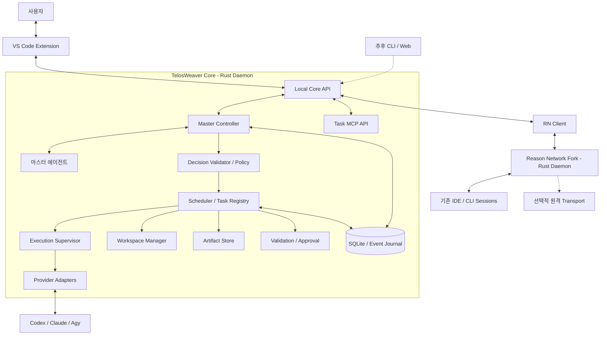
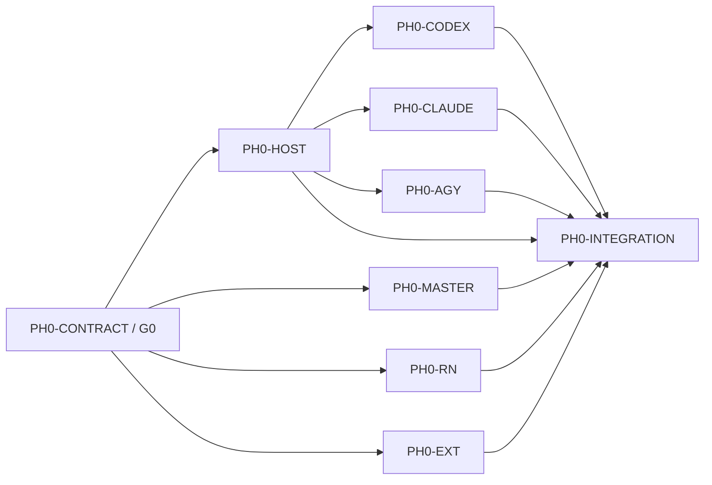
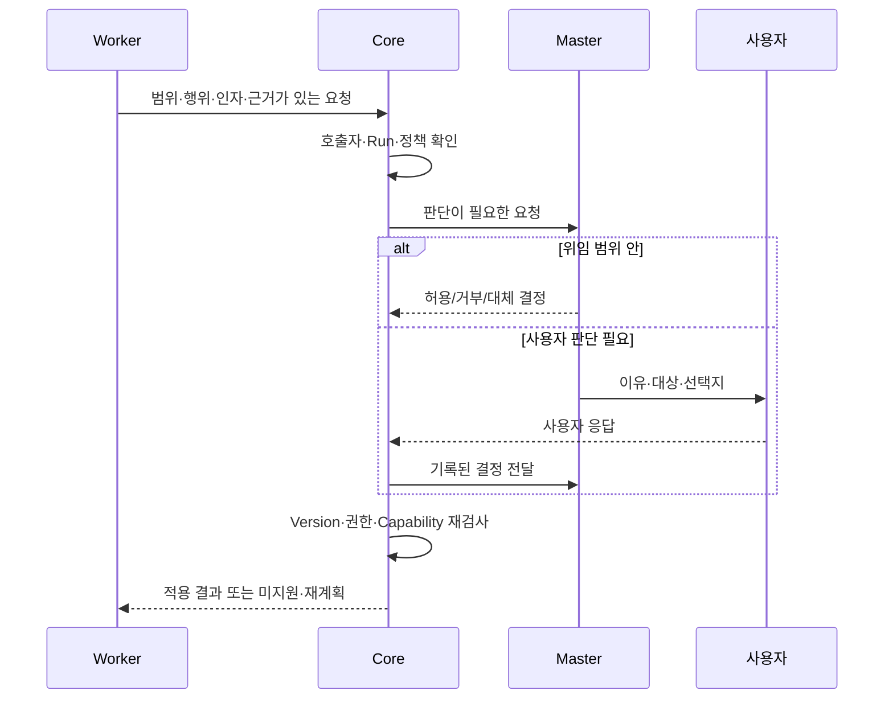

# TelosWeaver — 범용 멀티 에이전트 오케스트레이터 설계 및 기능 명세 (v1.5)

> **프로젝트명:** TelosWeaver (`telos-weaver`)  
> **문서 버전:** 1.5 (개정 1.5.7)  
> **작성일:** 2026-10-23  
> **수정일:** 2026-10-26  
> **문서 유형:** 제품 범위·아키텍처·실행 계약·기능 요구사항·개발 및 검증 계획  
> **상태:** 구현 기준 설계안. 사용자 확정 결정과 이를 구체화한 설계를 포함하며 구현 완료를 뜻하지 않습니다.  
> **초기 UI:** VS Code Extension  
> **구현 언어:** Core·Provider Adapter·RN Client·공통 Schema는 Rust, VS Code Extension은 TypeScript  
> **초기 실행 Provider:** OpenAI Codex, Anthropic Claude Code, Google Antigravity CLI(`agy`)  
> **기준 자료:** `DEVELOPMENT_v1.4.md` (개정 1.4.4), `DEVELOPMENT_v1.3.md` (개정 1.3.8), `DEVELOPMENT_v1.2.md`, `DEVELOPMENT_GAP_ANALYSIS.md` — 이전 문서는 `docs/archive/`에 로컬 보관하며 원격 저장소에는 올리지 않습니다

## 변경 이력

| 버전 | 날짜 | 주요 내용 |
|---|---|---|
| v1.0 | 2026-10-15 | 코딩 작업, 위임, Git Worktree, 검증·승인, VS Code UI 설계 |
| v1.1 | 2026-10-22 | 실행과 통신 분리, Reason Network 평가, 세션 정체성·전달 보장 구분 |
| v1.2 | 2026-10-22 | 범용 Task·Workspace·Artifact·Validation, RN Fork, 세 Provider의 Managed 실행 |
| v1.3 | 2026-10-23 | TelosWeaver 명칭, 마스터 총괄, 구체적인 입출력·승인·상태 계약, 세션 포크·토큰 효율, 지식·템플릿 단계 분리, 기존 코드와 독립된 새 구현 |
| v1.3.1 | 2026-10-23 | Core 구현 언어를 TypeScript/Node.js에서 Rust로 변경(DEC-05), 계약 타입을 Rust 표기로 전환, Extension 타입 생성 경로 추가, 기존 harness 코드 삭제 반영(DEC-04) |
| v1.3.2 | 2026-10-24 | Phase 0 병렬 구현의 작업 ID·수정 경로·공통 파일 소유권·계약 동결·배정·통합 게이트·검증 증거를 구체화 |
| v1.3.3 | 2026-10-24 | Phase 0 작업용 Git Worktree의 위치·이름 규칙을 추가(§19.5.5) |
| v1.3.4 | 2026-10-24 | 줄바꿈 LF 고정(`.gitattributes`)과 Linux·Remote SSH 실행 Host를 WSL로 확보하는 절차를 INTEGRATION 경로에 추가(§19.5.3, §19.5.8) |
| v1.3.5 | 2026-10-24 | Provider CLI를 각 에이전트의 VS Code 확장에서 탐지해 Managed 실행에 사용(DEC-06, §7.5). 탐색 위치·해석 순서·기록·인증·동시 사용 규칙, Phase 0 확인 항목, HOST의 공통 탐색 경로, 위험 추가 |
| v1.3.6 | 2026-10-24 | §7.5 확장 탐지를 버전 비의존 규칙으로 변경(`extensions.json`·`.obsolete` 해석, 폴더 이름 파싱, 파일 이름 검색 조건). Antigravity 실행 파일 위치를 `~/.gemini/bin/agy`로 확정 |
| v1.3.7 | 2026-10-24 | §7.5에 Antigravity 데이터 디렉터리 검증을 추가. 관찰 결과, `--app_data_dir=antigravity` 가설, AGY-DATA-01~05, 순서, 판정·반영 방법을 PH0-AGY 작업으로 지정 |
| v1.3.8 | 2026-10-24 | 배정표 수정 범위 완화(§19.5.5, §19.5.9): 담당 에이전트가 자기 작업 행·변경 요청 제출·변경 기록을 직접 갱신하고, 기준·게이트·판정·`verified` 전환은 통합 담당이 유지. 배정표 수정은 `main` 단독 커밋 |
| v1.4 | 2026-10-24 | v1.3.1~1.3.8 정리: Rust Core(DEC-05)와 기존 코드 삭제(DEC-04), Phase 0 병렬 구현 절차(작업 ID·독점 경로·게이트·증거·Worktree·배정표 수정 범위), LF 고정과 WSL 기반 Linux·Remote SSH Host, VS Code 확장 CLI 탐지(DEC-06, 버전 비의존 규칙·Antigravity 데이터 디렉터리 검증). REQ-010 탐지 계약 위치를 §7.5에 연결 |
| v1.4.1 | 2026-10-24 | INTEGRATION 경로에 `crates/core/src/integration/**` 추가(§19.5.3): G1~G3 통합 구성(운영자 설정 기반 Phase 0 실행 승인, Provider 탐지·구성, Daemon 종료 시 활성 Run 정리). 정식 정책은 MASTER(`core/policy`)가 대체 |
| v1.4.2 | 2026-10-24 | §7.5 Antigravity 데이터 디렉터리 검증 결과(AGY-DATA-01~05) 반영: 기본 `--app_data_dir=antigravity`, 실행 전 버전 명령으로 옵션 수용 확인, 미수용 시 `unsupported`. '확장을 끈 상태' 조건 제외(REQ-013) |
| v1.4.3 | 2026-10-24 | 병합 직후 Worktree·Branch 삭제를 통합 담당의 기본 동작으로 지정(§19.5.5). 커밋하지 않은 의미 있는 변경이 있으면 보류 |
| v1.4.4 | 2026-10-24 | RN Fork의 비공개 CLI 연동·자동 업데이트 등 민감 기능 제거 방향(DEC-07), 유지·제거·대체 정책과 미확정 경계(§12.4~12.5), PH0-RN-00~08의 선행 조건·산출물·소유권·검증(§19.5.10)을 추가. Upstream 변경은 선택적으로 반영하며 제거 경로의 재유입을 검사. 작업 배정·착수를 뜻하지 않음 |
| **v1.5** | **2026-10-24** | **v1.4.1~1.4.4 정리와 RN 방향 확정. DEC-07을 사용자 결정대로 좁힘: RN Fork는 클로즈드 소스 Reason CLI 연동, 자동 업데이트·받아서 실행하는 설치 경로, Reason 계정 로그인만 제거하고 Claude·Codex 세션 탐지·메시지 전달·MCP·Hook·네트워크 기능은 유지(§12.1·§12.4·§12.5 확정, RN-09~12·RN-POC-13~15·PH0-RN-03 문구 조정). Fork는 `rn-fork/`에 subtree(squash)로 도입, 실행 파일·상태·MCP 이름 분리, 실제 에이전트 설정 변경은 시험 시에만 백업·Diff·복원과 사전 확인. 이 밖에 v1.4.1 INTEGRATION 경로, v1.4.2 Antigravity 데이터 디렉터리 확정, v1.4.3 병합 후 정리 규칙, v1.4.4 RN 서브 태스크 계획을 포함** |
| v1.5.1 | 2026-10-25 | RN Core 연결(PH0-RN-07)의 Phase 0 방식과 재검토 조건(§12.3, §12.5): Core가 운영자 정책의 RN 실행 파일을 프로젝트별 상태 폴더로 자식 프로세스로 시작·정지하고, 예기치 않은 종료 시 제한된 재시작 후 Degraded. 사용자 단위 공유 RN은 P1 기존 세션 연결·P2 원격·팀 착수 전에 재검토(Core별 메일함·이벤트 범위·수명). RN RPC 계약(REQ-018)과 연결된 세션만 전송하는 Phase 0 규칙 반영 |
| v1.5.2 | 2026-10-25 | Phase 0의 Linux·단일 Remote SSH 실행 Host를 같은 PC의 WSL2에서 사용자의 Ubuntu 서버(`Psyki-NAS`, Ubuntu 26.04.1 LTS, 세 Provider 확장 원격 설치·로그인)로 변경(§19.5.8 앞 Host 절, §19.5.3 INTEGRATION 경로에 `docs/phase-0/LINUX_REMOTE_HOST.md` 추가). WSL2는 예비이며 그 결과는 Linux 증거로만 씀 |
| v1.5.3 | 2026-10-25 | Managed Run 세션을 각 Provider의 VS Code 확장 대화 목록에 표시(DEC-08, §7.6). Provider별 출처 지정 방식(Claude `CLAUDE_CODE_ENTRYPOINT`, Codex `threadSource` 검증, Agy 확장 데이터 디렉터리), 운영자 설정 `listed`/`hidden`, Workspace 경로 제약, Capability `vscode_listing`과 판정 방법, 실행 중 이중 조작 금지. AGENT-05 추가, §19.1 Phase 0 확인 항목 추가 |
| v1.5.4 | 2026-10-26 | §7.6을 Phase 0 판정 결과로 보정(REQ-021): Codex App Server는 `threadSource`(analytics 분류)·초기화 이름과 관계없이 저장된 Thread를 `vscode` 출처로 기록하므로 `hidden` 수단이 없고 운영자 정책에서 거부(사용자 결정). Antigravity `hidden`은 확장 인덱스에 CLI 출처로 색인되지만 확장 화면에서는 숨겨짐. 세 Provider `listed`·Claude/Agy `hidden`의 자동 판정과 사용자 화면 확인 결과, 운영자 정책 `vscodeListing`(Agy `dataDir`과의 관계)과 승인 Snapshot 기록, Agy 요약 인덱스 잔여 행 처리 |
| v1.5.5 | 2026-10-26 | Antigravity 인증의 Host별 차이(§7.5 AGY-DATA-02·Host별 규칙, §7.6): Linux Remote SSH 세션의 `agy`는 데이터 디렉터리 안의 파일 토큰을 쓰고 원격 확장은 확장 디렉터리에 토큰 파일을 두지 않아, `--app_data_dir=antigravity`가 그 Host에서는 별도 로그인 없이 동작하지 않음. Phase 0의 `psyki-nas`는 이미 로그인된 CLI 기본 디렉터리(`hidden`)를 운영자 정책으로 명시해 씀(사용자 결정). 그 Host의 Antigravity Managed Run은 원격 확장 목록에 보이지 않음 |
| v1.5.6 | 2026-10-26 | §7.3 Provider가 스스로 이어가는 Turn: 전용 프로세스 Run은 Turn 하나이므로 Provider의 백그라운드 작업처럼 첫 Turn 뒤에 이어지는 Turn을 막고(Claude `CLAUDE_CODE_DISABLE_BACKGROUND_TASKS=1`), 그래도 이어지면 기록하지 않고 프로세스를 끝내 성공으로 판정하지 않음(G3 발견 2) |
| v1.5.7 | 2026-10-26 | 공통 Capability 키 계약(REQ-024, §7.1): `detect()`와 `UnsupportedCapability.capability`가 쓰는 공통 키 8개(`managed_run`·`event_stream`·`cancel`·`native_resume`·`native_fork`·`send_input`·`answer_approval`·`vscode_listing`)와 의미·필수 범위, 문자열 상수와 같은 원본에서 생성하는 `CommonCapabilityKey` Schema, 세부 제한은 키가 아니라 `reason`, 한 요청의 거부가 영구 미지원을 뜻하지 않음, Provider 고유 키 `provider.<provider_id>.<feature>`, 생략·알 수 없는 키는 지원 근거가 아님(§7.2) |

## 목차

1. 목표·범위·확정 결정
2. 설계 원칙과 검증 상태
3. 전체 아키텍처와 배포
4. 마스터 에이전트와 결정 집행
5. 공통 도메인 및 Task·Artifact 계약
6. 실행 전 맥락과 입력 준비
7. Provider Adapter와 실행 이벤트
8. 세션 수명·포크·토큰 효율
9. Scheduler·위임·상태 전이
10. Workspace·Git·산출물 보관
11. Validation·승인·재작업
12. Reason Network Fork와 기존 세션 메시징
13. 설정·권한·예산
14. 영속화·서비스 수명·장애 복구
15. 로그·스트림·운영 진단
16. 지식 재사용·Workflow 템플릿·후속 자동화
17. VS Code 사용자 인터페이스
18. 기능 요구사항과 수용 기준
19. 개발 단계와 통과 조건, Phase 0 병렬 구현 규칙(§19.5)
20. PoC 및 제품 수용 시나리오
21. 대표 실행 흐름
22. 위험·추적성·참고 자료

## 1. 목표·범위·확정 결정

### 1.1 제품 목표

TelosWeaver는 서로 다른 AI 에이전트를 사용하여 **목표 확인 → 계획 → 위임 → 실행 → 산출물 수집 → 검증 → 승인 판단 → 재작업 또는 완료**를 관리하는 로컬 우선 오케스트레이터입니다. 사용자는 마스터 에이전트에 목표와 허용 범위를 제시하고, 마스터는 Worker의 작업과 결과를 총괄합니다. 작업 상태의 원본은 Orchestration Core에 있습니다.

코딩·조사·문서·데이터 분석·파일 및 CLI 자동화에 공통 작업 모델을 적용합니다. 모델의 내부 추론을 수집하는 대신 작업 계약, 도구 실행 결과, 산출물과 검증 근거를 기록합니다.

### 1.2 사용자 확정 결정

| ID | 결정 | 구현 범위에 미치는 영향 |
|---|---|---|
| DEC-01 | 초기 제품은 파일·CLI 중심입니다. | 외부 메일·CRM Connector, 예약·외부 이벤트 자동화는 P2로 둡니다. |
| DEC-02 | 지식 재사용과 파일 기반 Workflow 템플릿은 기본 실행 완성 후 첫 확장 단계에 넣습니다. | 기본 기능은 P1, 자동 지식 축적·시각적 편집은 P2입니다. |
| DEC-03 | 마스터 에이전트가 작업과 실행 정책을 총괄합니다. | 마스터가 판단하고 Core가 권한·예산·상태를 검사하여 집행합니다. |
| DEC-04 | 기존 Rust harness 코드는 저장소에서 삭제했으며 새 구현과 무관합니다. | 기존 모듈·설정·로그·TUI/Web의 재사용·호환·이관을 요구하지 않습니다. 필요하면 Git 이력에서만 참고합니다. |
| DEC-05 | Core는 RN Fork와 같은 Rust로 구현합니다. | Core·Adapter·RN Client·공통 Schema를 Cargo Workspace로 구성합니다. VS Code Extension만 TypeScript이며 공통 타입은 Rust에서 생성합니다. Core와 RN의 프로세스·DB 분리는 유지합니다. |
| DEC-06 | Provider 실행은 사용자가 설치한 각 에이전트의 VS Code 확장(Codex·Claude Code·Antigravity)이 내부에서 쓰는 CLI를 찾아 사용합니다. | 별도 CLI 설치를 전제로 하지 않습니다. 확장이 포함·관리하는 실행 파일을 탐지해 Core가 소유하는 Managed 프로세스로 실행합니다(§7.5). 확장이 이미 띄운 세션의 제어는 Attached(P1)이며 이 결정과 구분합니다. |
| DEC-07 | RN은 원본을 Fork한 뒤 **클로즈드 소스 Reason CLI 연동**, **자동 업데이트와 받아서 실행하는 설치 경로**, **Reason 계정 로그인**을 제거하고, 나머지 기능은 TelosWeaver에 맞춰 유지·재구성합니다. | 걱정하는 위험은 공개되지 않은 코드(Reason CLI)가 RN을 통해 실행되거나 업데이트로 다시 들어오는 것입니다. Claude·Codex 세션 탐지와 메시지 전달처럼 Provider의 비공식 인터페이스를 쓰는 기능은 TelosWeaver Provider Adapter(DEC-06)와 같은 위험 수준으로 수용합니다. 제거는 설정 비활성화가 아니라 코드·호출 경로·의존성에서 정리합니다(§12.4). PH0-RN은 §19.5.10의 서브 태스크로 진행합니다. |
| DEC-08 | Adapter가 시작한 Managed Run의 세션은 각 Provider의 VS Code 확장 대화 목록에 **기본으로 표시**되어야 합니다. | 각 Adapter가 Provider별 출처 지정 방식으로 세션을 확장 목록의 조회 대상에 넣고, 운영자 설정으로 숨길 수 있습니다(§7.6). 표시는 조회·열람을 위한 것이며 실행 중인 Run의 제어권은 Core에 있습니다. 확장 목록 표시를 지원한다고 표시하려면 Provider별 실환경 판정이 필요합니다. |

추가 확정 방향은 세션 포크와 문맥 전달 전략을 토큰 효율 설계에 포함하는 것입니다. 포크 지원 여부와 효율은 Provider별로 검증하며 절감률을 사전에 보장하지 않습니다.

### 1.3 초기 사용 사례와 비범위

| 작업 | 예시 흐름 | 주요 결과 |
|---|---|---|
| 코딩 | 설계 확인 → 구현 → 명령 검증 → 리뷰 → 통합 판단 | 변경 집합, Diff, 빌드·테스트 근거 |
| 조사 | 자료 확인 → 분석 위임 → 충돌·근거 검토 → 보고서 | 출처·사실·추론을 구분한 문서 |
| 문서 | 초안 → 기술 검토 → 수정 → 형식·내용 검사 | Markdown 또는 지정 파일 |
| 데이터 분석 | 입력 검사 → 변환·분석 → 수치·Schema 검증 | JSON/CSV, 표·차트·분석 결과 |
| 파일·CLI 자동화 | 실행 계획 → 허용 명령 → 결과 확인 | 실행 로그, 파일, 구조화 상태 |

P0는 `none`·`directory`·`git-worktree`와 세 Provider의 신규 Managed 실행을 대상으로 합니다. Windows 로컬과 단일 Remote SSH 실행 Host의 기본 경로를 검증합니다. 여러 Host를 잇는 분산 실행과 Artifact 동기화는 P2입니다.

자체 LLM 엔진, 전용 문서·Diff 편집기, 모든 Provider의 비공개 IDE 제어, 조직용 과금·관리, 무제한 에이전트 조직, 모든 작업에 강제하는 Council은 초기 범위에서 제외합니다. 서비스 이용약관·계정 제재 판단은 본 기술 설계의 범위에 포함하지 않습니다.

## 2. 설계 원칙과 검증 상태

### 2.1 필수 불변조건

1. **Task·Run·Session·Turn·Message를 구분합니다.** 논리 작업, 실행 시도, Provider 대화, 대화 내 실행, 통신 이벤트는 같은 ID가 아닙니다.
2. **전달·실행·검증·완료를 구분합니다.** Receipt, Exit Code, 에이전트의 완료 주장만으로 Task가 검증 통과하지 않습니다.
3. **마스터의 판단과 Core의 집행을 분리합니다.** 자연어 응답을 곧바로 실행 명령으로 처리하지 않습니다.
4. **검증·승인은 특정 계약과 결과 버전에 적용합니다.** 내용이 바뀌면 새 후보에 필요한 검증·승인을 다시 적용합니다.
5. **권한은 자동 확대하지 않습니다.** 메시지 수신, 위임, 포크, 세션 재개가 추가 실행 권한을 부여하지 않습니다.
6. **UI 수명과 실행 수명을 분리합니다.** VS Code Reload가 Task 기록이나 독립 Core를 종료시키지 않습니다.
7. **실제 지원 범위를 표시합니다.** 미지원·미검증 Capability를 지원하는 것처럼 대체하지 않습니다.
8. **장애 뒤 결과가 불명확하면 재조정합니다.** 부작용을 확인하지 않은 무조건 재시도를 금지합니다.

### 2.2 확인 사실·설계·실행 검증의 구분

문서의 `설계 계약`은 TelosWeaver가 구현할 동작입니다. Provider 공식 인터페이스의 존재는 실제 설치 환경의 성공 증거와 다릅니다. 기능별 증거 수준은 `documented`·`contract-tested`·`mock-tested`·`environment-tested`로 기록합니다. 실행하지 않은 시험은 통과로 표시하지 않습니다.

본 문서 작성 과정에서 TelosWeaver Core, RN Fork 빌드, Provider 실행을 검증하지 않았습니다. §7~§8의 외부 인터페이스 설명은 기준 자료와 같은 대화에서 확인한 공식 문서에 근거합니다. 배포 대상 버전의 Schema와 동작은 Phase 0에서 다시 고정합니다.

과거 `PROJECT_ANALYSIS.md`의 수치·문제 진단은 현재 구현 사실로 사용하지 않습니다. `영상 설명 요약`은 설계 참고 자료이며 독립된 실행 검증 근거가 아닙니다.

## 3. 전체 아키텍처와 배포

### 3.1 논리 구조



다이어그램의 기존 세션은 Core가 생성한 Managed Session과 다릅니다. 마스터도 Provider Adapter로 실행하는 논리적 역할입니다. `Master Controller`는 마스터의 실행·결정 회수·복구를 담당하는 Core 모듈입니다.

### 3.2 계층별 책임

| 계층 | 소유 책임 |
|---|---|
| VS Code Extension | 목표 입력, 마스터와의 상호작용, Task·로그·산출물·개입 화면 |
| Master Controller | 마스터 세션, 결정 요청·응답, 중복 결정 차단, 진행 상황 전달 |
| Core | Task/Run 상태, 정책·예산, 실행 감독, Workspace, 결과·검증·승인 원본 |
| Provider Adapter | 실행 탐지·시작·입력·이벤트·취소와 버전별 기능 차이 |
| RN Fork | 세션 발견, 정체성·Presence, 메시지 전달·수신 상태, MCP/Hook 연결 |
| Persistence | 원자적 상태 변경, 실행 의도·이벤트·결과·계보와 감사 기록 |

Task DAG, 모델 선택, 검증 성공 판정, 사용자 권한과 최종 Task 상태는 RN Fork에 넣지 않습니다. Core와 RN은 각 DB를 소유하며 RPC로만 연결합니다.

### 3.3 실행 Host와 서비스 경계

- P0는 한 Plan의 Task를 하나의 실행 Host에 배치합니다. Host는 Windows 로컬 또는 Remote SSH의 Workspace Host입니다.
- UI Host와 실행 Host를 구분합니다. CLI·Git·Workspace가 있는 Host에서 Supervisor와 RN을 실행합니다.
- 프로젝트별 Core 인스턴스는 하나의 Scheduler 소유권을 가집니다. 여러 VS Code 창은 같은 인스턴스에 접속합니다.
- Core는 Extension Host와 분리된 프로세스입니다. 시작·연결·상태 확인·명시적 종료를 지원합니다.
- 로컬 API·Named Pipe/Unix Socket에는 사용자·프로젝트 범위의 접근 제어를 적용합니다. Webview가 RN이나 Provider에 직접 접속하지 않습니다.
- 새 구현의 실행 파일·상태 디렉터리·서비스 식별자는 `telos-weaver`로 구분합니다. 기존 harness 파일과 상태를 자동 변환하거나 덮어쓰지 않습니다.

저장소 구조는 §3.4의 구성 단위를 따릅니다. 서비스 등록 방식은 구현 상세 설계에서 정하되, Core·Extension·RN Client·Provider Adapter·공통 Schema의 의존 방향을 분리합니다.

### 3.4 구현 언어와 구성 단위

DEC-05에 따라 Core 측 구성 요소는 Rust Cargo Workspace의 Crate로 나눕니다. Crate 이름은 상세 설계에서 확정하며 아래는 책임 단위입니다.

| 구성 단위 | 언어 | 책임 | 허용 의존 |
|---|---|---|---|
| 공통 Schema | Rust | §4~§13의 계약 타입, JSON Schema·TypeScript 타입 생성 원본 | 없음 |
| Provider Adapter | Rust | §7의 `AgentAdapter` 구현(Codex·Claude·Agy) | 공통 Schema |
| RN Client | Rust | §12 RN Fork Local RPC 호출 | 공통 Schema |
| Core | Rust | Core Daemon 실행 파일과 §3.1의 Core 모듈 | 위 세 단위 |
| VS Code Extension | TypeScript | §17 UI, Local Core API 접속 | 생성된 타입만 사용, Core 코드 직접 의존 금지 |

- Cargo의 Crate 의존 선언으로 방향을 강제합니다. 역방향·순환 의존을 만들지 않습니다.
- Extension이 쓰는 타입은 공통 Schema에서 생성한 JSON Schema·TypeScript 정의를 사용하며 손으로 복제하지 않습니다. 생성물과 Rust 원본의 불일치는 Contract Test로 검출합니다.
- Wire 형식은 JSON이며 필드 이름은 camelCase, 열거 값은 본 문서의 문자열 원문을 그대로 사용합니다.
- 본 문서의 Rust 계약 표기는 설명을 위한 것입니다. 모든 타입에 `Serialize`·`Deserialize`와 JSON Schema 생성 derive가 붙고 구조체 필드는 `#[serde(rename_all = "camelCase")]`로 직렬화한다고 가정하여 반복 속성을 생략합니다. 열거형의 직렬화 규칙만 표기합니다. `Option<T>`는 생략 가능한 필드, `JsonObject`는 `serde_json::Map<String, Value>`, 시각은 RFC 3339 문자열입니다.
- 같은 언어라는 이유로 Core와 RN Fork를 하나의 프로세스·DB로 합치지 않습니다. RPC 메시지 타입처럼 경계에 놓인 정의는 버전을 명시한 공유 Crate로 둘 수 있습니다.

Phase 0의 실제 작업 분할과 파일 수정 권한은 §19.5를 따릅니다. 위 표의 논리적 책임이 Crate 전체를 여러 에이전트가 동시에 수정해도 된다는 의미는 아닙니다.

## 4. 마스터 에이전트와 결정 집행

### 4.1 역할과 수명

사용자는 목표·제약·허용 범위를 마스터에 전달합니다. 마스터는 Task 생성·수정 제안, Provider/Model/Role과 문맥 전략 선택, 예산 배분, Worker 요청 판단, 검증·리뷰·재작업과 결과 통합을 총괄합니다. 특정 Provider나 모델을 마스터에 고정하지 않습니다.

P0 마스터는 제한된 Task 목록과 하위 위임을 생성하며 기본 실행 순서는 명시적 의존성과 큐를 따릅니다. P1에서 복잡한 자동 계획, DAG 병렬화와 자원 최적화를 추가합니다. 마스터 총괄을 P1 Planner 도입까지 미루지 않습니다.

Plan별 활성 마스터 제어권은 하나입니다. 재개·교체 시 `controllerEpoch`를 올리고 이전 마스터의 뒤늦은 결정을 실행하지 않습니다. 마스터 실행도 별도 Run과 Usage를 가지며 Worker의 예산·슬롯과 구분해 기록합니다.

마스터 실행은 Plan의 제어용 Task(`type: general`, `role: master`)로 기록하여 같은 Task/Run·Adapter 계약을 사용합니다. 제어용 Task의 수명은 Worker 완료 의존성과 분리하고, 마스터의 자식 대기가 Worker 실행을 막지 않도록 제어 슬롯과 실제 프로세스 상한을 함께 적용합니다.

### 4.2 구조화 결정 계약

```rust
pub struct MasterDecision {
    pub decision_id: String,
    pub plan_id: String,
    pub plan_revision: u32,
    pub master_run_id: String,
    pub controller_epoch: u64,
    pub idempotency_key: String,
    pub kind: MasterDecisionKind,
    pub payload: JsonObject,
    pub rationale: String,
    pub policy_revision: String,
}

#[serde(rename_all = "snake_case")]
pub enum MasterDecisionKind {
    CreateTasks, RequestRun, AnswerAction,
    RequestValidation, RequestRework, RequestCancel,
    AskUser, ProposeCompletion,
}
```

이 타입은 공통 외형입니다. 각 `kind`의 Payload는 별도 JSON Schema로 검증합니다. `propose_completion`은 완료 판정을 요청할 뿐 검증을 우회하는 명령이 아닙니다. 설명에는 판단 근거와 선택 이유를 남기며 내부 추론 전문을 요구하지 않습니다.

Core 집행 순서는 **호출자·소유권 확인 → Schema·Plan Revision·Epoch 확인 → 권한·DAG·예산·Capability 검사 → 결정 및 실행 의도 기록 → 집행 → 적용 결과 기록**입니다. 같은 멱등 키의 재요청은 같은 결정 결과를 반환합니다. 같은 키에 다른 Payload를 보내면 거부합니다.

### 4.3 Worker 요청·승인·사용자 개입

| 요청 | 처리 |
|---|---|
| 허용된 Workspace·명령·예산 안의 작업 | 정책에 따라 실행하거나 마스터가 판단합니다. 매 단계 사용자 확인을 강제하지 않습니다. |
| Worker의 추가 질문·대체안·재작업 요청 | 마스터가 자료와 계약을 확인해 답하거나 계획을 수정합니다. |
| 권한 확대·사용자 전용 결정·핵심 정보 부족 | 마스터가 이유·대상·선택지를 정리해 사용자에게 전달합니다. |
| 미지원 Provider 제어 요청 | 지원 가능한 재계획 또는 명시적 미지원 결과를 반환합니다. |

마스터가 판단해도 사용자의 권한 상한을 바꾸지 못합니다. 승인 주체는 `user` 또는 위임받은 `master`로 기록합니다. 원본 브랜치 반영·외부 변경은 별도 행위 정책을 적용하며, 사용자가 위임한 범위와 사용자 전용 결정을 구분합니다. 포괄적인 승인 생략 옵션을 기본값으로 삼지 않습니다.

## 5. 공통 도메인 및 Task·Artifact 계약

### 5.1 식별자와 버전

| 개념 | 의미 | 관계 |
|---|---|---|
| Project / Host | 작업 설정 범위 / 실제 실행 위치 | 경로·CLI·자격 증명을 Host별로 해석 |
| Plan / Plan Revision | 사용자 목표와 승인된 실행 구성 | 수정 시 새 Revision, 실행 중 묵시적 변경 금지 |
| Task / Task Revision | 논리 작업과 계약 버전 | 재시도는 같은 Task의 새 Run |
| Run | 실행 시도 | Core가 UUID 발급, 시도 번호·입력 버전 고정 |
| Session / Turn | Provider 대화 / 그 안의 실행 단위 | Run과의 연결을 별도 기록, 1:1 가정 금지 |
| Artifact / Version | 산출물의 논리 정체성 / 고정 내용 | 검증·입력·승인은 Version을 참조 |
| Message / Decision | 통신 사건 / 실행 판단 | Run·Task와 독립된 멱등성 관리 |

### 5.2 Task·입출력 계약

```rust
#[serde(rename_all = "lowercase")]
pub enum TaskType {
    General, Research, Analysis, Document,
    Coding, Automation, Review, Custom,
}

#[serde(rename_all = "lowercase")]
pub enum ArtifactKind {
    Text, File, Document, Dataset, Code, Diff, Structured,
}

pub struct ArtifactVersionRef {
    pub artifact_id: String,
    pub version_id: String,
}

#[serde(tag = "source", rename_all = "kebab-case")]
pub enum InputBinding {
    Artifact { name: String, r#ref: ArtifactVersionRef },
    TaskOutput {
        name: String,
        producer_task_id: String,
        producer_task_revision: u32,
        output_name: String,
    },
}

pub struct OutputContract {
    pub id: String,
    pub name: String,
    pub kind: ArtifactKind,
    pub content_type: Option<String>,
    pub relative_path: Option<String>,
    pub schema_id: Option<String>,
    pub required: bool,
    pub min_count: u32,
    pub max_count: u32,
}

#[serde(rename_all = "kebab-case")]
pub enum ValidationKind {
    Schema, File, Checksum, Command, Assertion,
    AiReview, Human, Visual, Custom,
}

pub struct ValidationContract {
    pub id: String,
    pub revision: u32,
    pub kind: ValidationKind,
    pub target_output_names: Vec<String>,
    pub parameters: JsonObject,
    pub required: bool,
}

pub struct AgentSelection {
    pub provider: String,
    pub model: Option<String>,
    pub role: String,
}

#[serde(rename_all = "kebab-case")]
pub enum WorkspaceMode { None, Directory, GitWorktree, Sandbox, Remote }

pub struct WorkspaceRequest {
    pub mode: WorkspaceMode,
    pub workspace_id: Option<String>,
    pub host_id: String,
    pub read_only: bool,
}

pub struct TaskSpec {
    pub id: String,
    pub revision: u32,
    pub project_id: String,
    pub plan_id: String,
    pub parent_task_id: Option<String>,
    pub r#type: TaskType,
    pub objective: String,
    pub constraints: Vec<String>,
    pub dependencies: Vec<String>,
    pub agent: AgentSelection,
    pub workspace: WorkspaceRequest,
    pub inputs: Vec<InputBinding>,
    pub outputs: Vec<OutputContract>,
    pub validation: Vec<ValidationContract>,
    pub permission_profile_id: String,
    pub budget_profile_id: String,
    pub completion_policy_id: String,
}
```

위 타입은 설계 계약이며 실제 Rust Crate가 구현되어 있다는 뜻은 아닙니다. `r#ref`·`r#type`은 Rust 예약어를 피한 표기이며 Wire 이름은 `ref`·`type`입니다. 명령·Validator 실행은 Core의 내부 Job으로 수행할 수 있으며 모든 검사에 AI Task를 새로 만들 필요는 없습니다.

출력 이름은 Task Revision 안에서 유일합니다. `task-output` 입력은 해당 Producer의 완료 결과에서 실제 Artifact Version으로 해석하고 Run 시작 시 고정합니다. 같은 Task ID라는 이유로 다른 Revision·재시도 결과를 혼합하지 않습니다. P0 의존성은 필수 선행 Task의 `Completed`를 요구하며, 다른 결과 조건은 P1 확장 계약으로 분리합니다.

### 5.3 Artifact Version과 결과

```rust
pub struct ArtifactVersion {
    pub artifact_id: String,
    pub version_id: String,
    pub task_id: String,
    pub task_revision: u32,
    pub run_id: String,
    pub output_name: String,
    pub kind: ArtifactKind,
    pub content_type: String,
    pub storage_uri: String,
    pub checksum: String,
    pub source_revision: Option<String>,
    pub created_at: String,
}

#[serde(rename_all = "lowercase")]
pub enum ExecutionOutcome { Succeeded, Failed, Cancelled, Unknown }

pub struct TaskResult {
    pub task_id: String,
    pub task_revision: u32,
    pub run_id: String,
    pub execution_outcome: ExecutionOutcome,
    pub artifacts: Vec<ArtifactVersionRef>,
    pub summary: String,
    pub unresolved: Vec<String>,
    pub evidence_ids: Vec<String>,
}
```

Artifact Version은 불변입니다. 작업 디렉터리의 변경 가능한 파일 경로 자체를 검증된 버전으로 간주하지 않습니다. 파일·본문을 저장소에 복사하거나 고정 Revision과 내용을 확인하여 Checksum을 계산합니다. 외부 URI의 접근 가능성과 실제 저장 내용을 분리합니다.

실행 결과와 논리 완료 상태는 다릅니다. `executionOutcome: succeeded`여도 필수 출력·검증·승인 조건이 부족하면 Task는 완료되지 않습니다. 기존 세션의 일반 자연어 답변도 자동으로 신뢰된 `TaskResult`가 되지 않습니다.

## 6. 실행 전 맥락과 입력 준비

### 6.1 Context Snapshot

Run 시작 전에 다음 내용을 `ContextSnapshot`으로 고정합니다.

| 범주 | 기록할 내용 |
|---|---|
| 지침 | 적용한 사용자·프로젝트 지침의 출처, 버전/해시, 적용 범위 |
| 입력 | Artifact Version, Producer 결과, 필수 파일과 참조 자료 |
| 환경 | Host·Workspace·cwd, 실행 파일 경로·버전, 필요한 명령·도구 |
| 코딩 상태 | Git 루트·Base Commit, staged/unstaged/untracked 상태와 작업 시작 기준 |
| 실행 계약 | Task/Plan Revision, 최종 설정·권한·예산·검증 계약 해시 |
| 불확실성 | 누락·충돌·오래된 입력, 알려진 가정과 미해결 질문 |

Workspace 전체를 무조건 모델 입력에 넣지 않습니다. 관련 파일·자료의 선택 이유와 제외 범위를 남깁니다. 필수 지침이나 입력을 읽지 못하면 조용히 생략하지 않습니다. Core가 판정 가능한 누락은 실행을 보류하고, 판단이 필요한 경우 마스터가 질문·제한적 실행·실패를 결정합니다.

### 6.2 출처와 신뢰 경계

프로젝트의 적용 지침과 분석 대상 문서·도구 출력·외부 메시지를 구분합니다. 자료 본문의 지시를 사용자 권한이나 정책 변경으로 승격하지 않습니다. 지침 충돌은 출처와 함께 표시하며 우선순위는 §13을 따릅니다.

조사 결과는 확인 사실·추론·미확인 주장을 구분합니다. P0는 필수 출처와 불확실성 표시를 검사하고 P1에서 주장별 `EvidenceRef` 추적을 추가합니다. Schema 통과나 URL 존재만으로 사실 정확성을 검증했다고 표시하지 않습니다.

## 7. Provider Adapter와 실행 이벤트

### 7.1 초기 Provider와 지원 판정

| Provider | Managed 연동 기준 | 세션 포크의 문서상 경로 | 미검증 범위 |
|---|---|---|---|
| Codex | `codex app-server`, Thread/Turn 이벤트 | `thread/fork`, 대상 버전에서 `lastTurnId` 확인 | 로컬 Schema·취소·재개·분기·권한 제어와 기존 확장 동시 접근 |
| Claude Code | `claude -p`와 Stream JSON | `--resume`/`--continue` + `--fork-session` | Print/Stream 분기, 분기 기준, 제어·권한·세션 충돌 |
| Agy | Headless 단발 또는 NDJSON 입력·출력 | 대화형 `/fork` 문서 존재 | Headless 분기 경로는 미확정, 기존 IDE Attached와 실시간 승인 별도 검증 |

근거는 [Codex App Server](https://learn.chatgpt.com/docs/app-server), [Claude Code CLI reference](https://code.claude.com/docs/en/cli-reference), [Agy Headless](https://www.antigravity.google/docs/cli/headless/), [Agy 대화 관리](https://antigravity.google/docs/cli/conversations)입니다. 이 표는 설치 환경의 지원 확인 결과가 아닙니다.

위 Managed 연동에 쓰는 실행 파일은 각 Provider의 VS Code 확장이 포함하거나 관리하는 CLI입니다(DEC-06). 탐지 규칙은 §7.5를 따릅니다.

Capability는 `supported`·`unsupported`·`unverified`와 Provider 버전·Host·확인 시각·증거·제한 사유를 가집니다. 필수 기능이 미검증이면 실행 전 탐지 또는 제한된 PoC를 거치며, 선택 기능의 미지원은 이유와 대체 경로를 표시합니다.

**공통 Capability 키(REQ-024).** `detect()`가 돌려주는 Map의 키와 `AdapterError::UnsupportedCapability.capability`는 모든 Adapter가 아래 이름을 씁니다. `telos-schema`가 문자열 상수와 알려진 키 목록을 정의하고, 같은 목록에서 `CommonCapabilityKey` Schema를 생성해 Extension 타입으로 씁니다. 이 Schema는 공통 키 카탈로그이며 Map의 허용 키를 닫지 않습니다.

| 키 | 의미·대응 | Phase 0 (§19.1) | Phase 1 / P0 (§19.2) |
|---|---|---|---|
| `managed_run` | `start_run`, 기본 `fresh` 모드의 Core 소유 실행 | 필수 검증 대상 | 실행할 Provider의 기본 필수 기능 |
| `event_stream` | `events`, 정규화 이벤트·순서·재생·종료 규칙 | 필수 검증 대상 | 기본 필수 기능 |
| `cancel` | `cancel_run`, 취소 접수와 실제 프로세스·자식 종료 확인의 구분 | 필수 검증 대상 | 기본 필수 기능 |
| `native_resume` | `start_run` + `resume`·`source_session_id` | 실험·제한 기록 필수, 지원 성공은 별도 판정 | 선택. 해당 모드를 요청할 때 확인 |
| `native_fork` | `start_run` + `native-fork`·부모 세션 | 실험·제한 기록 필수(Agy 성공은 필수 아님) | 선택. 새 Native ID·계보·기준 범위 확인 |
| `send_input` | `send_input`, 기존 Run·Turn의 진행 중 조정. 새 Turn은 기존 Run에 추가하지 않음(§7.3) | 선택 | 그 제어를 쓰는 경로에서 조건부 필수 |
| `answer_approval` | `answer_approval`, 요청 ID에 대응하는 실행 중 승인 응답. 시작 전 권한 설정과 다름 | 선택(도구 거부 검증과 별개) | 실시간 승인 경로를 쓰는 경우 조건부 필수 |
| `vscode_listing` | 세션을 확장 목록 대상으로 만드는 수단(§7.6) | Windows에서 수단 판정과 화면 확인을 따로 기록 | 목록 표시가 필요한 설정·Host에서 확인 |

- 키가 없거나 `unverified`·`unsupported`이면 지원으로 보지 않습니다. 키 하나의 `supported`가 특정 Turn 기준 재개·분기, `hidden` 모드, 화면 실시간 반영, 세션 소유권 같은 세부 조건까지 보장하지 않으며, 그런 제한은 `reason`과 실행 전 검사로 표현합니다.
- 설정값·세부 인자·권한 Port 이름을 키 뒤에 붙이지 않습니다(예: `hidden` 거부는 `vscode_listing` + 사유, 특정 Turn Resume 거부는 `native_resume` + 사유, 승인 정책 미구성은 `answer_approval` + 사유).
- 한 요청의 `UnsupportedCapability`는 인자·설정·정책을 포함한 그 요청의 거부이며 기능 전체의 영구 미지원을 뜻하지 않습니다. Core는 거부 하나로 `Capability.state`를 덮어쓰지 않습니다.
- Capability가 `supported`라는 이유로 승인·파일·실행 권한을 부여하지 않습니다(권한은 정책이 정함).
- Provider 고유 키는 `provider.<provider_id>.<feature>`(`snake_case`)를 씁니다. 공통 8개는 접두어 없는 예약 이름입니다. 알 수 없는 키를 공통 기능의 별칭으로 추측하지 않고, 공통 소비자는 이를 필수 기능 지원 근거로 삼지 않습니다. 공통 키의 추가·의미 변경은 CONTRACT 변경 요청과 이 절의 개정으로만 합니다.
- RN의 `RnSessionCapabilities`와 실패 분류 `unsupported_capability`는 이 키 목록과 별개입니다.

### 7.2 공통 실행·제어 계약

```rust
#[serde(rename_all = "lowercase")]
pub enum CapabilityState { Supported, Unsupported, Unverified }

#[serde(rename_all = "kebab-case")]
pub enum EvidenceLevel { Documented, ContractTested, MockTested, EnvironmentTested }

pub struct Capability {
    pub state: CapabilityState,
    pub provider_version: String,
    pub host_id: String,
    pub checked_at: String,
    pub evidence_level: EvidenceLevel,
    pub reason: Option<String>,
}

#[serde(rename_all = "kebab-case")]
pub enum SessionMode { Fresh, Resume, NativeFork, Capsule }

pub struct SessionRequest {
    pub mode: SessionMode,
    pub source_session_id: Option<String>,
    pub source_turn_id: Option<String>,
    pub capsule_version_id: Option<String>,
}

pub struct RunContext {
    pub run_id: String,
    pub task_id: String,
    pub task_revision: u32,
    pub attempt: u32,
    pub controller_epoch: u64,
    pub host_id: String,
    pub workspace_id: String,
    pub context_snapshot_id: String,
    pub policy_revision: String,
    pub idempotency_key: String,
    pub session: SessionRequest,
}

#[serde(rename_all = "snake_case")]
pub enum ProviderEventKind {
    SessionStarted, TextDelta, ToolStarted, ToolCompleted,
    ApprovalRequired, Usage, TurnFinished, ProcessExited, Error,
}

pub struct ProviderEvent {
    pub event_id: String,
    pub run_id: String,
    pub sequence: u64,
    pub occurred_at: String,
    pub schema_version: String,
    pub native_session_id: Option<String>,
    pub native_turn_id: Option<String>,
    pub tool_call_id: Option<String>,
    pub kind: ProviderEventKind,
    pub payload: JsonObject,
    pub raw_event_ref: Option<String>,
}

pub struct RunStarted {
    pub run_id: String,
    pub native_session_id: Option<String>,
    pub native_turn_id: Option<String>,
}

#[serde(rename_all = "lowercase")]
pub enum ApprovalAnswer { Allow, Deny }

#[serde(rename_all = "lowercase")]
pub enum RunInspection { Running, Finished, Interrupted, Unknown }

pub enum AdapterError {
    UnsupportedCapability { capability: String, reason: String },
    // 시작 실패·인증·설정·Protocol Parse 등은 §7.3 분류를 따릅니다.
}

#[async_trait]
pub trait AgentAdapter: Send + Sync {
    fn id(&self) -> &str;
    async fn detect(&self, host_id: &str)
        -> Result<HashMap<String, Capability>, AdapterError>;
    async fn start_run(&self, task: &TaskSpec, context: &RunContext)
        -> Result<RunStarted, AdapterError>;
    fn events(&self, run_id: &str, after_sequence: u64)
        -> BoxStream<'static, Result<ProviderEvent, AdapterError>>;
    async fn send_input(&self, run_id: &str, input_id: &str, text: &str)
        -> Result<(), AdapterError>;
    async fn answer_approval(&self, run_id: &str, request_id: &str,
        decision: ApprovalAnswer) -> Result<(), AdapterError>;
    /// 반환값은 취소 요청 접수 여부이며 실제 종료가 아닙니다.
    async fn cancel_run(&self, run_id: &str) -> Result<bool, AdapterError>;
    async fn inspect_run(&self, run_id: &str)
        -> Result<RunInspection, AdapterError>;
}
```

Core는 여러 Provider를 `Arc<dyn AgentAdapter>`로 다루므로 Trait은 객체 안전해야 합니다. 위 표기는 `async-trait` 방식을 가정하며, 비동기 Trait 구현 방식은 상세 설계에서 확정합니다.

메서드가 존재한다는 것이 기능 지원을 뜻하지는 않습니다. 미지원 제어는 `AdapterError::UnsupportedCapability`를 반환하며 `capability`에는 §7.1의 공통 키를 씁니다. Run ID는 Core가 발급하며 Adapter가 임의의 다른 Run을 만들지 않습니다. 동일 실행 키의 재요청으로 프로세스를 중복 생성하지 않습니다.

`none` Profile도 논리 Workspace ID를 발급하되 별도 파일 디렉터리는 만들지 않습니다. Adapter에 전달하는 입력은 Snapshot에 바인딩된 Version이며, 사용자 임의 경로를 검증 없이 실행 cwd로 사용하지 않습니다.

이벤트는 시작 직후부터 버퍼나 영속 경로에 남겨 구독 전에 발생한 종료도 회수합니다. 원본에 순서 정보가 없으면 Adapter가 수신 순서를 부여하고 그 한계를 기록합니다.

### 7.3 완료·오류·취소

Turn 완료, 프로세스 종료, Task 검증 성공은 별도 사건입니다. 지속형 프로세스는 Turn 완료 후에도 살아 있을 수 있습니다. Exit Code뿐 아니라 요구 출력, Provider 결과, Tool 거부·실패를 함께 판정합니다.

취소 요청 접수와 실제 종료를 구분합니다. Supervisor가 유예 시간 후 강제 종료와 자식 프로세스 회수를 담당합니다. Windows Job Object, Unix Process Group 등의 실제 수단을 선택해 PoC로 확인합니다. 종료 확인 전에 Writer Lock을 해제하지 않습니다.

**Provider가 스스로 이어가는 Turn:** 전용 프로세스 Run은 Turn 하나입니다. Provider가 첫 Turn의 결과 뒤에 백그라운드 작업 완료 등으로 같은 프로세스에서 Turn을 이어가면, 그 Turn은 Core가 요청하거나 감독하지 않은 실행입니다. Adapter는 Provider 설정으로 이런 작업을 끄고(Claude Code: 자식 환경 `CLAUDE_CODE_DISABLE_BACKGROUND_TASKS=1`, 2.1.310에서 Bash `run_in_background` 거부 확인), 그래도 이어지면 그 출력을 Run 이벤트에 넣지 않고 프로세스를 끝냅니다. 이 Run은 요청 종료로 보고되어 성공으로 판정하지 않습니다(근거: `docs/phase-0/evidence/PH0-INTEGRATION/README.md` §9.6).

시작 실패, 인증 오류, 잘못된 설정, Protocol Parse, Tool Denial, Timeout, Resource Limit, Provider 오류를 구분합니다. Run·실행 경로·버전·실패 단계를 연결하며 알 수 없는 상태를 성공으로 처리하지 않습니다.

### 7.4 Agy 처리 기준

Headless 스트림 입력은 Turn별로 직렬화하고 `result`를 소비한 다음 후속 입력을 보냅니다. `stdin`을 열어 둔 채 프로세스 종료만 기다리지 않습니다. `result.status`, Tool Event, 진단, 최종 Validation을 함께 확인합니다.

기준 Headless 문서의 `control_request`/`control_response` 제약을 고려합니다. 승인 화면을 만들었다고 실시간 응답이 가능하다고 가정하지 않습니다. 시작 전 권한 설정, 요청 거부, 지원 가능한 재계획을 사용하며 전체 권한 검사를 생략하지 않습니다.

### 7.5 VS Code 확장의 CLI 탐지와 실행

DEC-06에 따라 Provider CLI는 실행 Host에 설치된 각 에이전트의 VS Code 확장에서 찾습니다. Core는 찾은 실행 파일로 **새 Managed 프로세스**를 시작합니다. 확장이 이미 실행 중인 프로세스·대화에 붙거나 그 UI를 조작하지 않으며, 그런 연동은 Attached(§12, P1)로 구분합니다.

| Provider | 확장 ID | 실행 파일 위치 (버전 없는 규칙) | 2026-10-24 Windows 확인 결과 |
|---|---|---|---|
| Codex | `openai.chatgpt` | `<확장 폴더>/bin/<os>-<arch>/codex[.exe]` (`<os>-<arch>`: `windows-x86_64`, `linux-x86_64` 등) | 확장 26.1007.21434(`win32-x64`), `bin/windows-x86_64/codex.exe`, `codex-cli 0.162.0-alpha.17.2`. 같은 패키지에 `bin/linux-x86_64/codex`도 있음 |
| Claude Code | `anthropic.claude-code` | `<확장 폴더>/resources/native-binary/claude[.exe]` (플랫폼별 패키지) | 확장 2.1.309(`win32-x64`), `2.1.309 (Claude Code)` |
| Antigravity | `google.google-antigravity` | 확장 폴더 밖 `~/.gemini/bin/agy[.exe]`. 확장은 바이너리를 포함하지 않고 이 위치에 내려받아 관리하며(확장 코드의 `getInstalledTargetPath`) `agy --hub`로 자체 백그라운드 서버를 띄움 | 확장 1.9.0, `C:\Users\<user>\.gemini\bin\agy.exe` 1.4.7. PATH에는 없음 |

이 위치는 각 확장의 **비공개 내부 구조**를 관찰한 결과이며 공식 계약이 아닙니다. 확장 업데이트로 바뀔 수 있으므로 버전에 의존하지 않는 규칙으로 해석하고 다음을 따릅니다.

1. **탐색 위치:** 실행 Host의 확장 폴더를 찾습니다. 로컬은 `~/.vscode/extensions`(Insiders는 `~/.vscode-insiders/extensions`), Remote SSH·WSL 실행 Host는 그 Host의 `~/.vscode-server/extensions`입니다. UI Host의 확장으로 원격 실행 Host의 CLI를 대신하지 않습니다(§3.3).
2. **확장 폴더 해석 (버전 비의존):** 경로에 버전을 고정하지 않습니다. 확장 폴더의 `extensions.json`에서 확장 ID로 항목을 찾아 `relativeLocation`(현재 활성 폴더)과 `version`을 읽습니다. `extensions.json`이 없거나 항목이 없으면 `<확장 ID>-*` 폴더를 나열해 `.obsolete`에 있는 폴더를 빼고, 폴더 이름 `<확장 ID>-<version>[-<targetPlatform>]`을 파싱해 실행 Host 플랫폼과 맞는 가장 높은 버전을 고릅니다. 읽은 버전은 선택 근거와 기록에만 쓰고 경로 규칙에는 쓰지 않습니다.
3. **실행 파일 해석:** 위 표의 상대 경로를 먼저 확인합니다. 없으면 확장 폴더 안에서 실행 파일 이름(`codex[.exe]`, `claude[.exe]`)으로 찾되, 후보가 정확히 하나일 때만 쓰고 그 사실을 기록합니다. 여러 개이거나 없으면 추측하지 않고 미탐지로 처리합니다.
4. **해석 순서:** ① 사용자·Host 설정의 명시 경로 → ② 확장이 포함·관리하는 실행 파일(위 2·3) → ③ PATH. 어느 경로를 썼는지 출처로 기록하며, ③으로 대체할 때도 그 사실을 표시합니다.
5. **확인:** 찾은 파일은 버전 명령으로 실행 가능 여부와 버전을 확인합니다. 확인하지 못하면 해당 Provider의 Capability를 `unsupported`(사유 포함)로 두고 다른 경로로 조용히 바꾸지 않습니다.
6. **기록:** Run의 Context Snapshot과 Capability에 확장 ID·확장 버전·실행 파일 경로·CLI 버전·파일 해시를 남깁니다(§6.1). 경로는 Run 시작 시 고정하며 실행 중 확장이 업데이트되어도 같은 Run에서 다른 파일로 바꾸지 않습니다.
7. **복사 금지:** 확장의 실행 파일을 다른 위치로 복사·재배포하지 않습니다. 업데이트로 기존 버전 폴더가 사라지면 다음 Run부터 다시 탐지합니다.
8. **인증과 상태:** 인증은 CLI가 쓰는 사용자 설정을 그대로 사용하며 Core가 토큰을 읽거나 복사하지 않습니다(§14.1). 확장에서 로그인한 상태가 CLI 실행에도 유효한지는 Provider별로 Phase 0에서 확인합니다. Antigravity 확장은 `--app_data_dir=antigravity`로 별도 데이터 디렉터리를 쓰므로, Managed 실행은 기본으로 이 확장 디렉터리를 씁니다(아래 "Antigravity 데이터 디렉터리 검증"의 확정 규칙).
9. **동시 사용:** 확장 UI와 Managed 프로세스가 같은 사용자 설정·세션 저장소를 함께 쓸 때의 충돌은 PROV-10에서 검증합니다. Phase 0 Managed 실행은 확장 UI의 기존 대화를 재개하거나 수정하지 않습니다.

공통 탐색(`extensions.json`·`.obsolete` 해석, 폴더 이름 파싱·버전 비교, 파일 이름 검색, 해시 계산)은 공용 모듈이 담당하고, 확장 ID·실행 파일 상대 경로·버전 명령처럼 Provider별 규칙은 각 Provider Adapter가 담당합니다(§19.5.3). 공용 모듈의 시험은 여러 버전 폴더·`.obsolete`·`extensions.json` 누락·플랫폼 불일치를 포함한 Fixture로 수행합니다.

탐지 결과와 입력의 공통 계약은 `telos_schema::CliDiscovery`(결과 `found`/`unavailable`, 출처·위치 결정 방법·확장 정보·실패 분류)와 `telos_adapters::{ProviderCliRule, DiscoveryRequest, CliDiscoverer}`입니다(Phase 0 REQ-010). 결과는 Capability·Context Snapshot·Extension 표시에 같은 형태로 씁니다.

#### Antigravity 데이터 디렉터리 검증 (PH0-AGY)

**관찰 (2026-10-24, Windows, 확장 1.9.0, `agy` 1.4.7):**

- 확장은 `agy --hub --hub-port=<port> --app_data_dir=antigravity --csrf_token=<token>` 형태로 CLI를 실행합니다(확장 `extension.js`).
- `--app_data_dir`는 `agy --help`에 나오지 않는 **비공개 옵션**입니다. CLI 버전이 바뀌면 사라지거나 의미가 달라질 수 있습니다.
- 데이터 디렉터리는 두 개입니다.
  - `~/.gemini/antigravity`: 확장이 씁니다. `conversations`, `brain`, `worktrees`, `conversation_summaries.db` 등이 있습니다.
  - `~/.gemini/antigravity-cli`: CLI를 단독 실행할 때의 기본값입니다. `settings.json`, `history.jsonl`, `keybindings.json` 등이 있습니다.

**가설:** Managed 실행에 `--app_data_dir=antigravity`를 넘기면 확장과 같은 데이터 디렉터리와 로그인 상태를 쓸 수 있습니다.

**검증 항목:**

| ID | 확인 내용 |
|---|---|
| AGY-DATA-01 | `--hub` 없이 `-p`/`--output-format stream-json`과 함께 이 옵션이 받아들여지는지 확인합니다. 알 수 없는 옵션으로 실패하는지, 조용히 무시되는지도 구분합니다 |
| AGY-DATA-02 | 확장에서 로그인한 상태로 인증이 유효한지 확인합니다. 인증 정보가 데이터 디렉터리 안에 있는지, 밖(공용 설정이나 OS 자격 증명 저장소)에 있는지 기록합니다. 위치는 파일 이름과 존재 여부만 확인하고 내용은 읽지 않습니다 |
| AGY-DATA-03 | 실행 뒤 어느 디렉터리에 대화·로그·상태 파일이 생겼는지, 확장 UI의 대화 기록에 Managed 실행이 나타나는지 확인합니다 |
| AGY-DATA-04 | 확장의 허브 프로세스가 떠 있는 상태에서 동시에 실행할 때 잠금 충돌(`conversation_summaries.db` 등), 허브 상태 변경, 확장 오류가 있는지 확인합니다 (PROV-10, 규칙 9) |
| AGY-DATA-05 | `settings.json`이 CLI 쪽 디렉터리에만 있으므로, 권한·모드·모델 설정이 디렉터리에 따라 다르게 적용되는지 확인합니다 (§7.4 시작 전 권한 설정) |

**조건:** 실제 운용처럼 세 확장이 모두 켜진 상태에서 옵션 지정(확장 디렉터리)과 옵션 생략(기본 디렉터리)을 직접 비교합니다. 확장을 끈 상태는 운용 환경이 아니므로 판정 조건에서 제외합니다(사용자 합의). 짧은 프롬프트와 버려도 되는 Workspace를 쓰고, 확장의 기존 대화를 재개하거나 수정하지 않습니다(규칙 9).

**결과 (2026-10-24, PH0-AGY `aa21611`, 확장 1.9.0, `agy` 1.4.7, 확장 허브 실행 중):**

| ID | 판정 |
|---|---|
| AGY-DATA-01 | 수용됨. `--hub` 없이 `--version`·`models`·Stream JSON 실행 모두 종료 코드 0. 정의되지 않은 옵션은 종료 코드 1·2로 거부되므로, 이 옵션은 조용히 무시되는 것이 아니라 실제로 데이터 디렉터리를 `~/.gemini/antigravity`로 바꿉니다 |
| AGY-DATA-02 | 인증 상태는 데이터 디렉터리마다 따로 있습니다(상태 파일·`installation_id`, 내용 미열람). 빈 디렉터리를 지정하면 로그인을 요구하며 실패합니다. 옵션을 지정하면 별도 로그인 없이 확장의 로그인 상태를 씁니다(Windows 로컬, OS 자격 증명 저장소 공유). **Linux Remote SSH(`psyki-nas`, 2026-10-25):** `agy`가 SSH 세션을 감지하면 데이터 디렉터리 안의 파일 토큰(`<데이터 디렉터리>/antigravity-oauth-token`)을 씁니다. 원격 확장은 토큰을 클라이언트 쪽에 두고 허브에 메모리로만 넘기므로 `~/.gemini/antigravity`에 토큰 파일이 없고, 옵션을 지정한 실행은 인증 실패(`Authentication`)로 끝납니다. 사용자가 CLI로 로그인한 `~/.gemini/antigravity-cli`에만 토큰이 있습니다 |
| AGY-DATA-03 | 옵션 지정 시 대화가 `~/.gemini/antigravity/brain/<id>`에 생기고 확장과 공유하는 `conversation_summaries.db`에 기록됩니다. 생략 시 `~/.gemini/antigravity-cli`에만 생기며 확장 목록과 분리됩니다 |
| AGY-DATA-04 | 확장 허브가 떠 있는 동안 여러 Managed Run(완료·거부·취소·Resume)을 실행해도 잠금 오류·허브 중단·확장 오류가 없었습니다(SQLite WAL) |
| AGY-DATA-05 | 권한 규칙은 두 디렉터리 모두 상위 `~/.gemini/settings.json`의 공용 규칙을 읽습니다. 디렉터리별 차이는 표시 설정 등이며, Managed 실행은 모델·`--effort`·`--mode`·`--add-dir`를 인자로 명시하므로 영향이 없습니다 |

**확정 규칙:**

- Managed 실행은 기본으로 `--app_data_dir=antigravity`(확장 디렉터리)를 씁니다. DEC-06에 따라 확장의 로그인 상태를 별도 로그인·토큰 복사 없이 씁니다. 확장 대화 목록과 분리가 필요하면 운영자 설정으로 기본 디렉터리(옵션 생략)를 고를 수 있으며, 그 경우에도 토큰을 복사하지 않습니다.
- 옵션을 쓸 때 Adapter는 실행 전 `agy --app_data_dir=antigravity --version`으로 옵션이 받아들여지는지 확인합니다(규칙 5). 거부되면 다른 디렉터리로 조용히 바꾸지 않고 Capability를 `unsupported`(사유 포함)로 둡니다.
- 쓴 데이터 디렉터리는 Run의 Context Snapshot에 기록합니다(규칙 6).
- **Host별 차이(AGY-DATA-02):** Windows 로컬은 기본값(확장 디렉터리)을 씁니다. Linux Remote SSH Host에서는 확장 디렉터리에 CLI 토큰이 없으면 운영자 정책으로 기본 디렉터리(`dataDir: default` = `vscodeListing: hidden`)를 **명시**해 이미 로그인된 CLI 상태를 씁니다. Core·Adapter는 인증 실패를 보고 다른 디렉터리로 자동 전환하지 않고, 토큰 파일을 복사·생성하지 않습니다. 그 Host에서 `listed`가 필요하면 사용자가 그 Host에서 `agy --app_data_dir=antigravity`로 한 번 로그인한 뒤 정책을 바꿉니다. Phase 0의 `psyki-nas`는 기본 디렉터리를 씁니다(사용자 결정 2026-10-26).
- 옵션 지정 시 Managed 실행의 대화가 확장 화면의 기록에 나타날 수 있습니다. 확장 목록 표시의 판정과 운영자 설정은 §7.6을 따릅니다. 시험 세션은 끝난 뒤 정리합니다(배정표 §6).
- 근거: `docs/phase-0/evidence/PH0-AGY/README.md` §3.

### 7.6 VS Code 확장 대화 목록 표시

DEC-08에 따라 Adapter가 시작한 Managed Run의 세션은 각 Provider의 VS Code 확장 대화 목록에서 찾아 열 수 있어야 합니다. 세 Provider 모두 비대화형·외부 클라이언트 실행을 기본값으로는 **자동화 출처**로 기록하며, 확장의 기본 목록은 이를 제외합니다. Adapter는 아래 Provider별 방식으로 출처를 지정합니다. 조사 근거와 수동 호출 절차는 [외부 에이전트 CLI 세션의 VS Code 표시](AGENT_CLI_VSCODE_SESSIONS.md)를 따릅니다.

**의미와 한계**

- 표시는 **조회·열람**을 위한 것입니다. 실행 중인 Run의 입력·취소·승인은 Core가 소유하며(§7.2), 확장 화면이 실시간으로 갱신되거나 확장에서 Managed 프로세스를 제어할 수 있다는 뜻이 아닙니다.
- Run이 실행 중인 세션에 사용자가 확장에서 입력하면 같은 Session에 쓰기 Turn이 둘이 됩니다(§8.1 위반). Core·Extension은 Run 상태와 함께 "실행 중에는 확장에서 이어 쓰지 않음"을 안내하며, 확장 쪽 입력을 기술적으로 막는다고 가정하지 않습니다.
- Run이 끝난 뒤 사용자가 확장에서 같은 세션을 이어 쓸 수 있습니다. 그 뒤 Core가 그 Session을 `resume`·`native-fork`할 때는 기존 Session 소유권과 입력 유효성 확인(§8.1) 대상이며, Core 기록 이후 Native 세션이 바뀌었을 수 있음을 전제로 합니다.
- 출처 지정은 표시 분류만 바꿉니다. 권한·Sandbox·승인·모델 설정은 바꾸지 않습니다.

**운영자 설정**

- Provider별 `vscodeListing`: `listed`(기본) 또는 `hidden`. `hidden`은 자동화 출처로 기록해 확장 목록에서 제외합니다. 설정 위치·형식은 운영자 정책(§13.1)이며 Phase 0에서는 INTEGRATION 통합 구성(`claude`·`codex`·`agy` 절의 `vscodeListing`)이 각 Adapter 설정으로 전달합니다.
- **Codex는 `hidden`을 지원하지 않습니다.** 숨김 수단이 확인되지 않아(아래 표) 정책 로드에서 거부하고, Adapter도 프로세스 생성 전에 `unsupported`로 거부합니다. 목록에 보이는 Thread를 만든 뒤 Archive하는 것을 숨김으로 대신하지 않습니다(사용자 결정 2026-10-25).
- Antigravity의 기존 `dataDir`(`extension`·`default`)은 같은 선택의 이전 표현입니다(`extension` = `listed`, `default` = `hidden`). 두 값이 서로 다르면 정책 로드에서 거부합니다.
- 실제 적용 값과 방식(아래 "Adapter 처리")은 Run의 Context Snapshot에 기록합니다(§7.5 규칙 6과 같은 위치).
- 세션 영속성을 끄는 옵션(Claude `--no-session-persistence`, Codex `ephemeral: true`)은 어느 설정에서도 쓰지 않습니다. 저장되지 않은 세션은 Resume·Fork도 할 수 없습니다.

**Adapter 처리**

| Provider | 방식 | 확인 사실 (2026-10-25, Windows) | Phase 0 판정 결과 (2026-10-25~26, Windows) |
|---|---|---|---|
| Claude Code | 자식 프로세스 환경에 `CLAUDE_CODE_ENTRYPOINT=claude-vscode`(`listed`) 또는 `sdk-cli`(`hidden`)를 **명시적으로** 지정. Core 프로세스가 상속한 부모 Claude 세션 변수(`CLAUDECODE`, `CLAUDE_CODE_SESSION_ID`, `CLAUDE_CODE_CHILD_SESSION`, `CLAUDE_CODE_SESSION_ATTENDED`, `CLAUDE_CODE_MESSAGING_SOCKET`, `CLAUDE_CODE_MESSAGING_TOKEN`, `CLAUDE_PID`)는 자식 환경에서 제거 | 확장 2.1.310: 세션 JSONL 첫 줄 부근 `entrypoint`가 `sdk-cli`·`sdk-ts`·`sdk-py`이면 기본 목록에서 제외. `-p`는 환경 변수가 없으면 `sdk-cli`. 지정 시 모든 줄이 `claude-vscode`로 기록되고 `--resume --fork-session`도 새 세션 전체를 지정 값으로 기록 | 확장 2.1.310. `listed`: Fresh·Resume·NativeFork 세션 파일이 cwd 인코딩 폴더에 있고 모든 줄이 `claude-vscode`. `hidden`: 모든 줄 `sdk-cli`. 화면: `listed` 목록 표시·열기·확장에서 이어 쓰기(추가 줄도 `claude-vscode`), `hidden` 미표시(사용자 확인). 목록 범위는 **VS Code 첫 Workspace 폴더와 같은 cwd**, Worktree 제외 |
| Codex | `thread/start`·`thread/fork`에 `ephemeral: false`, `threadSource: "vscode"`. 응답의 Thread 출처가 `cli`·`vscode`가 아니면 Turn 전에 거부하고 만든 Thread를 Archive. `hidden`은 거부 | 확장 26.1021.22027은 `thread/list`에 빈 `sourceKinds`(= `cli`·`vscode`만)와 `useStateDbOnly: true`로 조회. `threadSource`는 로컬 Schema 설명상 analytics 분류 | CLI 0.164.0-alpha.11.1. `threadSource` 생략·`cli`·`exec`·`appServer`, `clientInfo.name` 변경 모두 저장 후 `vscode`로 기본 목록에 포함 → **숨김 수단 없음**. `listed`: Fresh·Resume·NativeFork가 기본 DB 목록에 포함(Native 읽기 전 조회). 화면: 목록 표시·열기 사용자 확인. 실시간 반영 미검증 |
| Antigravity | 기존 기본값 `--app_data_dir=antigravity`(§7.5 확정 규칙)를 `listed`로 사용. `hidden`은 옵션 생략(CLI 기본 디렉터리) | AGY-DATA-03: 대화가 확장 디렉터리의 `brain/<id>`와 공유 `conversation_summaries.db`에 기록됨 | 확장 1.9.0·`agy` 1.4.7. `listed`: 확장 인덱스에 `source=""`(확장 대화와 같은 값)·`workspace_uris`=실행 Workspace, Resume 같은 ID. `hidden`: `antigravity-cli`에 기록되지만 확장 허브가 확장 인덱스에도 `source="CORTEX_TRAJECTORY_SOURCE_CLI"`로 색인. 화면: `listed` 표시, `hidden` 미표시(사용자 확인). `hidden`은 디렉터리별 로그인(AGY-DATA-02) 주의. **Linux Remote SSH:** 확장 디렉터리에 CLI 토큰이 없어 `hidden`으로 운영(§7.5 Host별 차이), 그 Host의 Run은 원격 확장 목록에 보이지 않음 |

- 세션 JSONL·SQLite·요약 DB 등 Provider 저장소를 직접 수정해 출처를 바꾸지 않습니다. Provider가 받는 인자·환경 변수·Protocol 필드로만 지정합니다.
- 이 방식들은 각 확장의 **비공개 내부 동작**을 관찰한 결과입니다(§7.5와 같은 위험 수준). 확장·CLI 버전이 바뀌면 다시 판정합니다.

**Workspace 경로**

- Adapter는 표시를 위해 실행 cwd를 바꾸지 않습니다. Run은 §10의 Task Workspace에서 실행합니다.
- 확장마다 목록의 경로 범위가 다릅니다. Claude Code 확장은 VS Code 창의 첫 Workspace 폴더와 cwd가 정확히 같은 세션만 보여 주므로, 별도 Worktree에서 실행한 Run은 그 폴더를 VS Code 창으로 열어야 보입니다. Codex Thread에는 실행 cwd가 기록되며 화면 확인은 Run의 Workspace 폴더를 연 창에서 했습니다(다른 창에서의 표시 범위는 미확인). Antigravity는 `workspace_uris`에 실행 Workspace가 기록됩니다.
- Core는 Run의 실행 Host·Workspace 경로를 기록하고, Extension은 Run 상세에서 Provider·Native 세션 ID와 그 경로를 보여 줍니다(P1에서 "해당 폴더 열기" 동작 검토).
- 원격 실행 Host의 Run은 그 Host의 확장(Remote SSH 창)에서만 보입니다(§3.3).

**Capability와 판정**

- 각 Adapter는 `detect()`에 `vscode_listing` Capability를 추가합니다. 실환경 판정 전에는 `unverified`, Provider가 수단을 제공하지 않으면 `unsupported`(사유 포함)입니다. 운영자 설정이 `hidden`이어도 Capability는 수단의 지원 여부를 나타냅니다.
- `supported`(`environment-tested`)는 **자동 판정**이 통과한 Provider 버전·Host에만 씁니다. 자동 판정은 확장과 같은 기준의 목록 조회 결과입니다: Codex는 App Server `thread/list`(빈 `sourceKinds`), Claude는 설치된 확장의 목록 규칙(세션 파일 경로와 첫 줄 부근 `entrypoint`), Antigravity는 확장이 읽는 대화 기록. 판정에 쓴 확장 버전·규칙을 증거에 남깁니다.
- 확장 화면에서 실제로 보이고 열리는지는 사용자 확인이 필요하며 자동 판정과 따로 기록합니다. 확인하지 않은 화면 동작은 미검증으로 둡니다.
- 시험은 지금처럼 저장소 밖 임시 폴더에서 실행합니다. 화면 확인이 필요한 시험만 사용자가 연 Workspace에서 실행하고, 세션 ID를 증거에 남겨 병합 시점에 정리합니다(배정표 §6 "시험 세션 정리").
- Antigravity는 대화 파일(`brain/<id>`, `conversations/<id>.db`)을 지워도 확장 쪽 요약 인덱스(`conversation_summaries.db`)의 `listed` 행이 남아 확장 목록에 빈 항목으로 보일 수 있습니다. 이 DB는 Core가 수정하지 않으며, 정리는 사용자가 확장 UI에서 하거나 사용자 승인 아래 확장 허브를 멈춘 상태에서만 합니다.
- Phase 0 판정: 세 Provider의 `listed`는 Adapter 자동 판정·사용자 화면 확인·Core 통합 경로(G2 실환경, 정책 기본값) 모두 통과. Claude·Antigravity의 `hidden`은 자동 판정·화면 확인 통과, Codex `hidden`은 미지원. Linux·Remote SSH는 미판정이며, `psyki-nas`의 Antigravity는 `hidden`으로 운영하므로 `listed` 판정 대상에서 빠집니다(§7.5 Host별 차이). 근거: `docs/phase-0/evidence/PH0-INTEGRATION/README.md` §10.

## 8. 세션 수명·포크·토큰 효율

### 8.1 Session·Run·Turn과 문맥 전략

Session은 여러 Run에서 재사용할 수 있습니다. 동일 Session의 쓰기 Turn은 한 번에 하나로 제한하고 `run_sessions`에 Run·Session·Native Turn의 관계를 저장합니다. 재개 시 Task·입력·권한·예산을 다시 확인합니다.

| 전략 | 선택 조건 | 확인 사항 |
|---|---|---|
| `fresh` | 작은 작업, 독립 Review, 과거 문맥 불필요 | 필수 입력 포함 |
| `resume` | 같은 작업의 후속 실행·재작업 | 기존 Session 소유권과 입력의 유효성 |
| `native-fork` | 같은 Provider, 공통 문맥 비중이 높고 기능 검증 완료 | 부모·분기 기준·새 Session 기록 |
| `capsule` | 다른 Provider로 인계, Fork 미지원, 긴 이력 축소 | 목표·결정·근거·제약·미해결 사항 선별 |

마스터는 `ContextPlan`에 전략·필수 입력·분기 기준·선택 이유·대체 경로를 제안하고 Core가 검증합니다. 다른 Provider의 Native Session으로 직접 복제할 수 있다고 가정하지 않습니다.

### 8.2 분기 계약

1. 공통 자료를 확인한 완료 기준을 고정합니다. Provider가 특정 Turn을 지정하지 못하면 지원 가능한 기준을 명시합니다.
2. 새 Task/Run에는 별도 실행 ID를 발급하고 `parentSessionId`, 분기 기준, Provider 버전, Snapshot을 연결합니다. 분기 작업 자체의 새 Session 생성 기록도 남깁니다.
3. 대화 분기와 Workspace 복제는 별개입니다. 쓰기 위치와 Writer Lock을 따로 할당합니다.
4. 자식의 도구·경로·권한을 다시 적용합니다. 부모 대화의 과거 허용을 새 권한으로 사용하지 않습니다.
5. 완료된 부작용을 재실행하지 않도록 결과와 실행 의도를 확인합니다. 분기 깊이·개수·동시성·전체 예산에 상한을 적용합니다.
6. 실패하면 이유와 선택한 Capsule/Fresh 대체 경로를 기록합니다. Native Fork에 성공한 것처럼 표시하지 않습니다.

독립 Reviewer에는 대상 Artifact와 검증 계약을 우선 전달합니다. 구현자의 결론과 전체 이력 상속은 검토 독립성과 필요한 문맥을 고려해 선택합니다. 모든 Worker의 전체 대화를 마스터에 반복 전달하지 않습니다.

### 8.3 토큰 효율과 Prompt Cache

세션 포크는 문맥 재사용 기능이며 토큰 감소나 무료 이력 공유를 보장하지 않습니다. Prompt Cache는 일치하는 Prefix의 처리를 재사용하는 별도 기능입니다. 세션 유지 자체가 캐시 적중을 보장하지 않습니다. [OpenAI Prompt caching](https://developers.openai.com/api/docs/guides/prompt-caching)

안정된 지침·도구 정의·공통 자료와 변동하는 작업 내용을 구분합니다. 캐시 때문에 필요한 권한·모델·도구 변경을 피하지 않습니다. 긴 이력은 Capsule이나 요약을 검토하고 기준 자료와 생략 범위를 기록합니다.

| 지표 | 집계 기준 |
|---|---|
| 입력·출력 토큰 | 공통 준비, 전체 Worker, 마스터 판단·취합, 실패·재시도 포함 |
| 캐시 읽기·쓰기 | Provider 정의·단위 보존, 입력 합계에 포함된 값은 다시 합산하지 않음 |
| 비용·사용량 | API 실제 비용, CLI 추정치, 구독 사용량 구분, 미제공은 Unknown |
| 시간·도구 실행 | 전체 시간, 중복 자료 읽기·탐색·도구 호출 횟수 |
| 품질 | 동일 Validation Contract의 통과 여부와 재작업 횟수 |

누적값과 Turn별 증가량을 구분합니다. 부모 사용량에 자식 값이 포함되면 중복 집계하지 않습니다. 다른 Provider의 독자적인 크레딧을 단순 합산하지 않습니다. API 비용 규칙을 CLI 구독에 그대로 적용하지 않습니다.

P0는 전략 계약과 PoC, P1은 검증된 Native Fork와 측정 기반 최적화입니다. 세 Provider 모두의 포크 성공을 MVP 선행 조건으로 두지 않습니다.

## 9. Scheduler·위임·상태 전이

### 9.1 실행 순서

1. Task 계약·의존성·입력 Producer를 검사하고 순환을 거부합니다.
2. 필수 선행 Task 완료, 입력 접근성, Host·Provider·권한을 확인합니다.
3. 예산·동시성·Session·Workspace·공유 자원 Lock을 확인합니다.
4. Core가 Run을 발급하고 Snapshot·입력·설정을 고정하여 실행 의도를 기록합니다.
5. Adapter에 전달하고 이벤트와 Artifact를 수집합니다.
6. 필수 검증·승인 조건을 충족하면 Completed로 전환하고 후속 작업을 해제합니다.

P0부터 의존성 검사와 상한을 적용하고 P1에서 Ready Task의 병렬 배치를 고도화합니다. 장치·포트·공유 출력 위치도 자원 ID로 잠글 수 있습니다.

### 9.2 MCP 위임 계약

| Tool | 최소 계약 |
|---|---|
| `delegate_task` | 호출자·부모·작업 계약·권한·기한·멱등 키 확인 후 Task ID 즉시 반환 |
| `get_task_result` | Task Revision, 상태, 고정 결과·검증·미해결 사항 반환 |
| `list_tasks` | 허용된 Project/Plan만 조회 |
| `cancel_task` | 조작 범위와 취소 전파 정책 확인 후 요청 ID 반환 |
| `get_agent_status` | Provider/Host/Session과 Capability 조회 |
| `report_task_result` | 호출자와 Run 관계, Schema, Artifact 소유권 검사 |

MCP 인자의 Task ID만으로 호출자를 신뢰하지 않습니다. Core가 발급한 연결 자격·Scope를 Run에 연결합니다. Worker의 자식 생성은 마스터가 허용한 범위에서 처리합니다. P0의 제한된 자식 생성과 P2의 임의 DAG 재계획을 구분합니다.

### 9.3 동기 대기와 교착 방지

`delegate_task`는 비동기 등록입니다. 동기 이용은 Core의 `WaitingChild`로 추적하고 무제한 상태 조회를 반복시키지 않습니다.

- 모델 실행 슬롯, 살아 있는 프로세스 수, 논리 Task 수를 구분합니다. 대기 중 사용하지 않는 모델 슬롯은 반환할 수 있지만 살아 있는 부모 프로세스를 수에서 제외하지 않습니다.
- 자식이 부모의 Writer Lock을 요구하면 별도 Workspace, 명시적 일시정지·인계, 거부 중 하나를 선택합니다. 부모가 쓰기 가능한 상태로 Lock을 넘기지 않습니다.
- 프로세스 상한 등으로 자식을 실행할 수 없으면 지원되는 중단·재개 방식을 쓰거나 즉시 설명 가능한 오류를 반환합니다. 무한 대기를 만들지 않습니다.
- 자식은 부모의 남은 권한·예산을 초과하지 않습니다. 부모 취소의 자손 전파가 기본이며 독립 지속 예외는 계약에 기록합니다.

### 9.4 Task와 Run 상태

Task의 기본 경로는 `Created → Ready → Running → Executed → Validating → Verified → Completed`입니다. 검증을 요구하지 않는 작업도 명시적 Completion Policy를 충족해야 Executed에서 Completed로 진행할 수 있습니다.

| 상태·계기 | 전이와 처리 |
|---|---|
| 의존성 미충족 | Created에서 Blocked, 해결 후 Ready |
| 실행 시작 | Ready에서 새 Run 하나를 만들고 Running |
| 자식·마스터·사용자 응답 대기 | WaitingChild / WaitingMaster / WaitingUser, 복귀 상태와 기한 저장 |
| Provider 실행 완료 | Executed, 출력 등록 후 필요한 검증 실행 |
| 검증·승인 중 응답 대기 | 대기 상태에 원래 단계를 기록하고 응답 후 재개 |
| 필수 검증 통과 | Verified, 남은 승인·완료 정책 확인 후 Completed |
| 재작업 가능한 실패·반려 | 이전 Run 결과 확정 후 Ready, 새 Run으로 재시도 |
| 예산 소진·회복 불가 | Failed, 후속은 정책에 따라 Skipped 또는 Blocked |
| 미실행 작업 취소 | 외부 실행이 없으면 Cancelled |
| 실행·검증 중 취소 | Cancelling, 프로세스·Validator 정지 확인 후 Cancelled |
| 실행 주체·연결 유실 | Interrupted, 실제 상태 확인 |
| 부작용·종료 결과 불명 | NeedsReconciliation, 상태 조회·대조·필요한 개입 |

Run은 Starting·Running·Waiting·Succeeded·Failed·Cancelling·Cancelled·Interrupted·Unknown을 별도로 관리합니다. Run 성공은 Task 완료가 아닙니다. 대기 요청의 거부·기한 만료는 실패·재계획·사용자 질문 중 계약에 정한 경로를 따릅니다.

### 9.5 경합과 재시도

취소 의도 확정 뒤 늦은 완료 이벤트는 이력으로 보존하되 Task를 자동으로 Completed로 되돌리지 않습니다. 이전 Run의 출력은 새 Run 결과로 채택하지 않습니다. 이미 발생한 변경은 취소로 되돌렸다고 가정하지 않고 필요한 상태 대조를 수행합니다.

Timeout, Protocol 장애, 검증 실패, 외부 변경 결과 불명을 구분합니다. 재시도는 횟수·전체 시간·자원 예산과 부작용 확인을 충족할 때만 새 Run으로 수행합니다. 멱등 키, 이벤트 순서, 상태 Version의 조건부 갱신을 적용합니다.

## 10. Workspace·Git·산출물 보관

| Profile | 운영 규칙 |
|---|---|
| `none` | 별도 파일 쓰기 위치 없음, 텍스트·구조화 출력은 Core가 저장 |
| `directory` | Task/Run별 디렉터리, 소유권·읽기/쓰기 범위·잠금·정리 조건 |
| `git-worktree` | Base Commit·Branch 고정, 전용 Worktree에서 변경 수집 |
| `sandbox` | P1, OS/Container 등 실제 격리와 권한 적용 확인 |
| `remote` | P1 Profile, P2 Host 간 전송. 단일 Remote SSH Host의 일반 Profile과 구분 |

P0부터 모든 쓰기 Workspace에 소유권 제어를 적용합니다. Git Worktree를 보안 Sandbox로 간주하지 않습니다. 절대 경로 정규화, 허용 범위, Symlink 등 우회, 저장 위치 충돌을 검사합니다.

시작 시 기존 변경을 기록하고 staged/unstaged/untracked 변경을 자동 초기화하지 않습니다. Diff는 Base와 대상 Revision에 연결합니다. 원본 Branch Merge/Push는 별도 행위 정책을 거칩니다. P1 Integration Workspace는 통합된 Revision을 다시 검증합니다.

산출물의 이름·개수·형식 계약을 검사합니다. 큰 로그·Diff·바이너리는 메시지 본문 대신 Artifact로 참조하고 접근권·Checksum·Host를 확인합니다. 사용 중인 산출물과 미완 Run의 Workspace는 보존 규칙에 따라 정리하며 장애 조사 전에 자동 삭제하지 않습니다.

## 11. Validation·승인·재작업

### 11.1 검증 Profile

| 유형 | 기본 검사 | 필요한 추가 검사 |
|---|---|---|
| 코딩 | Diff, 지정 Build/Test/정적 검사 | 독립 Review, 통합 Revision 검사, UI 렌더 |
| 문서 | 파일·형식·필수 항목·참조 | 렌더·시각적 검토·기술 감수 |
| 조사·분석 | Schema, 원본 데이터, 범위·수치 Assertion | 주장별 근거, 독립 평가, 표·차트 검토 |
| 자동화 | 허용 명령, 실제 종료, 예상 파일·사후 조건 | 변경 전후 비교, 부작용 확인 |

명령 성공과 내용 정확성은 별개입니다. 검증 결과는 passed·failed·error·inconclusive·skipped를 구분하고 필수 검사는 passed만 통과로 인정합니다. 검증 실행 오류와 판정 불가를 성공으로 표시하지 않습니다. 생략 허용 조건은 계약에 명시합니다.

검증 계약과 명령은 Core가 Version을 고정합니다. Worker가 허용 조건이나 테스트를 완화하여 같은 검증을 통과했다고 처리하지 않습니다. 중간 Checkpoint는 자식 Task 또는 검증 Job으로 표현하며 재작업의 영향 범위와 최종 통합 검사를 구분합니다.

표준 시각 검증 확장은 P1입니다. P0의 특정 작업이 시각 검증을 요구하면 기존 도구나 사용자 검토로 증거를 확보하고, 이미지 존재만으로 검토 완료 처리하지 않습니다. 전용 편집기는 만들지 않습니다.

### 11.2 승인 대상 고정

계획 승인, 결과 검토, 개별 행위 실행 승인을 구분합니다. `ApprovalDecision`에는 Task/Run, Contract Revision, Artifact Version, 행위 대상·인자 Digest, 결정 주체, Policy Revision, 기한·소비 상태를 저장합니다.

마스터는 위임 범위에서 판단하며 매번 사용자 승인을 요구하지 않습니다. 반려·만료·철회·중복 클릭을 처리하고 바뀐 내용에 과거 승인을 적용하지 않습니다. 실행 직전에도 대상 Version과 현재 정책을 확인합니다.

Validation Contract가 `human`으로 명시한 검사는 실제 사용자 판단을 요구하므로 마스터가 대신 통과시키지 않습니다. 일반적인 마스터 검토·완료 판단과 사용자 전용 검사를 구분하고 작업 시작 시 선택한 정책을 고정합니다.

### 11.3 결과 변경과 독립 리뷰

검증 후 출력 후보가 바뀌면 새 Version을 만들고 이전 검증·승인을 새 후보에 적용하지 않습니다. 완료된 과거 결과는 당시 고정 Version의 이력으로 보존합니다. 새 결과를 요구하면 명시적 Task Revision 또는 새 Task로 실행합니다.

독립 Reviewer는 별도 Run에서 고정 대상을 평가하고 판정·근거·수정 요구를 반환합니다. 필수 독립 Reviewer 흐름은 P1이며 P0도 일반 Review Task를 다른 Provider에 위임할 수 있습니다. 재작업은 예산 안에서만 수행하고 반복되는 같은 실패를 감지합니다.

## 12. Reason Network Fork와 기존 세션 메시징

### 12.1 채택 범위와 Local RPC

RN Fork는 TelosWeaver가 유지·빌드·배포하는 표준 통신 인프라입니다. DEC-07에 따라 제거 대상(Reason CLI 연동·자동 업데이트·계정 로그인)을 정리한 뒤 독립 Rust Daemon으로 실행하며 원본 내부 IPC를 안정적 외부 API로 가정하지 않고 Fork에 버전이 명시된 RPC를 정의합니다. 유지·제거·대체 기준은 §12.4, 구현 분할은 §19.5.10을 따릅니다.

| RPC | 계약 |
|---|---|
| `health.get` | 상태, Upstream/Fork Commit, RPC 버전, Host |
| `providers.list` | Connector 상태와 기능 |
| `sessions.discover` | Provider/Host/Workspace/상태/최근 활동으로 탐색 |
| `sessions.resolve` | 주소를 Native ID·Host·Fingerprint로 확인 |
| `sessions.capabilities` | push/turn/pull, 응답·재개 등 검증 범위 |
| `messages.send` | 검증된 대상에 전송하고 DeliveryReceipt 반환 |
| `messages.status` | 대기·거부·전달·만료·실패 조회 |
| `messages.subscribe` | 커서가 있는 Message/Presence 이벤트 |
| `providers.agy.probe` | P1, Agy 탐지·버전·기능 진단 |

요청에 protocolVersion·requestId를 포함하고 응답에 같은 ID와 구조화 오류를 반환합니다. 구독에는 재연결 커서와 이벤트 순서를 두고 보존 범위를 넘으면 재동기화를 요구합니다. Named Pipe/Unix Socket을 우선 고려하고 Core가 접근을 중재합니다.

P0는 Health·Version·Discovery 계약과 통제된 대상의 Message 왕복을 확인합니다. 기존 IDE로의 실제 전달은 P1에서 Provider별 PoC 통과 기능만 활성화합니다.

세션 발견과 메시지 전달은 원본의 경로(Claude Code 세션 목록, Codex Hook·Thread 등 Provider별 Connector)를 유지합니다. 이 경로는 Provider 내부 구조에 기대므로 Provider 버전을 확인하고 검증된 기능만 `sessions.capabilities`로 보고합니다(§12.4). Core가 띄운 Managed Run을 RN 주소로 노출할지와 그 등록 방식은 §12.5에서 정하며, 채택하면 CONTRACT가 등록·갱신·해제 계약을 먼저 정의합니다.

### 12.2 Message와 DeliveryReceipt

Envelope는 messageId·taskId·runId·correlationId·idempotencyKey, 송수신의 Host/Provider/Native ID·Fingerprint, 기한, 본문 유형, Artifact 참조를 포함합니다. Receipt는 accepted·queued·delivered·held·refused·expired·failed를 반환합니다.

| Delivery Tier | 실행 정책 |
|---|---|
| `push` | 즉시 전달 시도, 실행 시작·완료는 별도 확인 |
| `turn` | 다음 Tool/Turn 경계까지 지연 가능, 대기 기한·개입 경로 제공 |
| `pull` | 수신측 Inbox 확인에 의존, 자동 실행 보장 없음 |

전달 재시도와 작업 재실행은 다릅니다. 같은 키의 다른 내용을 거부하고 중복·만료를 검사합니다. 사람이 읽는 주소는 영구 Session ID가 아니므로 재바인딩되면 자동 전송을 보류합니다.

Attached Session은 Core가 소유하지 않을 수 있습니다. 구조화 결과는 인증된 `report_task_result` 등으로 회수하고 자연어 응답은 검토 대상으로 다룹니다. RN의 수신 승인은 도구 실행 승인을 대체하지 않습니다.

### 12.3 설치·업데이트·장애

- 유지·도입하기로 확정한 자체 Task MCP와 RN MCP/Hook의 이름·책임을 구분합니다. 기존 등록과 충돌을 확인하고 설정 Diff·Backup·변경 소유권을 기록합니다. RN의 `setup`이 하는 에이전트 설정 변경(MCP 서버·Hook 등록)은 사용자가 명시적으로 실행할 때만 적용합니다. Phase 0 시험에서는 적용 직전에 사용자 확인을 받고, 설정 파일 Backup·Diff를 증거에 남기며 시험 후 되돌립니다. 자동 서비스 등록(시작 프로그램·launchd·systemd)은 사용하지 않습니다.
- 제거 시 자신이 추가한 항목만 정리하고 설치 후 사용자 변경도 보존합니다. 원본 설정을 일괄 복원해 나중 변경을 지우지 않습니다.
- Upstream 변경은 필요한 수정만 검토하여 선택적으로 반영합니다. 원본 SHA와 변경 출처를 보존하고 통합 Branch에서 Diff·의존성·제거 경로 재유입 검토, Build·Contract Test·Windows/Linux 시험 후 검증된 Fork SHA로 배포합니다. 전체 Upstream 병합이나 원본 자동 업데이트를 기본 갱신 수단으로 사용하지 않습니다.
- upstream_tag·upstream_commit·fork_commit·rpc_schema_version·Build Target/시각, Patch Inventory를 남깁니다. DB Migration·Backup·Rollback과 원본·의존 패키지의 배포 고지 조건도 확인합니다.
- RN 정지는 통신을 Degraded로 표시합니다. Managed Run 추적·취소·결과 보존은 Supervisor가 지속합니다. 신규 실행은 해당 Task가 통신을 필수로 요구하는지에 따라 판단합니다.
- Phase 0에서는 Core가 RN을 직접 띄웁니다(§12.5 "Core 연결 (Phase 0)"). 예기치 않게 종료되면 간격을 늘려 최대 3회 다시 시작하고, 그래도 실패하면 RN 구성 요소를 Degraded로 둔 채 Core는 계속 동작합니다. Core가 정지하면 자신이 띄운 RN도 정지합니다.
- Agy Attached는 탐지·정체성·공식 전달·응답·동시 사용·업데이트 호환의 PoC로 Go/Conditional Go/No-go를 판정하고 Managed 실행과 분리합니다.

### 12.4 RN Fork의 유지·제거·대체 정책

DEC-07의 제거 대상은 아래 표의 **제거** 세 분류입니다. 설정을 끄거나 feature flag의 기본값만 바꾼 것으로 제거를 완료하지 않습니다. 대상 코드, CLI/RPC 진입점, 간접 호출, 관련 설정·문서·시험과 불필요해진 의존성을 함께 정리합니다. 원본의 라이선스·출처·고지와 변경 이력은 보존합니다.

착수 후 PH0-RN-00에서 다음 목록을 실제 파일·심볼·호출자·부작용·관련 의존성과 연결한 처리표로 확정합니다. 이 표는 조사·구현 기준이며 현재 소스 도입·제거를 완료했다는 증거가 아닙니다.

| 분류 | 처리 | 기준 |
|---|---|---|
| 클로즈드 소스 Reason CLI 연동 | **제거** | `reason` CLI 호출(세션 조회·전송), CLI가 관리하는 Relay·프로세스, CLI 관리 설치 모드(`~/.reason/bin` 고정·CLI 동반 업데이트), `reason network` 진입점과 관련 설정·문서·시험을 정리합니다. 이 연동에만 쓰이던 Capability는 남기지 않습니다. |
| 자동 업데이트·받아서 실행하는 설치 | **제거** | 업데이트 확인, 실행 중 다운로드·설치 스크립트 실행, 자체 실행 파일 교체·재시작, 원격 설치 스크립트 호출과 이를 노출하는 명령·설정을 제거합니다. 배포 갱신은 TelosWeaver의 검토·고정 릴리스 절차로만 수행합니다. |
| Reason 계정 로그인 | **제거** | Reason 계정 로그인·서명된 신원 확인과 그 서버 호출을 제거합니다. 로그인에 기대던 기능은 로그인 없이 동작하도록 바꾸거나, 불가능하면 미지원으로 둡니다. |
| Provider 세션 탐지·메시지 전달 | 유지 | Claude Code·Codex 등 Provider별 Connector의 세션 발견·Busy/Idle·전달(push·turn·pull)을 유지합니다. Provider 내부 구조에 기대므로 버전을 확인하고 검증된 기능만 보고합니다. |
| MCP 서버·Hook·설정 변경 | 유지(명시적 적용) | 에이전트 설정 변경은 사용자가 명시적으로 실행할 때만 적용하고 Backup·Diff·복원을 남깁니다(§12.3). 자동 서비스 등록은 사용하지 않습니다. |
| 네트워크·Relay·팀·초대 | 유지 | 계정 로그인을 뺀 나머지 원격 기능은 유지합니다. Phase 0 시험 범위에는 넣지 않고 로컬 전용으로 시험합니다. 로그인 제거로 동작하지 않게 되는 경로는 PH0-RN-00 처리표에 기록합니다. |
| 통신 기능과 저장소 | 유지·조정 | Endpoint 정체성, 메시지·Receipt·멱등성·TTL·구독을 TelosWeaver 계약(§12.2)과 실제 수신 확인에 맞춰 재사용·수정합니다. |
| 독립 실행 기반 | 유지·분리 | Core와 별도 프로세스·DB를 유지합니다. 실행 파일·상태 디렉터리·MCP 서버 이름을 원본과 다르게 하여 공식 Reason Network 설치와 충돌·공유·이관하지 않습니다. |

처리표에는 영향받는 기능과 수용 시험을 연결합니다. `providers.list`·`sessions.capabilities`는 실제 남아 있는 검증된 기능만 보고합니다. 메시지 저장·전달 확인은 Agent 실행·Task 완료와 구분하고, 제거한 Reason CLI·업데이트·로그인 경로를 다른 호출로 되살리지 않습니다.

제거 검증은 소스·호출 경로와 빌드 의존성 검토, CLI/RPC의 제거 기능 거부, 대표 실행 중 파일·설정·프로세스·외부 통신 관찰을 함께 사용합니다. 문자열 검색만으로 전체 제거를 입증하지 않으며, 시험한 경로·환경·관찰 방법과 검증 한계를 기록합니다. 미허용 동작이나 제거 대상 경로의 잔존이 발견되면 수용 실패로 기록합니다. Upstream 변경을 가져올 때 같은 검사를 다시 수행합니다.

### 12.5 RN 경계 (v1.5 확정)

2026-10-24 사용자 결정으로 확정한 경계입니다. 아래에서 "PH0-RN-00에서 확인"으로 적은 항목은 원본 조사 결과를 처리표에 기록한 뒤 구현합니다.

| 항목 | 확정 내용 |
|---|---|
| 제거 범위 | 클로즈드 소스 Reason CLI 연동, 자동 업데이트·받아서 실행하는 설치 경로, Reason 계정 로그인 (§12.4). Provider의 비공식 인터페이스를 쓰는 세션 탐지·전달은 제거 대상이 아니며, DEC-06·§7.5의 기존 Adapter 결정도 그대로입니다. |
| 네트워크 기능 | 계정 로그인을 뺀 P2P·Relay·팀·초대는 유지합니다. Phase 0은 로컬 전용으로 시험하며, 로컬 동작이 로그인에 기대는지는 PH0-RN-00에서 확인합니다. |
| 세션 정보·전달 경로 | 원본의 Provider별 발견·전달 경로를 유지합니다. Core 소유 Managed Run을 RN 주소로 노출하는 등록 방식은 PH0-RN-05~07에서 필요성을 확인한 뒤 CONTRACT·INTEGRATION이 계약을 먼저 정의합니다. |
| 원본 저장·고정 | `rn-fork/`에 subtree(squash)로 도입합니다. 기준 SHA·Lockfile은 PH0-RN-01에서 고정·기록하며, 원본 변경은 필요한 수정만 선택적으로 반영합니다(§12.3). |
| 실행·상태·설정 | 실행 파일·상태 디렉터리·MCP 서버 이름을 원본과 분리합니다(가칭 `telos-rn`). 기존 Reason Network 설치와 공유·이관하지 않습니다. 실제 에이전트 설정 변경은 시험할 때만, 사전 확인·Backup·Diff·복원과 함께 적용합니다(§12.3). Linux·Remote SSH의 기존 대기 지시는 유지합니다. |
| RPC (v1.5.1) | 에이전트용 원본 로컬 API와 분리된 전용 Pipe/Socket, RN 시작마다 새 토큰, 첫 요청 `rn.hello`. Pipe·Socket·토큰은 현재 OS 사용자만 접근합니다. 계약은 `telos_schema::rn`(REQ-018)입니다. Phase 0에서는 RN MCP 서버나 Hook으로 연결된 세션에만 보내고, Provider 세션 목록에서 찾기만 한 세션은 `refused`입니다. Core는 RN 안의 Core 메일함을 발신자로 쓰고 답장을 구독 이벤트로 받습니다. |
| Core 연결 (Phase 0, v1.5.1) | 실행 파일은 운영자 정책의 절대 경로로만 받고 자동 빌드·다운로드하지 않습니다. 상태 폴더는 Core 프로젝트별 상태 폴더 아래(`<Core 상태>/rn`)이며 사용자의 `~/.telos-rn`과 섞지 않습니다. Core가 자식 프로세스로 시작해 `TELOS_RN_HOME`·`TELOS_RN_HOST_ID`·`TELOS_RN_CODEX_BIN`을 넘기고 Core 정지 시 함께 정지합니다. 같은 폴더에 이미 실행 중인 RN이 있으면 연결만 합니다. Core 밖에는 `core.health`의 `rn` 구성 요소만 보이며 메시지 기능은 Local Core API로 노출하지 않습니다. |
| 재검토 (v1.5.1) | RN은 원래 컴퓨터마다 하나 도는 팀 디렉터리이고 기계 키가 팀 안의 정체성입니다. 프로젝트별 RN은 사용자가 `setup`으로 연결한 기존 IDE 세션(기본 `~/.telos-rn`)에 닿지 못하고, 팀 안에 한 컴퓨터가 여러 기계로 보이게 합니다. P1 기존 세션 연결(COMM-03) 또는 P2 원격·팀 착수 전에 사용자 단위 공유 RN으로 바꿀지 다시 정합니다. 바꾸면 Core별 메일함(`rn.hello`에 프로젝트 식별), 구독 이벤트의 Core별 범위, Core 하나의 정지와 무관한 RN 수명을 함께 바꿉니다. |

## 13. 설정·권한·예산

### 13.1 설정 계층

일반 설정은 제품 기본값 → 사용자/Host → 프로젝트 → 명시적 Task 값 순서로 해석합니다. 실행 파일 경로·인증·도구 탐지는 Host 범위에서 수행하며, Provider CLI는 §7.5의 VS Code 확장 탐지 규칙을 따릅니다. 프로젝트의 논리 설정에 플랫폼별 명령 문자열을 무분별하게 복제하지 않고 실제 실행 차이는 Adapter에서 처리합니다.

권한은 단순한 후순위 덮어쓰기가 아닙니다. 최종 허용 범위는 사용자·Host·프로젝트 상한, Plan에서 부여한 권한, 부모의 위임 범위, Task 요청의 교집합입니다. 저장소 설정과 외부 메시지만으로 상한을 확대하지 않습니다.

Run에 최종 설정, 각 항목의 출처, Policy Revision과 해시를 저장합니다. 일반 설정 변경은 새 Run부터 적용합니다. 긴급 취소·권한 철회는 활성 실행에도 반영할 수 있도록 별도 제어 이벤트로 처리하며 적용 불가 시 실행을 중단합니다. 새 실행을 위해 필요한 권한 확대는 사용자 결정으로 기록합니다.

### 13.2 예산과 제어 상한

| 범주 | 제어 기준 |
|---|---|
| 실행 | Plan/Provider/Host별 모델 슬롯, 프로세스 수, 활성 Task 수 |
| 위임 | 최대 깊이·자식 수·전체 Task 수, 생성 속도 |
| 시간 | Run 실행 시간, 응답 대기 시간, Plan 전체 시간 |
| 재시도 | 실행 장애 재시도와 검증 재작업 횟수 분리 |
| 토큰·비용 | 마스터·Worker·재시도를 포함한 Plan 예산과 하위 배분 |
| 저장·자원 | 출력 크기, 메모리 버퍼, 로그 보존량, Workspace·디스크 여유 |

초기 설정 제안은 `providerConcurrency=1`, `maxDelegationDepth=3`, `maxPlanTasks=32`, `executionRetryLimit=1`, `reworkLimit=2`입니다. 제품에서 검증된 권장 수치가 아니라 PoC 시작값이며 설정으로 바꿀 수 있습니다. Timeout은 작업 프로파일별 필수 양수로 지정하고 전 작업에 동일한 짧은 값을 강제하지 않습니다.

마스터 판단 자체에도 예산을 부여하고 Worker가 전부 소진하지 못하도록 제어용 여유를 예약합니다. 남은 예산을 초과하는 새 작업은 거부·축소·사용자 요청 중 하나로 처리합니다.

토큰·구독 사용량이 제공되지 않으면 비용 상한을 정확히 집행했다고 주장하지 않습니다. 계측 불가를 표시하고 시간·호출·Task 상한을 적용합니다. 정확한 비용 상한이 필수인 Plan은 계측 불가 상태로 시작하지 않습니다. Provider의 보고 지연으로 인한 초과 가능성도 표시합니다.

## 14. 영속화·서비스 수명·장애 복구

### 14.1 데이터 소유권

Core SQLite와 파일 저장소를 원본으로 두며, UI는 API의 상태 Snapshot과 이후 이벤트로 재구성합니다. 상태 갱신과 해당 이벤트·실행 의도 기록은 같은 DB Transaction으로 처리합니다. 이벤트만으로 모든 상태를 복원하는 완전한 Event Sourcing을 필수 전제로 두지는 않습니다.

| 데이터 | 핵심 필드·관계 |
|---|---|
| `projects`, `hosts`, `plans` | 실행 범위·Host·목표·Plan Revision·마스터 제어 Epoch |
| `tasks`, `dependencies` | 계약 Revision·부모·의존성·상태·완료 정책 |
| `runs`, `run_intents` | 시도·입력/정책 Snapshot·소유권·실행 의도·결과 |
| `sessions`, `run_sessions`, `session_lineage` | Native ID·Run/Turn 연결·분기 기준·부모 |
| `context_snapshots`, `input_bindings` | 읽은 지침·자료·최종 해석 입력 |
| `workspaces`, `resource_locks` | 경로·Base·Writer·소유 Epoch·실제 프로세스 관계 |
| `artifacts`, `artifact_versions` | 출력 이름·고정 내용·Checksum·참조 관계 |
| `validations`, `approvals` | 대상 Version·계약·판정·근거·결정 주체·유효 조건 |
| `master_decisions`, `events` | 멱등 키·Epoch·적용 결과·순서·이벤트 Version |
| `messages`, `session_endpoints` | Receipt·상관 ID·TTL·Native ID·Host·Fingerprint |
| `provider_capabilities`, `fork_builds` | 환경별 기능·증거·버전과 Fork 배포 메타데이터 |
| `usage_records` | Run/Turn·Provider·누적/증분·원본 참조·집계 포함 관계 |
| P1 `knowledge_entries`, `workflow_templates` | 출처·검토·대체 관계와 템플릿 Version |

인증 토큰·비밀 원문은 Task DB에 복사하지 않습니다. CLI의 인증 경로와 OS 보안 저장소를 참조하고 RN 키는 RN 소유로 유지합니다. DB Schema Version, Migration 이력, Backup·호환 실패·Rollback 절차를 둡니다.

### 14.2 장애별 기본 동작

| 장애 | P0 최소 동작 | P1 고도화 |
|---|---|---|
| VS Code Reload·종료 | 독립 Core와 허용된 Run 지속, 재접속 후 상태 조회 | 이벤트 재전송·세부 화면 복원 |
| RN 종료 | 통신 Degraded, Managed Run 추적·취소 유지 | 대기 메시지 재조정과 재연결 |
| 마스터 세션 유실 | 미확정 결정 보류, 기존 허용 Run은 정책에 따라 지속 | Snapshot·결정 기록으로 새 마스터 재개 |
| Worker 프로세스 유실 | Interrupted, 종료·부작용 확인 후 복구 판단 | 지원 Provider의 Native Resume |
| Core 비정상 종료 | 재시작 시 미완 의도·Run·Lock 확인, 불명확 상태 차단 | 분리된 실행 감독과 출력 회수로 지속 추적 |
| Remote SSH 단절 | UI 연결과 원격 실제 실행 상태를 분리, 중복 실행 금지 | Heartbeat·재연결·대조 절차 강화 |

독립 Core만으로 Core 자체 장애 중 출력 보존까지 자동 보장된다고 쓰지 않습니다. P0는 확정 결과의 보존과 안전한 중단 판정, P1은 전체 실행 복구를 목표로 나눕니다.

### 14.3 재조정과 중복 방지

재시작은 DB의 미완 실행 의도와 실제 프로세스·Session을 대조합니다. PID만으로 정체성을 확정하지 않고 Host·시작 시점·실행 토큰·Native ID 등 가용한 증거를 함께 확인합니다. Lock의 기한이 끝났다는 이유만으로 살아 있는 Writer에게 새 Writer를 겹쳐 실행하지 않습니다.

스케줄러 소유권과 `controllerEpoch`를 조건부 갱신하여 이전 제어자의 결정을 차단합니다. 실행 의도 기록 후 실제 시작 전 장애와 시작 후 응답 유실을 구분할 수 있도록 Adapter의 멱등성·상태 확인을 시험합니다. 외부 변경의 결과를 확정할 수 없으면 NeedsReconciliation으로 두고 무조건 재실행하지 않습니다.

## 15. 로그·스트림·운영 진단

### 15.1 출력 경로와 보존

| 경로 | 보존·제어 |
|---|---|
| Provider 원본 형식 이벤트 | Schema·수신 시각·Run 연결, 민감정보 마스킹 후 저장 |
| 정규화 제어 이벤트 | 완료·승인·취소·오류의 영속 기록, 텍스트 축약과 분리 |
| UI 표시 버퍼 | 크기가 제한된 버퍼·페이지 조회, 생략·지연 표시 |
| 모델 전달 문맥 | 관련 결과·요약·Artifact 참조, 전체 로그 반복 주입 방지 |
| 대용량 텍스트·로그 | 파일 Artifact, 보존 기간·최대량·참조 수명 관리 |

필터링·마스킹한 항목은 표시하여 원본 그대로라는 오해를 막습니다. 토큰·환경 비밀정보를 UI·DB·로그에 노출하지 않습니다. 느린 UI 구독자가 실행 수집을 무기한 막지 않게 하고, 제어 이벤트를 임의로 버리지 않습니다. 영속 기록이 실패하면 후속 실행을 중단하거나 명시적으로 보류합니다.

### 15.2 파싱·자원 실패

부분 NDJSON, 여러 이벤트가 합쳐진 출력, stdout/stderr, 큰 단일 이벤트, 알 수 없는 이벤트, 종료 통지 누락을 다룹니다. 입력 길이·버퍼·큐·파일 크기에 상한을 두고 초과 원인을 보고합니다. 디스크 부족 시 저장하지 못한 결과를 완료로 확정하지 않습니다.

반복 파싱 오류·인증 실패·Provider 장애는 제한된 Backoff와 Circuit Breaker로 처리합니다. 같은 오류를 무제한 마스터 호출이나 Worker 재시도로 증폭하지 않습니다. 회로 재개 조건과 운영자 재시도 경로를 둡니다.

진단에는 Task/Run, Provider/Model, Host, 해석된 실행 경로·버전, 시작/대기/도구/파싱/검증 단계, 종료 상태, 재시도·대체 경로를 연결합니다. 모델이 알리지 않은 사용량은 0 대신 Unknown으로 표시합니다.

## 16. 지식 재사용·Workflow 템플릿·후속 자동화

### 16.1 지식 재사용 — P1

실행 로그 전체와 재사용할 지식은 다릅니다. `KnowledgeEntry`는 프로젝트 범위, 근거 Run/Artifact, 적용 조건, 확인된 결정·추론 구분, 검토 주체, 시각, 대체·폐기 관계를 가집니다.

작업 종료 후 후보를 만들고 마스터가 위임된 정책에 따라 검토·저장하거나 사용자에게 요청합니다. 다음 Run은 관련 지식을 찾아 Context Snapshot에 연결합니다. 오류·반려·만료된 항목을 자동 규칙으로 사용하지 않습니다. 프로젝트 지침 파일 변경 권한과 일반 산출물 생성 권한도 구분합니다.

### 16.2 파일 기반 Workflow Template — P1

템플릿에는 ID·Version, 입력 파라미터 Schema, Task·의존성, 출력·검증 계약, 기본 Role/Provider, 필수 Capability를 정의합니다. YAML 또는 JSON으로 저장하고 실행 때 별도 Plan 인스턴스를 만듭니다.

템플릿 변경은 진행 중 Plan에 소급하지 않습니다. 재사용이 과거 승인·실행 권한 재사용을 뜻하지 않습니다. 같은 흐름을 다른 입력·Provider로 실행할 수 있어야 합니다. 기존 실행에서 템플릿 후보를 추출하는 자동화와 시각 편집기는 P2로 둡니다.

### 16.3 외부 업무 자동화 — P2

메일·CRM 등의 업무 Connector는 RN Provider Connector와 별도입니다. 조회/변경 Capability, 계정 Scope, Schema, 인증 참조, 속도 제한, 오류·멱등성·실행 후 상태 조회를 정의합니다. 변경은 ActionProposal 준비 → 정책·승인 판단 → 실행 → 상태 확인 흐름을 따릅니다.

예약·외부 이벤트는 Trigger와 실행 인스턴스를 구분하고 이벤트 중복 키, 시간대, 놓친 실행, `nextWakeAt`, 종료·취소 조건을 영속화합니다. 긴 대기는 모델 프로세스·실행 슬롯을 점유하지 않습니다. 반복은 단일 Task DAG에 순환을 넣지 않고 새 실행 또는 명시적 제한 반복으로 표현합니다.

외부 시스템의 보장 없이 정확히 한 번 실행된다고 주장하지 않습니다. 준비 단계에서는 Mock으로 결과 유실·중복·후속 작업 취소를 시험할 수 있습니다. 초기 제품 지원 기능으로 표시하지 않습니다.

## 17. VS Code 사용자 인터페이스

| 영역 | 단계 | 기능 |
|---|---|---|
| Master View | P0 | 목표·제약·허용 범위, 마스터 진행 설명, 질문·개입·취소 |
| Task / Agent Explorer | P0 | Task/Run 트리, Role·Provider·Host, 대기 이유·오류 |
| Task Detail | P0 | 계약·입력/출력 Version·Snapshot·실행·검증·승인 기록 |
| OutputChannel | P0 | Run별 정규화 출력·도구·실패 진단, 대용량 로그 연결 |
| Artifact / Diff | P0 | 파일·텍스트·JSON·Diff, 고정 검증 대상 열기 |
| Approval / Intervention | P0 | 마스터가 올린 사용자 요청, 결정 주체·범위·대상·기한 |
| Task Board / DAG | P1 | 의존성·병렬 실행·실패·재작업 관계 |
| Session / Context Panel | P1 | Native ID, 부모·분기 기준, 전략·대체 이유·전달 자료 |
| RN / Provider Health | P0 최소, P1 상세 | 연결·버전·기능·Degraded·탐지 세션·Delivery Tier |
| Knowledge / Template | P1 | 검색·검토·폐기, 템플릿 선택·입력·버전 |
| Metrics | P0 사용량 기록, P2 분석 UI | 전체 사용량·출처·Unknown, 성능 비교 |

TreeView·OutputChannel·내장 Diff/파일 Editor를 우선 사용합니다. Webview는 표시 계층이며 실행 권한을 갖지 않습니다. 사용자에게 모든 Worker 승인을 직접 처리하게 하지 않고 마스터의 판단과 필요한 개입을 보여줍니다. UI 재연결 시 Snapshot과 이벤트 커서로 상태를 갱신합니다.

Extension은 TypeScript로 구현하며 Rust Core의 코드를 직접 포함하거나 호출하지 않습니다. Local Core API의 요청·응답·이벤트 타입은 §3.4에 따라 공통 Schema에서 생성한 정의를 사용합니다. Extension은 Core Daemon 실행 파일을 찾아 시작·연결·상태 확인만 담당하며 Core 수명을 소유하지 않습니다.

## 18. 기능 요구사항과 수용 기준

P0는 최초 실사용, P1은 첫 확장과 협업 고도화, P2는 후속 운영 확장입니다. 기존 ID는 가능한 한 유지하고 의미·단계가 변경된 항목은 본 표를 기준으로 합니다. Phase 0은 구현 우선순위와 별개인 기술 검증 단계입니다.

### 18.1 Task·마스터·Provider

| ID | 단계 | 요구사항·수용 기준 |
|---|---|---|
| TASK-01 | P0 | Task 생성·수정·조회·취소와 Revision 기록 |
| TASK-02 | P0 | Task별 Provider/Model/Role 설정과 시작 전 검사 |
| TASK-03 | P0 | Provider/Host별 큐·동시성 상한 집행 |
| TASK-04 | P1 | 복잡한 목표를 구조화 Plan으로 분해하고 수정 가능 |
| TASK-05 | P0/P1 | P0 의존·순환 검사, P1 DAG 병렬 배치 |
| TASK-06 | P0 | 실패 분류·Timeout·재시도·취소·최종 상태 준수 |
| TASK-07 | P2 | 제한된 자식 생성과 구분되는 임의 런타임 DAG 재계획 |
| TASK-08 | P2 | 성능 기반 자동 라우팅과 수동 설정·비활성화 |
| TASK-09 | P0 | 코딩·비코딩 Task를 같은 기본 모델로 실행 |
| TASK-10 | P0/P1 | P0 기본 Workspace·권한·출력 계약, P1 확장 Profile |
| MASTER-01 | P0 | 마스터 Provider 선택과 구조화 결정 검증 |
| MASTER-02 | P0 | 위임·Worker 요청·검증·재작업·통합 총괄 |
| MASTER-03 | P0 | 권한 안의 판단과 사용자 개입 요청 구분 |
| MASTER-04 | P0/P1 | P0 Epoch·중복 차단·안전 보류, P1 마스터 자동 재개 |
| MASTER-05 | P0 | 마스터 사용량·예산을 전체 Plan에 포함 |
| AGENT-01 | P0 | Provider/Model/Role 분리, 같은 역할의 Provider 교체 |
| AGENT-02 | P0 | Codex·Claude·Agy 신규 Managed Run의 공통 결과·오류 |
| AGENT-03 | P0/P1 | P0 필수 Capability 탐지, P1 상세 탐색·진단 |
| AGENT-04 | P1 | 검증된 기존 세션 탐색·선택·메시징 |
| AGENT-05 | P0 | Managed Run 세션을 Provider VS Code 확장 대화 목록에 기본 표시(§7.6, DEC-08). 운영자 설정 `listed`/`hidden`, Provider별 Capability `vscode_listing`과 판정 근거, 실행 중 확장 쪽 입력과의 이중 조작 방지 |

### 18.2 Session·문맥·포크

| ID | 단계 | 요구사항·수용 기준 |
|---|---|---|
| SESS-01 | P0 | 내부 ID·Native Session·Turn·Run 관계 저장 |
| SESS-02 | P0 | 실시간 이벤트·오류·도구·Turn/프로세스 종료 분리 |
| SESS-03 | P0 | 확정 상태·결과 영속화와 UI 재접속 조회 |
| SESS-04 | P1 | 지원 환경의 Native Session Resume |
| SESS-05 | P0/P1 | P0 유실·불명 상태 탐지, P1 실행 재연결·복구 |
| SESS-06 | P0 | 기본 Context Capsule로 필요한 계약·자료 전달 |
| SESS-07 | P0/P1 | P0 Provider 간 Capsule 인계, P1 선택·축약 고도화 |
| SESS-08 | P1 | RN 주소·Host·Native ID·Fingerprint 매핑 |
| SESS-09 | P1 | 주소 재사용 시 자동 전송 보류 |
| CTX-01 | P0 | 실행 전 지침·입력·환경·설정 Snapshot 고정 |
| CTX-02 | P0 | 필수 입력 누락·충돌의 실패·질문·제한 실행 구분 |
| CTX-03 | P0/P1 | P0 출처·불확실성 표시, P1 주장별 EvidenceRef |
| CTX-04 | P0 | 외부 콘텐츠와 적용 지침의 신뢰 경계 |
| FORK-01 | P0 | fresh/resume/native-fork/capsule 계약·Capability·PoC |
| FORK-02 | P1 | 검증된 Native Fork와 계보·분기 기준 조회 |
| FORK-03 | P0 | 미지원·실패 시 명시적 대체, Workspace·권한 경계 |
| FORK-04 | P0/P1 | P0 전체 사용량 기록, P1 같은 검증 기준의 전략 비교 |

### 18.3 위임·통신

| ID | 단계 | 요구사항·수용 기준 |
|---|---|---|
| DELEG-01 | P0 | 다른 Provider의 제한된 하위 Task 생성과 ID 반환 |
| DELEG-02 | P0 | 비동기 결과 조회, 계약·결과 Version 연결 |
| DELEG-03 | P0 | MCP와 UI의 조회·취소 상태 일치 |
| DELEG-04 | P0 | 깊이·전체 Task·예산 상한과 중복 자식 방지 |
| DELEG-05 | P1 | 실행 중 추가 메시지는 검증된 Capability만 사용 |
| DELEG-06 | P0/P1 | P0 기본 Artifact 인계, P1 고도화된 Handoff |
| DELEG-07 | P2 | Council/Broadcast의 독립 결과 구분·비교 |
| DELEG-08 | P1 | 기존 세션 메시징 전 대상 정체성 확인 |
| DELEG-09 | P0 | ACK만으로 Task Completed 처리 금지 |
| DELEG-10 | P0 | 동기 대기 자원·Lock 처리와 불가능한 위임의 명시적 거부 |
| COMM-01 | P0 | RN Fork 연결, Health·기능·Host 조회 |
| COMM-02 | P1 | 기존 세션 Provider/Host/상태/Tier 필터 |
| COMM-03 | P0/P1 | P0 통제된 RPC 전송, P1 기존 세션 실제 전달 |
| COMM-04 | P1 | push/turn/pull의 대기·Timeout·개입 정책 |
| COMM-05 | P0 | 전달·실행·검증을 별도 상태·UI로 구분 |
| COMM-06 | P1 | 주소 재바인딩·Fingerprint 불일치 차단 |
| COMM-07 | P0/P1 | P0 RPC 중복·TTL 검사, P1 기존 세션 종단 시험 |
| COMM-08 | P0 | Fork/RPC 비호환 오류와 Degraded 표시 |
| COMM-09 | P2 | Host 간 전달의 Identity·정책·접근 검사 |
| COMM-10 | P0/P1 | P0 Artifact 참조 원칙, P1 Attached 전달 통합 |

### 18.4 Workspace·Artifact·Validation

| ID | 단계 | 요구사항·수용 기준 |
|---|---|---|
| WS-01 | P0 | none/directory/git-worktree 선택·실행 |
| WS-02 | P0/P1 | P0 비Git Writer 소유권, P1 수명·정리·운영 관리 |
| WS-03 | P1 | 실제 Sandbox 및 명시적 Remote Profile |
| GIT-01 | P0 | Task별 Worktree/Branch 생성·정리 |
| GIT-02 | P0 | 같은 Worktree의 동시 Writer 차단 |
| GIT-03 | P0 | Base·Dirty·기존 변경 기록과 보존 |
| GIT-04 | P0 | 대상 Revision의 변경 파일·Diff 표시 |
| GIT-05 | P0 | 원본 Branch 반영에 개별 행위 정책·승인 적용 |
| GIT-06 | P1 | 병렬 결과의 Integration Workspace |
| GIT-07 | P1 | Merge/Cherry-pick 충돌을 통합 Task에 연결 |
| GIT-08 | P0 | 검증·승인·반영 대상 Revision 동일성 |
| ART-01 | P0 | 텍스트·파일·JSON·Diff의 등록·조회 |
| ART-02 | P0 | Output 이름과 Producer 기반 InputBinding |
| ART-03 | P0 | 불변 Version·Checksum·생성 Run·참조 수명 |
| VAL-01 | P0 | Schema/File/Command/Human의 기본 검증 계약 |
| VAL-02 | P1 | Custom/Visual Validator 확장 인터페이스 |
| VERIFY-01 | P0 | 명령·종료 코드·로그·시간·대상 Version 저장 |
| VERIFY-02 | P0 | 실행 완료와 검증 통과·최종 완료 구분 |
| VERIFY-03 | P0 | 사용자/마스터 승인·반려와 대상 고정 |
| VERIFY-04 | P1 | 독립 Reviewer의 근거·판정·수정 요청 |
| VERIFY-05 | P1 | 실패 근거 기반 제한된 자동 재작업 |
| VERIFY-06 | P0 | 실행 Agent의 검사 정책 완화 차단 |
| VERIFY-07 | P0 | 출력 후보 변경 시 재검증·재승인 |

### 18.5 RN·설정·운영·UI

| ID | 단계 | 요구사항·수용 기준 |
|---|---|---|
| RN-01 | P0 | Fork의 Windows/Linux Build·설치·제거 재현 |
| RN-02 | P0 | Health/Discovery/Message RPC 계약·Version 시험 |
| RN-03 | P0/P1 | P0 Envelope·상관 ID 계약, P1 종단 연결 |
| RN-04 | P1 | Agy Discovery/Delivery는 개별 PoC 통과분만 활성화 |
| RN-05 | P1 | Upstream 수정의 선택적 반영·제거 경로 재유입 검사·회귀·리비전 고정 절차 |
| RN-06 | P2 | 원격 메시징의 Host Identity·정책 |
| RN-07 | P0/P1 | P0 Schema·Backup 기준, P1 Migration/Rollback 검증 |
| RN-08 | P0/P1 | P0 Fork 패치 기록, P1 Upstream 영향·충돌 추적 |
| RN-09 | Phase 0/P0 | 제거 대상(Reason CLI 연동·자동 업데이트·계정 로그인)과 유지 대상의 처리표, 파일·호출·의존성·부작용 근거 확정 (§12.4) |
| RN-10 | Phase 0/P0 | 제거 대상의 코드·진입점·간접 호출·불필요 의존성 정리. 설정 비활성화만으로 완료 처리 금지. 제거 후 최소 빌드·회귀 확인 |
| RN-11 | Phase 0/P0 | 로그인 제거 후 신원·Endpoint 정체성의 동작과 Capability 정합성. Managed Run 등록 방식 채택 시 CONTRACT 계약 확정 후 소비 구현 |
| RN-12 | Phase 0/P0 | 제거 결과의 소스·빌드·실행 검증과 환경·한계 기록. Upstream 반영 시 같은 검사를 재수행하고 Reason CLI·업데이트·로그인 경로의 재유입을 거부 |
| CFG-01 | P0 | 설정 계층·출처·최종 설정 해시 저장 |
| CFG-02 | P0 | 권한 상한의 교집합과 하위 위임 적용 |
| CFG-03 | P0 | MCP/Hook 등록 소유권·충돌·설치 후 변경 보존 |
| OPS-01 | P0 | UI 수명 분리, 프로젝트별 단일 Scheduler 소유권 |
| OPS-02 | P0 | 로그·큐·컨텍스트 상한과 느린 UI 처리 |
| OPS-03 | P0/P1 | P0 유실 탐지·안전 보류, P1 전체 재조정·출력 회수 |
| UI-01 | P0 | Task/Agent/마스터·Provider·Host 표시 |
| UI-02 | P0 | Run별 텍스트·오류·도구·검증 로그 |
| UI-03 | P0 | 마스터가 올린 개입·질문·승인·취소 |
| UI-04 | P0 | 내장 파일·Diff 보기 |
| UI-05 | P1 | Task Board와 DAG 관계 표시 |
| UI-06 | P0/P1 | P0 Task/Artifact/검증 상세, P1 Session 상세 |
| UI-07 | P0 | Reload 후 기록·상태 재조회 |
| UI-08 | P2 | 공식 지원 경로의 Provider 세션 열기 |
| UI-09 | P2 | 사용량·성능 분석과 출처·Unknown 구분 |
| UI-10 | P0/P1 | P0 RN 오류·버전, P1 상세 Health/Presence |
| SAFE-01 | P0 | 명령·파일·네트워크 실행 범위 집행 |
| SAFE-02 | P0 | 위임·동시성·전체 작업 상한 |
| SAFE-03 | P0 | Timeout/Cancel/Kill과 자식 종료 확인 |
| SAFE-04 | P0 | 비밀정보 마스킹과 보존 정책 |
| SAFE-05 | P0 | 부작용 행위와 사용자 전용 결정의 별도 통제 |
| SAFE-06 | P0/P1 | P0 상태·결정·이벤트 영속화, P1 전체 복구 |
| SAFE-07 | P0 | 버전·필수 Capability 검사와 미지원 차단 |
| SAFE-08 | P0 | Task MCP 인증·Project/Run Scope 검사 |
| SAFE-09 | P0 | 외부 콘텐츠의 권한·정책 승격 금지 |
| SAFE-10 | P0/P2 | P0 단일 실행 Host 식별, P2 다중 Host 실행 |
| SAFE-11 | P0 | Agent 메시지의 출처·실행 권한 구분 |
| SAFE-12 | P0 | RN 장애 중 Managed Run 추적·취소·결과 보존 |
| SAFE-13 | P0 | 중복 결정·전달·재실행 방지와 결과 불명 재조정 |
| SAFE-14 | P0 | 메시지 수신 승인과 실제 실행 승인 분리 |

### 18.6 첫 확장·후속 자동화

| ID | 단계 | 요구사항·수용 기준 |
|---|---|---|
| KNOW-01 | P1 | 근거·범위·검토 상태가 있는 재사용 지식 |
| KNOW-02 | P1 | 새 Session에서 관련 지식 검색·Snapshot 연결 |
| KNOW-03 | P1 | 수정·대체·폐기, 지침 파일 변경 권한 분리 |
| TPL-01 | P1 | 파일 기반 템플릿과 입력 Schema·Version |
| TPL-02 | P1 | 독립 Plan 인스턴스 생성, 과거 승인 자동 재사용 금지 |
| TPL-03 | P2 | 실행에서 템플릿 후보 추출·시각적 편집 |
| AUTO-01 | P2 | 업무 Connector의 조회/변경·상태 확인 계약 |
| AUTO-02 | P2 | Trigger·대기·시간대·중복·종료 조건 |

## 19. 개발 단계와 통과 조건

### 19.1 Phase 0 — 기술 기반 검증

Phase 0은 §19.5의 작업 묶음으로 나누어 병렬 구현할 수 있습니다. 착수 전에 통합 담당·계약 기준·수정 경로를 확정합니다. 아래 체크리스트는 제품 기술 검증의 목표이며 개별 에이전트의 파일 소유권 목록은 아닙니다.

- [ ] 세 Provider의 탐지·버전·신규 Managed 실행·스트림·완료·실패·취소를 확인합니다.
- [ ] 세 Provider의 VS Code 확장에서 CLI 실행 파일을 탐지하고(§7.5), 확장 로그인 상태가 Managed 실행에 유효한지와 Antigravity의 데이터 디렉터리 처리를 확인합니다. Windows 로컬과 Remote SSH 실행 Host(`~/.vscode-server/extensions`)를 각각 확인합니다.
- [ ] 마스터 후보가 구조화 결정을 반환하고 Core가 잘못된 결정·중복·권한 초과를 거부하는 최소 경로를 확인합니다.
- [ ] Agy의 Turn 직렬화·도구 거부·Exit Code와 결과 차이를 확인합니다.
- [ ] 세 Provider의 Managed Run 세션이 확장 대화 목록의 조회 대상에 들어가는지(§7.6 `vscode_listing`)를 Windows 로컬에서 판정하고, 확장 화면 확인 결과를 따로 기록합니다. 판정하지 못한 Provider는 `unverified`·`unsupported`로 남깁니다.
- [ ] RN Fork에서 Reason CLI 연동·자동 업데이트·계정 로그인을 제거하고(§12.4), 정리된 Fork의 Windows/Linux Build, Health·Version·Discovery·통제된 Message RPC를 재현합니다(§12.4, §19.5.10).
- [ ] VS Code 로컬과 단일 Remote SSH에서 실제 CLI·Workspace·Core의 Host를 확인합니다.
- [ ] 이벤트 구독 전 종료, 잘못된 Stream, 프로세스·자식 종료와 기본 권한 적용을 확인합니다.
- [ ] Native Resume·Fork를 실험하고 Provider별 증거·제한을 기록합니다. 신규 실행 통과와 별개로 판정합니다.
- [ ] Core/RN·Adapter Event·MasterDecision의 Schema와 Contract Test를 마련합니다.
- [ ] Rust Cargo Workspace의 Crate 경계를 고정하고, 공통 Schema에서 JSON Schema·TypeScript 타입을 생성해 Extension에서 쓰는 경로와 불일치 검출 시험을 확인합니다.
- [ ] Rust Core Daemon의 Windows/Linux Build와 Extension의 실행 파일 탐지·시작·연결을 확인합니다.

**통과 조건:** 세 Provider가 동일한 상위 계약으로 신규 작업의 실행·성공·실패·취소를 보고하고, RN Fork Build와 필수 RPC, 마스터 결정 검증 경로가 재현됩니다. Agy Headless Fork나 기존 IDE Attached 성공은 필수 통과 조건이 아닙니다. 실패한 실험을 지원 기능으로 표시하지 않습니다.

### 19.2 Phase 1 — 최초 실사용 MVP / P0

- [ ] 마스터 제어와 Core 결정 검증·권한 집행·Epoch·감사 기록을 구현합니다.
- [ ] Task/Run/Session·상태·제한된 자식 생성·큐·기본 의존성 검사를 구현합니다.
- [ ] 세 Adapter의 기본 실행과 최소 Capability, 인증된 Task MCP 여섯 도구를 연결합니다.
- [ ] Context Snapshot, 필수 입력 검사, OutputContract·InputBinding·불변 Artifact를 구현합니다.
- [ ] none/directory/git-worktree, Writer 소유권, 기존 변경 보존, Diff를 구현합니다.
- [ ] 기본 Validation, 대상에 묶인 마스터/사용자 승인, 예산·취소·재시도·중복 방지를 구현합니다.
- [ ] 설정 계층, RPC 호환·멱등성, RN 설치 설정 보존과 Degraded 동작을 구현합니다.
- [ ] DB Transaction·실행 의도·결과·제어 이벤트 기록, 유실·불명 상태의 안전 보류를 구현합니다.
- [ ] UI 연결과 Core 수명 분리, 기본 Master/Task/Artifact/개입 UI, 출력·큐·로그 한도를 구현합니다.
- [ ] Context 전략의 Fresh/Capsule과 사용량 기록을 연결합니다. Native Fork는 PoC 결과만 표기합니다.

**통과 조건:** 사용자가 마스터에 코딩 작업 하나와 비코딩 작업 하나를 각각 요청하고, 다른 Provider에 하위 작업을 위임하여 Artifact를 수집·검증·완료할 수 있습니다. 마스터가 범위 안의 Worker 요청을 처리하고 필요한 요청만 사용자에게 올립니다. 취소·중복·예산·유실에 대한 P0 시험을 통과하며 기존 코드의 호환을 요구하지 않습니다.

P0 통과는 §18의 모든 P0 항목과 혼합 단계 항목의 P0 부분을 포함합니다. 복잡한 자동 Planner, 병렬 최적화, 지식·템플릿, 전체 Core 장애 중 실행 지속은 P0 완료 주장에 넣지 않습니다.

### 19.3 Phase 2 — 첫 확장과 협업 고도화 / P1

- [ ] 복잡한 자동 계획·DAG 병렬 배치·Integration Workspace를 구현합니다.
- [ ] 독립 Reviewer·실패 근거 기반 재작업·Custom/Visual Validator를 연결합니다.
- [ ] 검증된 Native Resume/Fork, Session Lineage, 전략별 전체 사용량·품질 비교를 구현합니다.
- [ ] 근거·검토·대체 관계가 있는 지식 저장·검색·폐기와 파일 기반 템플릿을 구현합니다.
- [ ] Codex/Claude 기존 세션 탐색·메시징을 검증 범위에서 활성화하고 Agy는 개별 PoC 판정에 따릅니다.
- [ ] 마스터·Core 재개, 실행 대조·출력 회수, DB Migration/Rollback을 검증합니다.
- [ ] RN Upstream 수정의 선택적 반영·패치 관리·제거 경로 재유입 검사·회귀·고정 릴리스 절차와 상세 UI를 운영합니다.

**통과 조건:** 마스터가 여러 Provider의 의존 작업을 병렬 실행하고 독립 검토·재작업·통합까지 관리합니다. 새 세션에서 검토된 지식을 사용하고 템플릿을 다른 입력으로 실행합니다. 포크 효과는 전체 사용량과 같은 검증 기준으로 비교하며 미지원 조합을 명시적으로 대체합니다.

### 19.4 Phase 3 — 후속 확장 / P2

- [ ] 다중 Host Discovery·메시지, Remote Workspace·Artifact 동기화를 추가합니다.
- [ ] 업무 Connector·ActionProposal·실행 후 재조정, 예약·이벤트·대기·중단 조건을 추가합니다.
- [ ] Council/Consensus·Broadcast, 임의 동적 DAG 변경, 측정 기반 자동 라우팅을 추가합니다.
- [ ] 템플릿 추출·시각 편집, 자동 지식 축적, 사용량·성공률 분석 UI와 다른 Client를 추가합니다.

**통과 조건:** P0/P1의 권한·산출물 Version·검증·중복 방지·복구 경계를 유지하며 범위를 확장합니다. P2 기능 부재가 파일·CLI 중심 제품의 기본 실행을 막지 않습니다.

### 19.5 Phase 0 병렬 구현 — 작업 분할과 소유권

#### 19.5.1 적용 범위와 작업 선택

이 절은 **TelosWeaver를 개발하는 에이전트의 작업 분담 규칙**입니다. 제품이 실행 중 Task를 병렬 스케줄링하는 P1 기능과 구분합니다. 작업 ID의 `PH0`는 기술 검증 단계 Phase 0을 뜻하며 MVP 우선순위 `P0`와 다릅니다.

에이전트는 이 절에서 작업 ID를 선택하고, [작업 배정표](phase-0/WORK_ALLOCATION.md)에서 소유권을 확정한 뒤 구현을 시작합니다(§19.5.5). 작업 범위·선행 계약은 Spec이 원본이고, 배정표는 담당자·Branch/Worktree·상태·기준 Commit의 운영 기록입니다. 배정표만으로 Spec 범위를 변경하지 않습니다.

각 활성 작업은 담당자 한 명을 갖습니다. 한 담당자가 여러 작업 ID를 맡을 수 있지만 한 작업 ID에 여러 Writer를 배정하지 않습니다. 일부를 다시 나누려면 경로와 계약을 먼저 분리하여 통합 담당이 배정표에 기록합니다(새 작업 행 추가는 통합 담당). 배정이 불명확하면 자료 확인·설계 검토까지 수행하고 해당 파일 쓰기에는 진입하지 않습니다.

#### 19.5.2 G0 — 공통 계약 확정

`PH0-INTEGRATION`과 `PH0-CONTRACT`가 먼저 다음 계약과 변경 기준 Commit을 확정합니다. 공통 타입의 초안이 이미 있다는 이유만으로 G0를 통과한 것으로 보지 않습니다.

| 계약 | G0에서 정할 최소 내용 | 사용 작업 |
|---|---|---|
| Adapter 실행 | RunContext·TaskSpec, Run ID 발급 주체, 시작 멱등성, 시작 결과와 오류 분류 | HOST, 세 Provider, MASTER |
| 이벤트·취소 | ProviderEvent 순서·원본 연결·재구독, Turn/프로세스 종료, 취소 접수/종료 확인 | HOST, 세 Provider, INTEGRATION |
| 공용 프로세스 경계 | stdin/stdout/stderr·종료·자식 회수·OS 차이·오류를 처리할 공용 모듈의 공개 인터페이스 | HOST, 세 Provider |
| 마스터 결정 | 지원 kind와 Payload Schema, 검증 입력 Snapshot, 권한·Epoch·멱등 검사 및 반환 결과 | CONTRACT, MASTER, HOST |
| Local Core API | 초기 연결·Health·버전·Run 시작/이벤트/취소에 필요한 요청·응답·오류·접근 범위 | CONTRACT, HOST, EXT |
| RN RPC | 버전·메서드·Envelope·Receipt·오류·구독 커서, Core와 RN의 독립성 | CONTRACT, RN, INTEGRATION |
| 생성·시험 | Rust→JSON Schema→TypeScript 생성, 공통 Fixture·테스트 지원 인터페이스, 증거 형식 | 전체 작업 |

G0 완료 시 공통 인터페이스와 최소 컴파일 가능한 등록 경로를 기준 Commit에 포함합니다. 아직 구현되지 않은 경로는 명시적인 Stub으로 둘 수 있으며 가용 기능으로 표시하지 않습니다. 초기 Stub 파일 등록은 G0 준비 작업이고, 동결 이후에는 아래 소유권을 적용합니다.

기존 `crates/adapters/tests/unimplemented.rs`는 세 Provider 모두의 미구현 상태를 가정합니다. `PH0-CONTRACT`가 G0에서 이를 명시적인 미지원 테스트 대역의 계약 시험으로 분리합니다. 이후 Provider가 기능을 구현했다고 공통 테스트가 실패하거나, Provider 담당자가 각자 같은 테스트 파일을 고치게 만들지 않습니다.

공용 프로세스 코드는 `crates/adapters/src/runtime/`에 둡니다. 이 모듈은 기계적인 프로세스 I/O·수명·종료 수단을 제공하고 Task 정책·DAG·최종 완료를 소유하지 않습니다. Core의 `execution`은 이 기능을 이용하는 Adapter를 감독합니다. 같은 OS 프로세스 제어를 Provider별로 복제하지 않습니다.

#### 19.5.3 작업 묶음과 독점 수정 경로

모든 경로는 저장소 루트 기준입니다. `**`는 해당 경로 아래를 포함합니다. 아래 허용 범위에서 §19.5.4의 공통 파일 예외를 제외합니다. 읽기는 다른 작업 영역에도 허용합니다.

| 작업 ID | 책임·산출물 | 독점 수정 경로 | 선행 조건 |
|---|---|---|---|
| PH0-INTEGRATION | 배정·기준 Commit·공통 등록·의존성·통합 Harness·환경 시험·게이트 판정 | Cargo.toml, Cargo.lock, crates/*/Cargo.toml, crates/core/src/lib.rs, crates/core/src/main.rs, crates/core/src/integration/**, crates/core/tests/phase0_*.rs, crates/core/tests/phase0/**, crates/core/README.md, .github/workflows/**, .gitignore, .gitattributes, .gitmodules, README.md, AGENTS.md, CLAUDE.md, docs/DEVELOPMENT_v1.5.md, docs/phase-0/WORK_ALLOCATION.md, docs/phase-0/WSL_LINUX_HOST.md, docs/phase-0/LINUX_REMOTE_HOST.md | 최초 지정, G0 준비부터 담당 |
| PH0-CONTRACT | 공통 Rust 계약·Payload Schema·생성 원본·Wire/Schema 시험, Adapter Trait·공통 오류 | crates/schema/**, schemas/**, crates/adapters/src/lib.rs, crates/adapters/src/unimplemented.rs, crates/adapters/tests/unimplemented.rs | INTEGRATION과 G0 확정 |
| PH0-HOST | 공용 프로세스 I/O·취소·자식 회수, VS Code 확장 CLI 공통 탐색, 최소 Core API·Supervisor와 Fixture 경로 | crates/adapters/src/runtime/**, crates/adapters/src/discovery/**, crates/adapters/tests/runtime_*.rs, crates/adapters/tests/discovery_*.rs, crates/adapters/tests/support/runtime/**, crates/adapters/tests/fixtures/runtime/**, crates/core/src/api/**, crates/core/src/execution/**, crates/core/tests/host_*.rs, crates/core/tests/fixtures/host/** | G0, 공용 런타임·API 계약 |
| PH0-CODEX | Codex App Server 접속·신규 실행·이벤트 매핑·오류·취소, Resume/Fork 실험 | crates/adapters/src/codex.rs, crates/adapters/src/codex/**, crates/adapters/tests/codex_*.rs, crates/adapters/tests/fixtures/codex/** | G0, HOST 공개 인터페이스 |
| PH0-CLAUDE | Claude Print/Stream 실행·Session/Turn 연결·오류·취소, Resume/Fork 실험 | crates/adapters/src/claude.rs, crates/adapters/src/claude/**, crates/adapters/tests/claude_*.rs, crates/adapters/tests/fixtures/claude/** | G0, HOST 공개 인터페이스 |
| PH0-AGY | Agy Headless·NDJSON·Turn 직렬화·소프트 거부·취소, 재개/분기 판정 | crates/adapters/src/agy.rs, crates/adapters/src/agy/**, crates/adapters/tests/agy_*.rs, crates/adapters/tests/fixtures/agy/** | G0, HOST 공개 인터페이스 |
| PH0-MASTER | 최소 마스터 호출·결정 회수, kind별 검증·권한/Epoch/멱등 거부와 결과 통지 | crates/core/src/master/**, crates/core/src/policy/**, crates/core/tests/master_*.rs, crates/core/tests/policy_*.rs, crates/core/tests/fixtures/master/**, crates/core/tests/fixtures/policy/** | G0, CONTRACT 타입·HOST API |
| PH0-RN | RN Fork 도입·DEC-07 제거 대상(Reason CLI·자동 업데이트·계정 로그인) 정리·재구성·고정 리비전·빌드·Local RPC와 Client 실제 통신·시험. 서브 태스크 PH0-RN-00~08은 §19.5.10을 따름 | rn-fork/**, crates/rn-client/** | G0 RPC 계약, §12.5 경계·Fork 도입 방식·기준 SHA 기록, 서브 태스크별 선행 조건 |
| PH0-EXT | Core 실행 파일 탐지·시작·연결·Health/상태 표시, 생성 타입 사용 | extension/** | G0 Local API, 생성된 Schema; 실제 연결은 HOST 통합 후 |

각 작업은 추가로 `docs/phase-0/evidence/<작업 ID>/**`에 자신의 한국어 검증 기록을 작성할 수 있습니다. 출력 파일명은 `README.md` 등 영문을 사용합니다. 다른 작업의 증거를 대신 수정하지 않습니다. 통합 담당은 자기 증거 경로에 전체 판정을 기록합니다.

표에 없는 파일·새 Crate·새 공유 테스트 경로가 필요하면 변경 요청으로 처리합니다. 기존 작업 ID 이름과 유사하다는 이유로 새로운 경로를 독점하지 않습니다.

#### 19.5.4 공통 파일과 중복 구현 방지

다음 규칙은 넓은 경로의 소유권보다 우선합니다.

1. **모든 Rust Cargo.toml과 루트 Cargo.lock은 PH0-INTEGRATION만 수정합니다.** 각 담당자는 의존 패키지·기능·필요 이유를 요청하고 통합 담당이 별도 Commit으로 반영합니다. extension/package.json·package-lock.json은 PH0-EXT가 소유합니다.
2. **공통 Schema·Adapter Trait·공통 오류는 PH0-CONTRACT만 변경합니다.** Provider 담당자는 임시 필드·별도 공통 타입·독자적인 이벤트 외형을 만들지 않습니다. Provider 원본 DTO는 자기 모듈에 두고 고정 계약으로 변환합니다.
3. **모듈 등록을 구분합니다.** crates/schema/src/lib.rs와 crates/adapters/src/lib.rs는 CONTRACT, crates/core/src/lib.rs·main.rs는 INTEGRATION, crates/rn-client/src/lib.rs는 RN, Extension 진입점은 EXT가 소유합니다. 다른 담당자는 등록 Patch를 요청합니다.
4. **공용 런타임은 HOST만 구현합니다.** Provider는 CLI별 인자·Protocol·DTO·이벤트 의미 매핑을 담당합니다. Task 정책·멱등 결정의 최종 판정은 MASTER/Core에 두고 Adapter는 자신의 시작 키와 프로세스 중복을 방지합니다.
5. **RN 경계를 유지합니다.** RN 담당자가 Core의 Scheduler나 정책을 만들지 않고, HOST/EXT 담당자가 RN Daemon을 다시 구현하지 않습니다. .gitmodules·공유 Crate·루트 설정이 필요하면 통합 담당을 거칩니다.
6. **생성물은 손으로 편집하지 않습니다.** schemas/의 원본 변경은 CONTRACT, extension/src/generated/는 EXT의 생성 명령으로 갱신합니다. 빌드 중 생성은 자기 Worktree에서만 수행하고 생성 스크립트로 다른 Worktree의 파일을 지우지 않습니다.
7. **전체 포맷·Lock 갱신·Spec 수정은 통합 담당이 직렬로 적용합니다.** 작업자는 자기 변경 파일만 포맷하고 관계없는 모듈을 정리하지 않습니다. `cargo test --workspace --locked` 등 변경 없는 검사는 실행할 수 있습니다.

아키텍처의 동작 의미를 바꾸는 변경은 사용자의 기존 Spec 변경 합의 원칙을 따릅니다. 고정 계약 안의 등록·의존성·배정 조정은 통합 담당이 처리합니다. 작업 분담을 이유로 사용자에게 매 파일 수정을 확인받을 필요는 없습니다.

#### 19.5.5 작업 배정과 계약 변경 절차

- 최초 통합 담당은 사용자 또는 이미 지정된 진행 담당이 한 명 지정합니다. 서로 독립적으로 실행된 에이전트가 모두 통합 담당을 자임하지 않습니다.
- 배정표는 **대표 저장소의 단일 원본**입니다. 다른 Worktree나 Clone의 복사본은 소유권 확정 수단이 아닙니다. 수정 범위는 다음과 같습니다.
  - **담당 에이전트:** 자기 작업 행(상태·Branch/Worktree·기준·결과 Commit·인계), 자기가 제출하는 변경 요청 행, 변경 기록 추가. 배정 시작(`unassigned → reserved`)은 커밋 직전에 그 행이 아직 `unassigned`인지 확인합니다.
  - **통합 담당만:** 관리 항목(대표 저장소·통합 담당·계약 기준 Commit), 게이트 판정, 변경 요청의 채택·완료 판정, 계약 범위·환경 결정 절, 다른 작업의 행, `integrated`·`verified` 전환.
  - 배정표 수정은 대표 저장소 `main`에서 단독 커밋으로 합니다. 코드 Branch의 커밋에 섞지 않습니다. 이 범위의 수정은 §19.5.3의 INTEGRATION 독점 경로에 대한 예외입니다.
- 담당·Branch·Worktree·기준 Commit·계약 기준·상태를 기록합니다. 상태는 `unassigned → reserved → in-progress → review → integrated → verified`이며 `blocked`는 기존 담당을 유지합니다. 대기 중인 작업을 다른 에이전트가 가져가지 않습니다.
- 작업자는 서로 다른 Branch/Worktree를 사용합니다. 같은 작업 트리에 동시에 쓰는 경우 독점 경로 배정을 더 작은 단위로 먼저 확정해야 하며 공통 파일 규칙은 동일합니다. Worktree 분리만으로 논리적 중복 구현이 해결되지는 않습니다.
- 대표 저장소의 작업용 Git Worktree는 `D:\worktree\TelosWeaver\` 아래에 만듭니다. 경로는 `D:\worktree\TelosWeaver\<작업 ID 소문자>`(예: `ph0-contract`), Branch는 `ph0/<작업 이름>`(예: `ph0/contract`)을 기본으로 하며 실제 값을 배정표에 기록합니다. 대표 저장소는 일방향 백업 동기화 대상이므로 Worktree를 그 안이나 형제 경로에 만들지 않습니다. Worktree의 커밋·Branch는 대표 저장소의 `.git`에 저장되며, 커밋하지 않은 변경은 백업되지 않습니다. 통합 담당은 `main`에 병합한 직후 해당 Worktree(`git worktree remove`)와 Branch(`git branch -d`)를 기본으로 삭제하고 배정표에 기록합니다. 삭제 전 Worktree에 커밋하지 않은 변경이 있으면 내용을 확인해, 의미 있는 변경이면 담당에게 돌려주고 삭제를 보류합니다. 작업을 이어 갈 담당은 최신 `main`에서 새 Branch·Worktree를 만듭니다.
- 계약 변경 요청에는 작업 ID, 필요한 필드/메서드·의존성, 이유, 영향 작업, 호환·시험 계획을 남깁니다. 통합 담당과 CONTRACT가 공통 변경을 먼저 적용하고 새 기준 Commit을 배포합니다. 영향 작업이 갱신한 뒤 진행하며, 소비자가 먼저 임시 계약을 배포하지 않습니다.
- 담당 변경은 미완 Patch·시험·남은 문제를 인계하고 배정표를 갱신합니다. 충돌은 임의 덮어쓰기·Reset으로 해결하지 않습니다.

#### 19.5.6 의존 관계와 병렬 진행 순서



화살표는 실제 연결·최종 통합에 필요한 의존성입니다. G0 이후에는 Provider별 Parser·Fixture 시험을 HOST 구현과 병렬로 진행하고, MASTER와 EXT도 고정 API의 테스트 대역으로 개발할 수 있습니다. 테스트 대역을 실제 Provider/RN/API 구현이나 실환경 성공으로 표시하지 않습니다.

통합 담당은 대표 Provider 하나의 최소 경로를 먼저 연결해 계약을 확인합니다. 기본 대표는 Codex이며 환경상 다른 Provider를 먼저 쓰면 이유를 배정표에 기록합니다. 다른 두 Provider의 구현을 대표 경로 통과까지 전부 대기시키지는 않습니다. RN·MASTER·EXT도 독립 개발을 지속할 수 있습니다.

인원이 적으면 INTEGRATION+CONTRACT, HOST+EXT, 세 Provider, MASTER, RN처럼 묶을 수 있습니다. 세 명으로 진행하면 ① INTEGRATION+CONTRACT+MASTER, ② HOST+세 Provider, ③ RN+EXT로 배치할 수 있습니다. 인원 수가 바뀌어도 파일 소유권과 통합 게이트는 유지합니다.

#### 19.5.7 작업별 완료·제외 범위

| 작업 ID | 최소 완료 결과·대응 시험 | 이 작업에 포함하지 않는 범위 |
|---|---|---|
| PH0-CONTRACT | Rust/Wire/Schema 일치, 결정 Payload·Local API 계약, 공통 실패 Fixture, G0 기준 기록 | Core 정책 실행·Provider 프로세스·UI 구현 |
| PH0-HOST | 프로세스 I/O·구독 전 종료·이벤트 보존·취소/자식 회수·최소 API의 로컬 시험, PROV-03/08의 공용 기반, VS Code 확장 폴더 공통 탐색(§7.5) | CLI별 Protocol 매핑, 완성된 Scheduler·SQLite·MCP·Workspace Manager |
| PH0-CODEX | PROV-01~04/06~09를 Codex 환경에서 검증, PROV-05·FORK-POC-01~02 실험 결과 | 공통 Trait·OS 런타임 변경, Claude/Agy, 기존 IDE Attached |
| PH0-CLAUDE | 동일 공통 시험을 Claude 환경에서 검증, Resume/Fork 실험 | 공통 Trait·OS 런타임 변경, Codex/Agy, 기존 IDE Attached |
| PH0-AGY | 동일 공통 시험과 Turn 직렬화·Tool 거부·Exit Code/결과 차이 검증, 재개/Fork 지원 판정 | 미검증 Headless Fork 보장, 기존 IDE 제어, 타 Provider |
| PH0-MASTER | 실제 마스터 후보의 구조화 결정 회수, 유효/잘못된 Payload·권한·Epoch·중복 거부, 허용 결정의 실행 결과 연결 | 전체 DAG Planner·예산 엔진·지식·템플릿·독립 리뷰 루프 |
| PH0-RN | 고정 Upstream/Fork, DEC-07 제거 대상 정리와 검증, Windows/Linux Build, Health/Version/Discovery와 통제된 Message 왕복·오류/중복 계약. §19.5.10의 서브 태스크 결과 통합 | Core DB·Scheduler, P1 Attached 안정화·P2 원격 P2P. 미확정 경계를 임의 결정하거나 제거 기능을 재활성화하는 작업 |
| PH0-EXT | 생성 타입 기반 Core 탐지·시작·Health 연결, 오류 표시, Extension 종료 후 Core 수명 분리 | Task Board·전체 마스터 대화 UI·Artifact Explorer 등 P0 완성 UI |
| PH0-INTEGRATION | Crate·생성 경로·공통 등록 통합, 실제 Provider·RN·마스터·Extension 연결, 환경 증거와 G0~G3 판정 | 개별 담당 영역의 무단 재구현, 미실행 시험 통과 처리 |

PROV 범위는 해당 Provider의 실제 지원 상태와 환경을 기록하는 의미입니다. Resume/Fork 실험 실패 자체는 신규 Managed 실행의 실패와 구분합니다. Phase 0에서 구현한 최소 API·검증기는 P0에서 확장할 기반이며 P0 전체 구현 완료를 뜻하지 않습니다.

#### 19.5.8 통합 게이트와 증거

| 게이트 | 진입·완료 조건 | 판정 주체 |
|---|---|---|
| G0 계약 기준 | 배정·공통 인터페이스·시험 경계·최소 Stub 등록을 확정하고 기준 Commit 기록 | INTEGRATION, CONTRACT 확인 |
| G1 대표 실행 | 공용 런타임 + 대표 Provider가 시작→이벤트→완료/실패→취소→결과를 실제 경로로 재현 | INTEGRATION, HOST·대표 Provider 확인 |
| G2 구성 통합 | 세 Provider·마스터 검증·RN RPC·Extension 연결 및 공통 Contract/생성 시험 통합 | INTEGRATION, 각 담당 확인 |
| G3 Phase 0 수용 | §19.1의 모든 필수 조건과 Windows/Linux·Remote SSH 해당 환경 증거, 미지원 기능 판정 확보 | INTEGRATION이 근거를 모아 보고 |

개별 작업이 `integrated`가 되어도 G3 통과 전 Phase 0 전체 완료를 선언하지 않습니다. G3의 환경 조건은 Spec이 정한 대상 범위이며 모든 Provider를 모든 OS 조합에서 검증했다는 식으로 확대하지 않습니다. 실행하지 못한 필수 환경은 미검증으로 남기고 게이트 통과를 보류합니다.

Phase 0의 Linux 실행 Host와 단일 Remote SSH 실행 Host는 사용자의 Ubuntu 서버(`Psyki-NAS`, Ubuntu 26.04.1 LTS) 하나로 확보하며 구성·검증 절차는 [Linux·Remote SSH Host 절차](phase-0/LINUX_REMOTE_HOST.md)를 따릅니다(v1.5.2). 서버에는 세 Provider의 VS Code 확장이 원격(`~/.vscode-server/extensions`)으로 설치·로그인되어 있으며 Windows의 인증 정보를 옮기지 않습니다. Remote SSH 증거는 VS Code Remote-SSH로 이 서버에 접속한 경로에서 얻습니다. 같은 PC의 WSL2 배포판은 예비로 두며([WSL Linux Host 절차](phase-0/WSL_LINUX_HOST.md)), 그 결과는 Linux 증거로만 쓰고 Remote SSH 증거로 쓰지 않습니다. 같은 LAN·실제 계정 사용이라는 조건은 각 증거에 기록합니다.

각 `docs/phase-0/evidence/<작업 ID>/README.md`에는 다음을 기록합니다.

- 작업 ID·담당·기준/결과 Commit·계약 기준과 실제 수정 파일 목록
- 구현한 기능, 명시적 Stub·미지원·미검증·남은 문제
- 실행한 명령, 날짜, OS/Host, CLI·Extension·RN 버전과 설정 범위
- 기대 결과·실제 결과·종료 상태, 로그·Fixture·Artifact 위치
- Contract·Mock·실환경 시험 구분, 실패·거부·취소·재연결 등 반례 결과
- 공통 파일·의존성·후속 작업에 필요한 변경 요청과 인계 내용

소스 파일 존재, Trait 구현, 빌드 성공만으로 실행 PoC 통과를 기록하지 않습니다. 공통 검사는 변경 영향에 맞춰 실행하며, 최종 통합에서는 `cargo test --workspace --locked`, `cargo clippy --workspace --all-targets --locked`, 포맷 검사, Extension 타입 생성·빌드와 대상 실환경 시험을 확인합니다. 이 절 추가는 작업 배정이나 시험 실행 완료를 뜻하지 않습니다.

#### 19.5.9 에이전트 착수·인계 체크리스트

1. 현재 Spec의 결정·§3.4·담당 작업 ID·§19.1/§20의 대응 시험을 읽습니다. 표에서 HOST 등 짧은 표기는 같은 `PH0-` 작업 ID를 뜻합니다.
2. 대표 저장소 배정표에서 중복 담당이 없는지 확인하고, 자기 작업 행에 담당자·Branch/Worktree·기준 Commit·상태를 기록해 `main`에 커밋한 뒤 시작합니다(§19.5.5).
3. 자기 Worktree의 기존 변경과 기준 Commit을 확인합니다. 계약 기준과 다르면 먼저 갱신하고, G0 미통과 상태에서 독자적인 공통 계약을 확정하지 않습니다.
4. 허용 경로의 코드·전용 시험·자기 증거만 수정합니다. 다른 담당 영역이나 공통 파일 변경은 요청으로 전달합니다.
5. 완료 요청에는 변경 파일·Commit·실행한 시험·미구현/미검증·남은 계약 요청을 제공합니다. `git diff --name-only`와 결과 Commit의 파일 목록을 확인하여 무관한 변경이 섞이지 않게 합니다.
6. 통합 담당이 경로 소유권·계약·시험을 확인한 뒤 순차 통합합니다. 통합 기준의 재검증 전에는 `verified`로 표시하지 않고, 남은 실패는 담당과 재개 조건을 유지하여 인계합니다.

#### 19.5.10 PH0-RN 서브 태스크와 진행 순서

PH0-RN은 DEC-07에 따라 원본 조사·제거·재구성부터 수용 시험까지 포함하는 상위 작업입니다. 아래 ID는 **계획상 분할**이며 담당 배정·예약·착수 기록이 아닙니다. 실제 착수는 §19.5.5에 따라 별도로 기록합니다. 서브 태스크 ID는 기존 기능 요구사항 `RN-01~12`와 혼동하지 않도록 `PH0-RN-00~08`을 사용합니다.

| 서브 태스크 | 선행 조건 | 작업·산출물 | 완료 조건 |
|---|---|---|---|
| PH0-RN-00 범위·제거 정책 | Spec·원본 읽기, §12.5 결정 조정 | 실제 파일·심볼·호출·외부 통신·설정 변경·프로세스 실행·데이터 접근·의존성을 조사한 유지·제거·대체 처리표. 허용 인터페이스·대체 경계·미지원 Capability·시험 대응표 | 각 조사 대상의 처리·근거·담당·검증 방법과 미확정 항목이 구분되고, 후속 작업에 필요한 경계가 확정됨 |
| PH0-RN-01 원본 도입·기준 | 00의 도입·조사 기준 | 고정 원본 도입, 출처·고지·SHA·Lockfile·Patch Inventory, 수정 전 빌드·시험 기록, Core와 분리된 빌드 구조. 원본 자동 설치·서비스·MCP/Hook 설정은 실행하지 않음 | 원본 기준이 재현 가능하고 실패가 있으면 원인·처리 기준이 기록됨. 이후 구현의 파일 소유권과 공통 변경 요청이 확정됨 |
| PH0-RN-02 업데이트·설치 제거 | 01 | 업데이트 확인, 다운로드·원격 스크립트 실행, 자체 바이너리 교체·재시작, 자동 설치·서비스 등록의 대상 코드·명령·설정·불필요 의존성 정리 | 설정으로 다시 켤 수 있는 잔존 경로를 포함해 제거 결과가 확인되고 최소 빌드·관련 시험 통과 |
| PH0-RN-03 Reason CLI·로그인 제거 | 01, 00의 처리표 | `reason` CLI 호출·CLI 관리 모드·Relay 연동과 Reason 계정 로그인·서명 신원의 코드·명령·설정·불필요 의존성 정리. 로그인에 기대던 기능은 로그인 없이 동작하도록 바꾸거나 미지원으로 표시 | 제거 경로가 남지 않고 남은 기능이 로그인 없이 빌드·동작하며, 미지원 기능이 기록됨 |
| PH0-RN-04 Daemon 기반 정리 | 02·03, 네트워크·운영 범위 확정 | 진입점·설정·IPC·상태·DB·시작·종료 정리, 기존 RN 상태와의 분리, 네트워크·Relay 등 확정된 대상 제거·정리 | 승인된 실행·상태·외부 접근 범위 안에서 독립 Daemon이 동작하고 정리된 기준 빌드가 고정됨 |
| PH0-RN-05 메시지·정체성·저장소 | 04, Endpoint·Receipt 의미 확정 | Endpoint 정체성, Message·Receipt, 멱등성·TTL·보존·재시작·DB 백업 기준 | 실제 수신 확인과 상태 전이가 일치하고 중복·만료·재바인딩·장애 후 불명 상태의 회귀 시험 통과 |
| PH0-RN-06 Local RPC 서버 | 04, CONTRACT의 관련 계약 확정 | 접근 제어·버전·프레임·요청 상관 관계·조회·전송·구독·커서·오류 처리 | 실제 Daemon이 공통 계약대로 응답. 순서·상한·재연결·재동기화·비호환·권한 실패가 명시적으로 처리됨 |
| PH0-RN-07 Client·Core 연결 | 04, 공통 계약 확정. 실제 통합은 05·06 필요 | `telos-rn-client`의 연결·시간 제한·제한된 재시도·오류·구독. INTEGRATION의 Core 등록·호출·Degraded·수명 연결 인계 | Client와 실제 Fork Daemon의 통제된 메시지 왕복 및 RN 장애 중 Managed Run 추적·취소의 독립성 확인 |
| PH0-RN-08 제거 검증·수용 | 02~07의 통합 결과 | 제거 결과·빌드 의존성·대표 실행·RPC·메시지·장애·설정 보존·대상 OS 시험, 미지원·미검증·검증 한계 기록 | 제거 검증과 기능 시험의 근거가 모두 존재. Windows/Linux·Remote SSH 해당 증거와 남은 조건을 INTEGRATION에 인계 |

**순서와 병렬 범위**

1. 00~01에서 정책·원본·기준·계약 변경 목록을 먼저 확정합니다. 미확정 항목에 의존하지 않는 조사와 원본 재현은 진행할 수 있으나, 소비자가 임시 공통 타입·등록 Protocol을 먼저 구현하지 않습니다.
2. 02~04는 논리적으로 나누더라도 진입점·설정·Daemon 시작부·Manifest가 겹칩니다. 초기 제거는 순차 통합하거나 공통 파일 Writer 한 명을 지정합니다. 각 결과가 빌드 가능한 중간 상태가 되도록 나누고 04에서 정리된 기반을 고정합니다.
3. 05·06·07의 독립 부분은 정리된 기반과 확정 계약을 기준으로 병렬 진행할 수 있습니다. 송수신·등록·수명 의미는 같은 계약을 사용하고 최종 연결 시험은 필요한 선행 결과를 통합한 뒤 수행합니다.
4. 08은 통합 결과를 검증합니다. 가능하면 제거 구현자와 다른 검토자가 확인하되, 분리하지 못하면 자기 검토 한계를 기록합니다. Windows 결과만으로 Linux·Remote SSH나 Phase 0 전체 통과를 선언하지 않습니다. 기존 환경 검증 대기 지시는 별도로 해제되기 전까지 유지합니다.

**소유권과 인계**

- 여러 Writer에게 상위 `rn-fork/**`를 동시에 배정하지 않습니다. 01 완료 전에 실제 모듈 기준으로 파일별 Writer·시험 경로·공통 파일 처리자를 기록하고 겹치는 경로를 해소합니다. 경로가 확정되지 않은 단계에서 병렬 편집을 시작하지 않습니다.
- `rn-fork/**`와 `crates/rn-client/**`의 RN 독점 범위는 §19.5.4의 공통 파일 예외를 유지합니다. RN Fork 내부를 포함한 모든 Rust Cargo.toml과 루트 Cargo.lock은 INTEGRATION, 공통 RN Schema·오류·등록 계약은 CONTRACT가 처리합니다. Fork 자체 Lockfile의 고정·변경 담당은 01의 파일 배정에 명시하며 임의 재생성하지 않습니다.
- Core의 모듈 등록·진입점·`core/integration`·`tests/phase0_*` 연결은 INTEGRATION 소유입니다. 07을 이유로 RN 담당이 Core DB·Scheduler·정책 또는 HOST의 프로세스 런타임을 구현하지 않습니다.
- 각 서브 태스크에는 입력 기준·계약 Commit, 정확한 수정 경로, 선행 인계, 완료·제외 조건, 결과 Commit·변경 파일·검증·남은 요청을 기록합니다. 증거는 `docs/phase-0/evidence/PH0-RN/` 아래 서브 태스크별로 구분하고, 상위 README가 통합 결과를 안내합니다.
- 상위 PH0-RN의 담당·상태와 실제 서브 태스크 Writer는 대표 배정표를 단일 원본으로 사용합니다. 여러 Writer를 둘 때는 통합 담당이 서브 태스크 행·조정 담당·파일 배정을 먼저 명시합니다. 본 절 추가만으로 기존 `unassigned`를 바꾸지 않습니다.

## 20. PoC 및 제품 수용 시나리오

모든 시험 기록에는 대상 Commit, OS/Host, CLI·Extension·RN 버전, 설정, 기대/실제 결과, 로그·Artifact 참조와 증거 수준을 남깁니다. Mock 통과와 실환경 통과를 구분합니다. 다음 표는 **시험 계획이며 실행 결과가 아닙니다.**

### 20.1 Provider 공통 PoC

| ID | 검증 | 단계·통과 조건 |
|---|---|---|
| PROV-01 | 실행 탐지·버전·Host | Phase 0, VS Code 확장의 CLI 탐지(§7.5)와 확장 ID·버전·실제 경로·CLI 버전 기록 |
| PROV-02 | 신규 Managed Session | Phase 0, 별도 Native ID와 Run 연결 |
| PROV-03 | 스트림·stderr·부분 이벤트 | Phase 0, 파싱·표시와 제어 이벤트 보존 |
| PROV-04 | Session/Turn 저장 | Phase 0, Run과 원본 ID 연결 |
| PROV-05 | Native Resume | 실험 후 P1, 새 실행 성공과 별도 판정 |
| PROV-06 | 성공·실패·취소 | Phase 0, 도구 거부와 결과 불명 구분 |
| PROV-07 | 도구 실행·권한 거부 | Phase 0, 시작 전 정책과 실제 결과 일치 |
| PROV-08 | 동시성·Cancel·자식 종료 | Phase 0/P0, 제한 준수와 잔존 프로세스 확인 |
| PROV-09 | 모델·권한·제어 Capability | Phase 0, 미지원/미검증 명시 |
| PROV-10 | 공식 IDE와 동시 사용 | P1, 세션 소유·충돌·정체성 확인 |
| FORK-POC-01 | 공식 경로의 Native Fork | 실험 후 P1, 새 Native ID·부모·기준 확인 |
| FORK-POC-02 | 대화 분리와 Workspace | 분기 후 후속 대화 분리, 실제 파일 격리 별도 확인 |
| FORK-POC-03 | 미지원·실패 대체 | P0, Capsule/Fresh와 전환 이유 기록 |
| FORK-POC-04 | 전체 사용량·품질 | P1, 준비·마스터·재시도 포함 비교 |

각 Provider의 기본 Managed PoC는 모두 필수입니다. 모델이나 권한 옵션이 같은 이름·의미라고 가정하지 않습니다. Fork·Resume·Attached는 각 기능의 별도 시험 결과를 사용합니다.

### 20.2 RN 및 Agy Attached PoC

| ID | 검증·수용 기준 |
|---|---|
| RN-POC-01 | 설치·제거와 기존 MCP/Hook 설정·사용자 후속 변경 보존 |
| RN-POC-02 | Windows Codex 세션의 Native ID·Host·Workspace 탐지 |
| RN-POC-03 | Windows Claude 세션의 동일 정보와 Busy/Idle 확인 |
| RN-POC-04 | Codex↔Claude 읽기·검토 메시지 송수신과 상관 관계 |
| RN-POC-05 | 종료/Idle/Busy의 Tier별 대기·Timeout 결과 |
| RN-POC-06 | 주소 재사용 시 오래된 자동 요청 전달 차단 |
| RN-POC-07 | 전달 성공·응답 없음·중복 전달을 Task 완료로 오판하지 않음 |
| RN-POC-08 | RPC 버전·MCP·Hook·인증 충돌 탐지와 명시적 실패 |
| RN-POC-09 | RN 종료·재시작 중 Managed 추적·취소·결과 보존 |
| RN-POC-10 | Upstream 수정의 선택적 반영 후 제거 경로 재유입 검사·Build·Contract·회귀 통과와 고정 릴리스 |
| RN-POC-11 | Windows/Remote SSH Host 혼동·잘못된 경로 전달 차단 |
| RN-POC-12 | DB Migration·Backup·Rollback의 정합성 |
| RN-POC-13 | 처리표의 제거 대상(Reason CLI·업데이트·로그인)과 코드·CLI/RPC 진입점·간접 호출·의존성을 대조하고 제거 후 최소 빌드 확인 |
| RN-POC-14 | 대표 실행에서 파일·설정 변경·자식 프로세스·외부 통신을 관찰해 `reason` CLI 실행·업데이트 다운로드·로그인 호출의 부재와 검증 한계 기록 |
| RN-POC-15 | 로그인 제거 후 Endpoint 정체성·Host·Native ID·Fingerprint·단절·만료·재시작 처리와 Capability 정합성 |
| AGY-ATT-01 | 기존 확장 Native ID 탐지 |
| AGY-ATT-02 | Host·cwd·상태 식별 |
| AGY-ATT-03 | 공식 경로로 대상 고정 메시지 전달 |
| AGY-ATT-04 | Busy/Idle 전달 시점·Tier·Timeout |
| AGY-ATT-05 | 응답·결과·완료 회수와 Task 연결 |
| AGY-ATT-06 | 공식 확장과 동시 접근·잠금·대화 변경 충돌 |
| AGY-ATT-07 | CLI/Extension 업데이트 후 기능 재확인 |

Go는 정체성·전달·결과 연결이 반복 재현된 기능만 활성화하는 판정입니다. Conditional Go는 탐지·읽기·수동 메시징 등 검증 범위로 제한합니다. No-go는 오인·충돌·무검출 유실·권한 경계 실패가 해결되지 않은 Attached 기능을 비활성화하는 판정이며 Managed 지원과 별개입니다.

RN-POC-13~15는 §12.4의 제거 검증이며, 실제 IDE Attached 성공과 구분합니다. RN-POC-02~06은 유지한 Provider별 발견·전달 경로로 시험합니다. 시험을 통과하려고 제거한 Reason CLI·업데이트·로그인 경로를 다시 도입하지 않으며, 검증하지 못한 기능은 미지원·미검증으로 남깁니다.

### 20.3 제품 E2E 수용 시나리오

| ID | 단계 | 시나리오·통과 조건 |
|---|---|---|
| E2E-01 | P0 | 비Git 초안→다른 Provider 검토→최종 문서, 출력 계약·Version·검증 연결 |
| E2E-02 | P0/P1 | 필수 입력 누락·상충 조사, P0 질문·불확실성, P1 주장별 근거 |
| E2E-03 | P1 | 새 세션에서 검토된 결정 검색·사용, 폐기 지식 제외 |
| E2E-04 | P0 | 동시성 1·Writer Lock 아래 자식 위임, 진행 또는 즉시 설명 가능한 거부 |
| E2E-05 | P0 | 승인 뒤 결과·행위 변경, 이전 승인 재사용 차단 |
| E2E-06 | P0 | 취소/완료 경합·이전 Run 지연, 확정 상태와 새 결과 보호 |
| E2E-07 | P0/P1 | UI/RN/Core/마스터 장애, P0 보존·안전 보류와 P1 재개 구분 |
| E2E-08 | P0 | 대량 스트림·느린 UI·부분 JSON·디스크 부족, 상한·제어 이벤트·진단 |
| E2E-09 | P0 | 기존 MCP/Hook 환경의 설치·수정·제거, 사용자 설정 보존 |
| E2E-10 | P2 | Mock 외부 변경 후 응답 유실, 상태 대조 없이 중복 실행하지 않음 |
| E2E-11 | P2 | 회신과 예정된 후속 작업 경합, 회신 후 중단·재기동 중복 방지 |
| E2E-12 | P1 | 같은 지원 기준의 두 포크, 대화·계보·Workspace·권한 분리 |
| E2E-13 | P0 | 다른 Provider·포크 미지원·실패, Capsule/Fresh 대체와 필수 입력 유지 |
| E2E-14 | P0/P1 | Worker 승인·권한 초과·마스터 장애, P0 권한·중복 차단과 P1 재개 |
| E2E-15 | P1 | Fresh/Fork/Capsule의 전체 사용량과 같은 검증 품질 비교 |

E2E-01과 별도로 코딩 작업의 Worktree→구현→명령 검증→Diff→완료 경로를 P0에서 반드시 수행합니다. 중복 마스터 결정, 같은 키의 다른 Payload, 다른 Project/Run의 결과 보고, 시작 응답 전 종료, Validator 오류·판정 불가도 P0의 실패·거부 시나리오 시험에 포함합니다.

## 21. 대표 실행 흐름

### 21.1 문서 작성과 기술 검토

1. 사용자가 목표·자료·허용 Workspace를 마스터에 제공합니다.
2. 마스터가 초안과 Review 작업, 논리 출력 이름·검증 계약을 제안합니다.
3. Core가 입력·설정 Snapshot과 Task 계약을 고정합니다.
4. 초안 Worker가 `draft`를 만들고 Core가 불변 Version으로 저장합니다.
5. Review Worker는 `producerTaskId + outputName`으로 고정 입력을 받습니다. 다른 Provider이면 Capsule을 사용합니다.
6. 수정 결과를 검증하고 마스터가 위임 정책 안에서 완료를 제안합니다. 사용자 전용 판단이 있으면 해당 요청만 전달합니다.
7. Core가 조건을 확인하고 최종 Artifact·검증·결정 기록을 제공합니다. P1에서는 재사용 결정 후보도 저장합니다.

### 21.2 코딩과 병렬 통합

P0는 마스터가 제한된 구현·Review Task를 만들고 Worktree·Writer·Build/Test·Diff를 추적합니다. P1에서는 API 계약 확정 후 구현과 테스트를 별도 Worktree에서 병렬 실행하고 Integration Workspace에 통합합니다. 통합 Revision을 다시 검증한 뒤 원본 Branch 반영 정책을 적용합니다.

같은 Provider의 공통 문맥은 검증된 Fork를 선택할 수 있습니다. 독립 Review는 별도 문맥을 우선 검토하며 포크가 파일 격리를 제공한다고 가정하지 않습니다.

### 21.3 Worker 승인과 마스터 재계획



마스터 응답이 있더라도 Provider가 실행 중 승인 응답을 받지 못하면 Core가 불가능한 제어를 보내지 않습니다. 새 권한으로 재시작할 경우 기존 부작용과 실행 상태를 확인하고 별도 Run을 만듭니다.

## 22. 위험·추적성·참고 자료

### 22.1 핵심 위험과 대응

| 위험 | 대응·검증 경계 |
|---|---|
| 마스터의 잘못된 결정·과도한 위임 | 구조화 Schema, 권한·DAG·예산 검사, Epoch·멱등성 |
| Provider Protocol·옵션 변경 | Adapter 격리, 버전 고정·Capability·Contract Test |
| VS Code 확장 내부 구조·업데이트 변경 | 비공식 경로임을 명시, 확장 버전별 탐지 Fixture, 사용자 명시 경로 우선, 미탐지 시 `unsupported`와 사유 표시, Run 중 경로 고정 |
| Rust Core와 TypeScript Extension의 타입 불일치 | 공통 Schema 단일 원본, 생성 타입 사용, 생성물 Contract Test |
| 실행 완료·검증·전달 혼동 | 별도 타입·상태·판정과 음성 시험 |
| 포크의 문맥 과대·편향·효율 오판 | Fresh/Capsule 대안, 독립 Review, 전체 사용량·품질 측정 |
| 주소 재사용·지연 이벤트 | Native ID·Host·Fingerprint, Run/Epoch·TTL 확인 |
| 장애 뒤 결과 불명·중복 실행 | 실행 의도 영속화, 상태 대조, NeedsReconciliation |
| 동기 위임 교착·Writer 경합 | 자원 종류 구분, 별도 Workspace·거부·명시적 인계 |
| Artifact 변경·오래된 승인 | 불변 Version, 계약·대상 Digest, 새 후보 재검증 |
| 로그 증가·느린 UI·저장 실패 | 버퍼·보존·큐 상한, 제어 이벤트 영속화, 명시적 중단 |
| RN 제거 범위 누락·Upstream 재유입·설정 충돌 | 유지·제거·대체 처리표, 선택적 수정 반영, Patch Inventory, 제거·의존성·실행 검증, 사용자 설정 보존 |
| 지식의 오래된 가정·잘못된 규칙 | 출처·검토·적용 범위·대체·폐기와 정책 분리 |
| 원격 실행·파일 접근 오인 | 실행 Host 명시, 경로·접근 검사, 실제 격리 별도 확인 |

### 22.2 보완 분석 대응표

| 보완 항목 | v1.3 반영 |
|---|---|
| GAP-01 맥락 Snapshot | §5~§6, CTX-01 |
| GAP-02 지식 수명 | §16.1, KNOW-01~03, P1 |
| GAP-03 파일 템플릿 | §16.2, TPL-01~03, P1/P2 분리 |
| GAP-04 입력·불확실성·근거 | §6.2·§11, CTX-02~03 |
| GAP-05 산출물·입력 연결 | §5.2~5.3, ART-02~03 |
| GAP-06 검증 Profile·시각 검토 | §11, VAL/VERIFY 요구사항 |
| GAP-07 승인 대상 Version | §4.3·§11.2, VERIFY-03·07 |
| GAP-08 업무 Connector | §16.3, AUTO-01, P2 |
| GAP-09 Trigger·대기 | §16.3, AUTO-02, P2 |
| GAP-10 상태·경합·복구 | §9·§14, TASK-06·SAFE-13 |
| GAP-11 동기 위임 | §9.2~9.3, DELEG-10 |
| GAP-12 Adapter 계약 | §7, AGENT/SESS 요구사항 |
| GAP-13 서비스·Session 수명 | §3.3·§8.1·§14, OPS-01·03 |
| GAP-14 RN 설정·Tier | §12, CFG-03·COMM-04 |
| GAP-15 설정 계층 | §13, CFG-01~02 |
| GAP-16 자원·진단 | §13~§15, OPS-02·SAFE-04 |
| GAP-17 기존 코드 | §1.2·§3.3, DEC-04에 따라 기존 코드 삭제·호환 요구 제외 |
| GAP-18 우선순위 정합성 | §18~§20, P0/P1의 최소·고급 범위 분리 |
| GAP-19 포크·토큰 효율 | §7~§8·§13, FORK-01~04 |
| GAP-20 마스터 총괄 | §3~§4·§21.3, MASTER-01~05 |

기존 SESS-06/07·ART-02/03·VERIFY-06/07·SAFE-06/07/08/12/13/14 등의 기본 안전·계약 부분을 P0로 앞당겼습니다. 기존 Task ID는 유지하되 임의 DAG 재계획·성능 기반 자동 라우팅은 P2로 유지합니다. 상세 Capability UI와 단순 실행 전 기능 검사를 구분합니다.

### 22.3 참고 자료와 증거 범위

`docs/archive/`의 문서는 로컬에만 보관하며 원격 저장소에는 포함하지 않습니다.

- `v1.2 기준 설계`, `보완 분석과 확정 결정`: 제품 결정과 요구사항 통합의 기준입니다.
- `프로젝트 분석`, `영상 설명 요약`: 과거 분석·아이디어 참고이며 현재 구현·성능을 증명하지 않습니다.
- [Reason Network](https://github.com/reason-machines/reason-network), [DESIGN.md](https://github.com/reason-machines/reason-network/blob/main/DESIGN.md), [Cargo.toml](https://github.com/reason-machines/reason-network/blob/main/Cargo.toml): Fork 검토 대상입니다. 본 문서에서 최신 릴리스나 현재 소스의 동작을 새로 확정하지 않습니다.
- [Codex App Server](https://learn.chatgpt.com/docs/app-server), [Claude Code CLI reference](https://code.claude.com/docs/en/cli-reference), [Agy Headless](https://www.antigravity.google/docs/cli/headless/), [Agy 대화 관리](https://antigravity.google/docs/cli/conversations): Managed·세션·분기 계약의 공식 참고 자료이며 배포 버전에서 다시 검증합니다.
- [OpenAI Prompt caching](https://developers.openai.com/api/docs/guides/prompt-caching): 캐시와 세션 재사용의 구분에 사용합니다. 다른 Provider나 CLI 구독의 과금으로 일반화하지 않습니다.
- [VS Code Extension API](https://code.visualstudio.com/api): UI·Extension Host 구현 시 확인할 공식 자료입니다.

OpenRig·Claw Orchestrator·AgentFlow·Agent Orchestrator·Agent Hub·Veyra·Daintree·Tasker의 협업·DAG·인계·검토 아이디어는 v1.2의 참고 분석을 계승합니다. 해당 프로젝트를 실행 검증했거나 그대로 도입했다는 뜻은 아닙니다.

**구현 완료 판정:** 본 문서의 요구사항·상태·API는 설계 계약입니다. 기능은 해당 단계의 Contract·Mock·실환경 수용 시험 근거를 확보한 뒤 지원 상태를 갱신합니다. 문서 작성만으로 TelosWeaver의 런타임이나 Provider 통합이 완성된 것으로 판단하지 않습니다.

