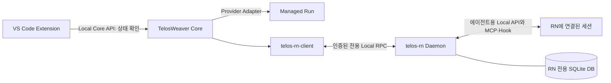

# Reason Network 사용 방식과 제거 범위

작성일: 2026-10-27

확인 기준: TelosWeaver `29008e9`, Phase 0 완료 상태

이 문서는 TelosWeaver가 Reason Network(RN)를 어떻게 사용하는지, 어떤 기능을 왜 제거했는지, 현재 확인된 범위와 남은 한계를 정리합니다. 구현 기준은 [DEVELOPMENT_v1.5.md](DEVELOPMENT_v1.5.md)의 DEC-07·§12이며, 이 문서는 설계나 지원 범위를 새로 정하지 않습니다.

아래의 **확인 사실**은 현재 코드·Git 이력 또는 저장소의 시험 기록에 근거합니다. **해석**은 해당 결정이 줄이려는 위험을 설명한 것입니다. 기존 시험 결과는 당시 기록을 인용하며, 이 문서 작성 과정에서 실환경 시험을 다시 실행하지 않았습니다.

## 1. 채택한 구성과 역할

TelosWeaver는 RN 원본을 그대로 설치해 사용하는 대신, `rn-fork/`에 도입한 Fork를 `telos-rn`이라는 별도 실행 파일로 빌드합니다. RN은 세션 탐색과 메시지 전달을 맡고, 에이전트 실행·추적·취소는 Core와 Provider Adapter가 맡습니다.

| 구분 | 역할과 현재 경계 |
|---|---|
| Core·Provider Adapter | Codex·Claude Code·Antigravity CLI 실행, Run 상태·이벤트·취소·프로세스 회수 |
| RN Fork `telos-rn` | Provider 세션 탐색, MCP·Hook으로 연결된 세션과 메시지 교환, 메시지·Receipt 저장 |
| `telos-rn-client` | Core가 RN 전용 Local RPC를 호출하는 Rust 클라이언트 |
| `telos-schema` | Core와 RN이 공유하는 RPC·Endpoint·Envelope·Receipt 계약 |
| Extension | Core에 연결해 상태 표시. 현재 RN 메시지 기능은 사용자용 Local Core API에 노출되지 않음 |

RN은 Core와 별도 프로세스·DB를 사용하며, 루트 Cargo Workspace에서도 제외됩니다. 다만 RPC 계약 타입을 재사용하기 위해 Fork가 `telos-schema`를 path dependency로 참조합니다. 프로세스와 저장소의 분리가 코드 의존성까지 전혀 없다는 뜻은 아닙니다.

근거: [Spec §3.4·§12](DEVELOPMENT_v1.5.md), [루트 Cargo.toml](../Cargo.toml), [Fork Cargo.toml](../rn-fork/Cargo.toml), [RN 변경 목록](../rn-fork/TELOSWEAVER.md).

### 1.1 원본 고정과 이름 분리

| 항목 | 값 |
|---|---|
| 원본 저장소 | `https://github.com/reason-machines/reason-network` |
| 기준 태그 | `v0.12.11` |
| 기준 Commit | `b3557ff454cd26a04c2a18804ba83ae5db8b119d` |
| 도입 | 2026-10-25, `git subtree add --prefix=rn-fork ... --squash` |
| 실행 파일·MCP 서버 이름 | `telos-rn` |
| 독립 실행 기본 상태 폴더 | `~/.telos-rn`, `TELOS_RN_HOME`으로 변경 가능 |
| Core가 시작한 RN의 상태 폴더 | `<Core 프로젝트별 상태 폴더>/rn` |
| 환경 변수 | `TELOS_RN_*`; 원본 `REASON_NETWORK_*`·`TINCAN_*` fallback 제거 |

공식 Reason Network 설치의 상태나 설정을 공유·이관하지 않습니다. 기존 `tincan` 상태 이전과 기존 설정 항목을 정리하던 코드도 제거했습니다. 원본 LICENSE·NOTICE와 출처는 유지합니다.

근거: [RN-01 도입 기록](phase-0/evidence/PH0-RN/RN-01/README.md), [RN-04 이름·상태 분리](phase-0/evidence/PH0-RN/RN-04/README.md).

## 2. Core에서 RN을 사용하는 흐름

### 2.1 시작·감시·종료

1. 운영자 정책의 `rn.executable`에 빌드된 `telos-rn`의 절대 경로를 지정합니다. Core가 RN을 자동 빌드하거나 다운로드하지는 않습니다.
2. Core는 프로젝트별 RN 상태 폴더를 정하고, 같은 폴더에서 동작 중인 RN에 접속을 시도합니다. 이미 실행 중이면 연결만 합니다.
3. 접속할 RN이 없으면 공용 프로세스 런타임으로 `telos-rn daemon`을 시작합니다. `TELOS_RN_HOME`·`TELOS_RN_HOST_ID`와 탐지된 Codex CLI 경로인 `TELOS_RN_CODEX_BIN`을 전달합니다.
4. `rpc.json`·`rpc-token`으로 RPC에 연결하고 `rn.hello`로 인증합니다. 이후 2초마다 `health.get`을 호출합니다.
5. 연결이 끊기거나 프로세스가 끝나면 `rn`을 Degraded로 표시하고 1·2·4초 간격으로 최대 3회 재시작합니다. 60초 이상 정상 상태를 유지하면 재시작 횟수를 초기화합니다.
6. Core 종료 시 자신이 시작한 RN만 정지합니다. 이미 실행 중이어서 연결만 한 RN은 정지하지 않습니다.

`rn` 정책이 없거나 RN 시작이 실패해도 Core는 동작하며 `core.health`의 `rn` 구성 요소에 사유를 표시합니다. RN 장애와 Managed Run의 추적·취소는 분리되어 있습니다. 향후 통신이 필수인 Task의 신규 실행 판단은 별도 정책 대상입니다.

근거: [Core RN 연결 코드](../crates/core/src/integration/rn.rs), [RN-07 구현·시험 기록](phase-0/evidence/PH0-RN/RN-07/README.md), [Spec §12.3·§12.5](DEVELOPMENT_v1.5.md).

### 2.2 전용 Local RPC

Core는 에이전트용 원본 Local API와 다른 Named Pipe/Unix Socket을 사용합니다. RPC 버전은 현재 `0.1`이며, 전송 형식은 NDJSON입니다.

| RPC | 용도·현재 상태 |
|---|---|
| `rn.hello` | 연결 첫 요청. 토큰 인증, RPC 버전·Host·Core 메일함 Endpoint 확인 |
| `health.get` | RN 상태, 원본·Fork Commit, RPC 버전·Host 확인 |
| `providers.list` | Connector 가용 상태와 제한 사유 조회 |
| `sessions.discover` | 이 Host의 연결·기억된 세션과 Claude 세션 목록 탐색 |
| `sessions.resolve` | Endpoint의 Host·Native Session ID·Fingerprint 확인 |
| `sessions.capabilities` | 해당 세션의 전달 Tier·회신·재개 가능 여부 조회 |
| `messages.send` | 검증된 수신 대상에 Envelope 전송, Receipt 반환 |
| `messages.status` | 저장된 Receipt 조회 |
| `messages.subscribe` | Receipt·Core 메일함 수신 메시지·Presence 이벤트 구독 |
| `providers.agy.probe` | Phase 0에서는 `refused`; Antigravity Attached 지원은 후속 범위 |

Core의 발신자는 RN 안의 `telosweaver` 메일함입니다. 세션은 이 주소로 답장하고, Core는 구독 이벤트로 답장을 받습니다. RN은 최근 이벤트 1,024개를 메모리에 보존합니다. 커서가 보존 범위를 벗어나거나 RN이 재시작하면 `resync_required`를 보내며, 클라이언트는 DB에 남은 Receipt를 조회해 상태를 다시 맞춥니다.

현재 메시지 기능은 Core 내부 Rust API에서 사용합니다. Local Core API·마스터 결정·Extension에서 메시지 송수신을 사용할 수 있다고 표시해서는 안 됩니다.

근거: [RPC 계약](../crates/schema/src/rn.rs), [RN Client](../crates/rn-client/src/lib.rs), [RN RPC 서버](../rn-fork/src/daemon/rpc.rs).

### 2.3 세션 탐색과 실제 전송의 구분

Provider 세션 목록에서 발견한 것만으로 전송 가능한 대상이 되지는 않습니다. Phase 0 Core RPC는 **해당 RN의 MCP 서버나 Hook으로 연결된 세션**에만 전송합니다.

- 목록에서 찾기만 한 세션은 `attached: false`이며, 전달 Tier가 비어 있고 전송은 `refused`입니다.
- 연결된 세션은 기본적으로 `pull`, Hook 경로가 확인되면 `turn`·`pull`을 보고합니다.
- `push`는 검증되지 않아 보고하지 않습니다. 현재 `canResume`도 `false`입니다.
- Codex의 `codex queue`는 Core가 지정한 `TELOS_RN_CODEX_BIN`만 사용합니다. `PATH`에서 임의의 Codex CLI를 찾지 않으며, 경로가 없으면 Hook 전달 경로만 남습니다.
- 원본 P2P 기능은 남아 있지만, 현재 Core Envelope의 수신자는 같은 Host로 제한됩니다.

프로젝트별 RN은 사용자가 기본 `~/.telos-rn`에 `setup`으로 연결한 기존 IDE 세션과 상태를 공유하지 않습니다. 기존 IDE 세션 연결(P1, COMM-03)이나 원격·팀 기능(P2)에 착수하기 전에 사용자 단위 공유 RN으로 바꿀지 재검토하도록 Spec에 남아 있습니다. 현재 구성에서 모든 기존 IDE 세션에 곧바로 메시지를 보낼 수 있다는 뜻은 아닙니다.

근거: [Spec §12.5](DEVELOPMENT_v1.5.md), [RPC 서버의 탐색·Capability](../rn-fork/src/daemon/rpc.rs), [Envelope 검증](../rn-fork/src/daemon/envelope.rs), [Codex 경로 제한](../rn-fork/src/agent.rs).

## 3. 보안 우려에 따른 제거 결정

**확인 사실:** DEC-07에 기록된 핵심 우려는 공개되지 않은 Reason CLI가 RN을 통해 실행되거나 업데이트로 다시 들어오는 경로입니다. v1.5에서 제거 범위는 다음 세 분류로 확정되었습니다. Provider의 비공식 세션 인터페이스를 사용하는 Claude·Codex 탐지·전달은 DEC-06의 Adapter 결정과 같은 위험 수준으로 수용했습니다.

**해석:** 이 결정은 실행 코드와 갱신 경로를 TelosWeaver가 검토·고정할 수 있도록 통제 범위를 줄이는 조치입니다. 원본에서 악성 동작이나 실제 침해가 발견되었다는 판정은 DEC-07·제거 기록에 없습니다.

### 3.1 클로즈드 소스 Reason CLI 연동

| 제거한 부분 | 원래 동작 | 현재 처리 |
|---|---|---|
| Reason 세션 동기화·전달 | 주기적으로 `reason session list --json`, 전송 시 `reason session send` 실행 | `src/daemon/reason.rs`와 호출 경로 삭제 |
| CLI 관리 Relay | `reason network __relay` 자식 프로세스 사용 | 관련 실행·관리 경로 삭제 |
| CLI 관리 설치 모드 | 실행 파일이 `~/.reason/bin` 아래면 `reason network`로 이름·동작 변경 | `managed()`와 해당 진입점 삭제; 이후 실행 이름을 `telos-rn`으로 분리 |
| Reason 에이전트 설정 | Reason 탐지·표시·`setup` 항목·`cfg.reason`·전용 회신 안내 | 관련 코드·설정·안내 제거 |

이 제거는 Reason CLI에 관한 것입니다. TelosWeaver가 사용하는 Claude·Codex CLI나 RN의 일반 Relay 기능까지 제거한 것은 아닙니다.

근거: [RN-03 제거 기록](phase-0/evidence/PH0-RN/RN-03/README.md), Git Commit `6c06b5f`.

### 3.2 자동 업데이트와 받아서 실행하는 설치 경로

| 제거한 부분 | 원래 동작 | 현재 처리 |
|---|---|---|
| 자동 업데이트 루프 | GitHub Release 확인 → 설치 스크립트 실행 → 재시작 | `src/daemon/update.rs`, `update_loop`, `auto_update` 제거 |
| `upgrade` 명령 | 설치 스크립트를 받아 실행 | 명령과 `installer()`·다운로드 실행 경로 제거 |
| 설치 스크립트 | `curl ... \| sh`, `irm ... \| iex` 방식 설치 | `install.sh`·`install.ps1`·관련 시험과 출력 안내 삭제 |
| 자기 교체·이전 | 시작 시 실행 파일 교체·tincan 설치 이전·서비스 재등록 | `src/migrate.rs`와 호출 경로 삭제 |

배포 갱신은 필요한 Upstream 수정만 선택적으로 검토하고, 제거 경로 재유입 검사·Build·Contract Test·Windows/Linux 시험을 거쳐 검증된 Fork SHA로 배포하는 방식으로 정했습니다. 원본 전체 병합과 자동 업데이트를 기본 갱신 수단으로 사용하지 않습니다.

**해석:** 실행 중 내려받은 코드가 검토·고정한 Fork를 바꾸거나, 삭제했던 Reason CLI 연동을 다시 가져오는 위험을 줄입니다. 기능을 설정으로 끈 수준이 아니라 코드와 진입점을 제거한 결정입니다.

근거: [RN-02 제거 기록](phase-0/evidence/PH0-RN/RN-02/README.md), [Spec §12.3·§12.4](DEVELOPMENT_v1.5.md), Git Commit `4c61f22`.

### 3.3 Reason 계정 로그인과 신원 증명

삭제한 부분은 `proof`·`endpoint` 명령, `init`·`join`의 `--proof`, Local API의 `Request::Proof`, 가입 프로토콜의 계정 증명, 팀의 `attestations`·`verified_people`·동일 계정 가입 경로와 verified 표시입니다. Reason 사이트 로그인 안내도 제거했습니다.

계정 증명 제거에 따라 팀원 이름은 Reason 계정으로 검증된 신원이 아닙니다. 가입은 초대 코드·팀 링크로 통제합니다. 계정 로그인 제거가 RN의 기계 키나 P2P 암호화까지 제거했다는 뜻은 아닙니다.

로그인 증명 검증에 사용하던 `proof.rs`는 삭제·분리했지만, Relay 목록의 서명을 확인하는 일반 JWS 검증은 `signed.rs`에 남겼습니다. `ring`도 이 용도로 유지합니다. 로그인 제거를 위해 Relay 목록 검증까지 없애지 않았습니다.

근거: [RN-03 로그인 제거·`ring` 조사 정정](phase-0/evidence/PH0-RN/RN-03/README.md), [서명 검증 코드](../rn-fork/src/signed.rs), [Relay 목록 코드](../rn-fork/src/relays.rs).

## 4. 함께 제거하거나 조정한 부분

다음은 DEC-07의 세 분류에 더해 설치 부작용·설정 충돌·전달 의미를 조정한 내용입니다.

| 항목 | 변경과 이유 |
|---|---|
| 자동 시작 서비스 등록 | macOS launchd, Linux systemd `--user`, Windows Run 레지스트리 등록·제거 경로 삭제. Core가 RN 수명을 관리하는 구성에 맞춤 |
| `init`·`join`의 자동 설정 변경 | 팀 생성·가입 중 MCP·Hook을 자동 연결하던 경로 제거. 에이전트 설정 변경은 명시적인 `telos-rn setup`에서만 적용 |
| 제품 이름·상태 분리 | 실행 파일·MCP·환경 변수·상태 폴더 분리. 공식 RN과 상태·설정을 섞거나 이전하지 않음 |
| 초대 출력 | 설치 실행 명령과 웹 주소 안내를 빼고 `rn1-…` 티켓·`join` 안내 사용 |
| 원본 Python E2E 9개 | 제거된 기능·원본 이름을 전제로 하므로 사용자 결정으로 폐기. 격리 Rust 시험과 Core 연동 시험을 대체 근거로 기록했으며, 원본의 모든 시나리오를 다시 검증했다는 뜻은 아님 |

`setup`의 MCP·Hook 등록 기능 자체는 유지합니다. `--dry-run`으로 변경 예정 사항을 확인할 수 있고 `--remove`로 연결을 제거할 수 있습니다. 실제 사용자 설정 변경에는 명시적 실행과 변경 소유권 보존이 필요하며, Phase 0 실제 설정 시험의 사전 확인·Backup·Diff·복원 규칙은 Spec §12.3을 따릅니다. RN-08은 실제 사용자 설정 대신 격리 임시 홈에서 적용·제거를 확인했습니다.

근거: [RN-02](phase-0/evidence/PH0-RN/RN-02/README.md), [RN-04](phase-0/evidence/PH0-RN/RN-04/README.md), [RN-08](phase-0/evidence/PH0-RN/RN-08/README.md), [E2E 폐기 사유](../rn-fork/tests/e2e/README.md).

### 4.1 메시지 수신 확인과 세션 식별 보강

- **전달 상태 구분:** 에이전트 Inbox·Queue에 넘긴 성공은 `queued`입니다. Hook·Inbox가 메시지를 수신측에 보여 주었거나 세션 Transcript에서 메시지를 확인한 경우에 `delivered`로 바꿉니다. 사람이 읽고 이해했는지, 도구가 실행되었는지, Task가 완료되었는지까지 보장하지 않습니다.
- **주소 재바인딩:** 저장된 대상 세션과 현재 주소를 가진 세션이 달라지면 자동 전달하지 않고 `held`로 보류합니다. 사람이 승인하면 현재 주소 소유 세션으로 전달됩니다.
- **Endpoint:** `hostId`·`provider`·`nativeSessionId`와 이 필드로 계산한 Fingerprint를 사용합니다. Workspace는 Fingerprint에 포함하지 않습니다. Fingerprint는 계정 인증이나 서명이 아니라 세션·Host 혼동을 막기 위한 식별값입니다.
- **중복·기한:** 같은 발신자 Fingerprint·멱등 키의 동일 Envelope는 기존 Receipt를 돌려주고, 내용이 다르면 거부합니다. TTL 상한은 7일이며, 최종 상태 후 7일이 지난 메시지·Receipt·멱등 키는 정리 대상입니다.
- **저장소:** DB Migration 전에 백업하고 최근 3개를 유지합니다. 백업 실패나 더 높은 DB 스키마 버전은 거부합니다. 현재 `sessions.wired`를 포함한 스키마 버전은 2입니다.

근거: [RN-05 메시지·정체성·저장소 기록](phase-0/evidence/PH0-RN/RN-05/README.md), [RN-06 스키마·연결 구분](phase-0/evidence/PH0-RN/RN-06/README.md), [Envelope 코드](../rn-fork/src/daemon/envelope.rs), [저장소 코드](../rn-fork/src/store.rs).

## 5. 유지한 기능과 남아 있는 보안 경계

### 5.1 네트워크·Relay·팀·초대

**확인 사실:** P2P·Relay·팀·초대 코드는 유지되어 있습니다. 팀에 가입하지 않은 Daemon은 네트워크를 시작하지 않고 Relay 목록도 조회하지 않습니다. Reason 기본 Relay를 사용하는 팀에서는 서명된 목록을 `https://reasonmachines.com/network/relays.json`에서 조회하는 경로가 남아 있습니다. 자체 Relay를 지정한 팀은 이 목록 갱신 경로를 사용하지 않습니다.

Relay 목록은 HTTPS로 받아 고정 공개 키로 서명을 검증하는 데이터입니다. 자동 업데이트·설치 스크립트 다운로드와 용도가 다르며, 코드에는 이 목록을 가져오는 `curl` 호출도 남아 있습니다. 따라서 모든 다운로드·외부 통신 또는 Reason 도메인 의존성이 제거되었다고 설명할 수는 없습니다.

프로토콜 식별자(`tincan/1`, `tincan/join/1`, `rn1-` 티켓 형식 등)와 Relay 목록 서명 형식도 유지합니다. 원본과 혼합한 팀의 호환성이나 팀 가입·중계 사용 중의 통신을 Phase 0에서 검증한 것은 아닙니다.

근거: [네트워크 코드](../rn-fork/src/net.rs), [Relay 갱신 조건](../rn-fork/src/daemon/mod.rs), [Relay 목록 검증·조회](../rn-fork/src/relays.rs), [RN-04](phase-0/evidence/PH0-RN/RN-04/README.md).

### 5.2 Local RPC의 접근 통제와 한계

RN은 시작할 때마다 새 32바이트 난수 토큰을 생성하고 `rpc-token`에 저장합니다. Windows는 현재 사용자 SID만 허용하는 DACL, Unix는 Socket·토큰 `0600`을 적용하며, 보호 설정 실패 시 RPC를 열지 않습니다. `rn.hello` 이전 요청이나 잘못된 토큰은 거부합니다. Windows Client는 Named Pipe 서버 PID도 `rpc.json`의 PID와 대조합니다.

이 경계는 같은 OS 사용자로 실행되는 다른 프로세스까지 격리하지 않습니다. 같은 사용자의 프로세스는 토큰 파일과 에이전트용 원본 Local API에 접근할 수 있습니다. 또한 RN 메시지 수신 허용은 Core 정책의 도구 실행 승인을 대신하지 않습니다.

Claude·Codex 세션 탐지·전달은 Provider 내부 구조나 비공식 인터페이스에 의존합니다. 기능을 유지하기로 한 결정과 특정 버전에서의 실환경 검증은 구분해야 하며, Provider 업데이트 후 호환성은 다시 확인해야 합니다.

근거: [RPC 계약의 접근 경계](../crates/schema/src/rn.rs), [권한 처리](../rn-fork/src/private.rs), [RN Client PID 검사](../crates/rn-client/src/lib.rs), [Spec DEC-07·§12.2](DEVELOPMENT_v1.5.md).

## 6. 검증된 범위와 미검증 범위

다음은 2026-10-25~26에 저장소에 기록된 결과입니다. 초기 RN-06·07 문서의 Linux 미검증 상태는 이후 RN-08·INTEGRATION의 Linux 결과로 보완되었습니다.

| 항목 | 기록된 확인 범위 | 한계 |
|---|---|---|
| 제거 경로 | 소스 검색·호출 검토, 의존성 검토, Windows 바이너리 리터럴 검사 | 문자열 검색은 간접 호출을 완전히 배제하는 증명이 아님. Linux 바이너리 문자열 미검사 |
| RN Fork 시험 | 격리 Windows 204개, Linux `psyki-nas` 212개 통과; 엄격 Clippy·fmt 통과 | 당시 코드·환경의 결과 |
| 격리 Daemon 관찰 | Windows/Linux에서 자식 프로세스·외부 연결 0건, 사용자 전용 Pipe/Socket·토큰 권한 확인 | 팀 미가입 상태에서 2~3초 관찰. 팀 가입·Relay 사용 중 통신은 범위 밖 |
| 설정 변경 | 격리 임시 홈에서 `setup --dry-run`·`setup`·`setup --remove` | 모든 실제 사용자 설정 조합에 대한 보장은 아님 |
| 실제 Claude 메시지 왕복 | RN-06에서 연결된 Claude 세션에 전송·다음 Turn Hook 표시·Receipt 전이·답장 이벤트 확인; 미연결 세션 전송 거부 | 통제된 세션·검증 버전 기준. 임의 IDE 세션·push 일반화 불가 |
| Core RN 연결 | 실제 메일함 왕복·Receipt 보존·재시작·Core 종료 시 정지, RN 장애 중 실제 Claude Run 추적·취소·프로세스 회수 | 기존 RN에 연결만 하는 경로와 재시작 상한의 연속 실패는 RN-07에서 실환경 미시험 |
| Linux·Remote SSH | Linux `phase0_rn` 실환경 2개; Remote SSH에서 Linux Core 동작 확인 | Remote SSH에서 RN 자체를 별도로 시험하지는 않음 |

RN-08 문서에는 제거가 “완벽히 입증”되었다는 표현이 있지만, 최종 통합 검토는 위 관찰·검사 범위로 한정해 수용했습니다. 이 문서도 해당 한계를 따릅니다.

미지원·미검증인 핵심 후속 범위는 메시지 기능의 Local Core API 노출, 기존 IDE 세션 연결, Managed Run의 RN 주소 노출, 사용자 단위 공유 RN 결정, Antigravity Attached, `push`, 원격·팀 통신 검증입니다. Artifact 참조는 현재 Envelope 전송에서 거부합니다.

근거: [RN-06 실제 Claude 왕복](phase-0/evidence/PH0-RN/RN-06/README.md), [RN-07 실제 Core 연결](phase-0/evidence/PH0-RN/RN-07/README.md), [RN-08 제거 검증](phase-0/evidence/PH0-RN/RN-08/README.md), [최종 통합 검토 §9.4·§9.7](phase-0/evidence/PH0-INTEGRATION/README.md), [G3 수용 대조표](phase-0/evidence/PH0-INTEGRATION/G3_ACCEPTANCE.md), [지원 백로그 SB-19](SUPPORT_BACKLOG.md).
