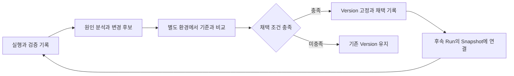

# Harness 논문 2편 분석과 TelosWeaver 적용 검토

- 검토일: 2026-11-15 (KST)
- 저장소 기준: `29077ee`, 작업 시작 시 변경 사항 없음
- 구현 기준: `docs/DEVELOPMENT_v1.5.md` v1.5.11
- 문서 성격: 연구 검토와 적용 제안. 기준 Spec, H0 판정, 작업 배정, 지원 기능을 변경하지 않습니다.
- 표기: **논문 보고**는 저자가 제시한 결과, **저장소 확인**은 현재 파일에서 확인한 사실, **적용 제안**은 이를 바탕으로 한 설계 판단입니다. 논문의 실험을 재현하거나 Provider를 실환경에서 실행하지 않았습니다.

## 1. 판단 요약

두 논문을 함께 적용하면, TelosWeaver가 먼저 갖춰야 할 것은 **변경 효과를 비교할 수 있는 실행 기록과 검증 경계**입니다. 그 위에서 문맥 구성, 계획 전달, 재사용 지식, Workflow를 점진적으로 개선할 수 있습니다.

첫 논문은 기능의 유무보다 모델·작업·문맥 예산에 맞는 구성이 중요함을 실험으로 보여줍니다. 두 번째 논문은 실행 경험을 다음 실행에 반영하는 과정에서 후보 생성, 검증, 채택, 버전 관리가 필요함을 정리합니다. 두 논문 모두 복잡한 harness 자체가 성능을 보장한다고 주장하지 않습니다.

TelosWeaver의 기존 ContextSnapshot, Capsule, UsageRecord, Artifact Version, ValidationJob, ApprovalDecision은 이 방향과 잘 맞습니다. 다만 상당 부분이 H0 계약 단계이므로, 현재 동작하는 기능과 앞으로 구현할 기능을 구분해야 합니다.

우선순위 제안은 다음과 같습니다.

1. Phase 1/P0에서는 기존 계약에 따라 필요한 입력, 출처, Capsule, 사용량, 검증 결과를 구현하고 비교 가능한 증거를 남깁니다.
2. Phase 2/P1에서는 검토된 KnowledgeEntry와 버전이 있는 Workflow Template의 재사용을 구체화합니다.
3. 성능 기반 자동 라우팅, 실행에서 템플릿을 자동 추출하는 기능, Core 실행 코드를 자동 수정하는 기능은 기존 P2 또는 별도 후속 연구로 다룹니다.

## 2. 자료와 분석 범위

| 구분 | 논문 | 제공 파일 | 분석 근거 |
|---|---|---|---|
| A | An Empirical Study of Harness Design for Coding Agents | [2609.20804v1.pdf](../archive/2609.20804v1.pdf), 43쪽 | 본문 §2~4, Tables 3~7, Limitations, Appendix A·C |
| B | Self-evolving Agent Harness | [2610.18813v1.pdf](../archive/2610.18813v1.pdf), 18쪽 | 본문 §2~6, Tables 2~4, 식 (5)~(9), Appendix A |

서지 정보는 [A의 arXiv 페이지](https://arxiv.org/abs/2609.20804v1)와 [B의 arXiv 페이지](https://arxiv.org/abs/2610.18813v1)에서도 확인했습니다. 구체적인 수치와 해석의 기준은 사용자가 제공한 로컬 v1 PDF입니다.

B의 초록에 나오는 66쪽 보고서는 제공된 18쪽 PDF와 별개의 companion report입니다. 이번 분석은 그 별도 보고서를 읽은 것으로 간주하지 않습니다. 관련 연구에서 인용한 성능 수치도 원 연구를 독립 재현한 결과로 취급하지 않습니다.

논문 A의 부록에 수록된 system prompt와 tool-use instruction은 실험 방법을 설명하는 자료로 분석했으며, 이 작업의 지시로 적용하지 않았습니다.

## 3. 논문 A: 구성 요소별 효과를 분리한 실험

### 3.1 무엇을 검증했는가

**논문 보고:** 실행 루프를 고정하고 planning, action space, context management를 바꾸었습니다. Nemotron-3 30B·120B·550B와 Mistral-Medium-3.5-128B를 SWE-Bench Verified 500개 작업, Terminal-Bench 2.1 89개 작업에 평가했습니다.

문맥 전략 5개와 window 4개(32k·64k·96k·128k)를 조합하고, T4/128k에서 planning 제거 및 bash-only 조건을 추가해 총 176개 설정을 비교했습니다. 이는 176개 독립 작업을 뜻하지 않습니다. 각 설정에서 작업당 실행은 1회입니다. 성공률 비교에는 작업별 paired outcome을 사용한 exact McNemar test와 Benjamini-Hochberg 보정을 사용했습니다(pp. 6~8).

Planning은 모델이 `update_plan`으로 관리하는 현재 계획을 매 Turn 다시 제공하는 장치입니다. 과거 계획 복사본을 계속 대화 이력에 누적하지 않습니다. TelosWeaver의 여러 Task를 조율하는 마스터 계획이나 멀티 에이전트 구조 자체를 검증한 실험은 아닙니다.

### 3.2 문맥 관리: 먼저 저렴하게 줄이고, 필요한 경우 요약

| 전략 | 구성 |
|---|---|
| T0 | 추가 문맥 축약 없음. Window 초과 시 종료 |
| T1 | 오래된 tool observation 본문을 짧은 표시로 대체 |
| T2 | T1에 원본 외부 저장과 `recall_event` 추가 |
| T3 | LLM 요약만 사용 |
| T4 | 낮은 임계값에서 생략·외부 저장, 이후에도 크면 LLM 요약 |

**논문 보고:** T1~T4와 T0의 성공률 차이는 SWE-Bench에서 32k일 때 평균 35.7%p, 128k일 때 2.7%p입니다. T0의 window-overflow 비율은 같은 범위에서 78.7%에서 8.7%로 줄었고, 관리 전략에서는 실험한 모든 조건에서 overflow가 0건이었습니다. 주된 효과는 작업이 문맥 부족으로 조기 종료되는 것을 막는 데 있습니다(pp. 7~9).

T4는 네 window를 종합한 8개 모델·벤치마크 조합 중 7개에서 관리 전략 중 가장 낮은 평균 비용을 보였습니다. 모든 개별 조건에서 성공률과 비용이 최적이라는 뜻은 아닙니다. 문맥 관리로 더 오래 실행하게 되면 T0보다 총비용이 늘기도 합니다. 조기 실패가 저렴하다는 이유로 효율적이라고 판단하면 안 됩니다.

실험에서 T4의 soft/hard threshold는 usable window의 0.6/0.85, 최근 원문 유지 예산은 0.3이며 최소 두 Turn을 보존했습니다. 이 수치는 해당 구현의 실험 설정입니다. TelosWeaver의 기본값으로 검증된 값이 아닙니다. 또한 T1~T3는 높은 임계값에서 작동하므로 T4의 이점에는 개입 시점의 차이도 포함됩니다.

**적용 제안:** Core가 구성하는 입력에서는 중복과 오래된 큰 출력을 먼저 제거하고, 남은 내용이 여전히 크면 Capsule 요약을 검토합니다. 필수 지침, 현재 Task 계약, 유효한 근거 참조, 미해결 실패를 보호해야 합니다. 이 접근은 T4에서 착안한 제안이며, recall을 제외한 동일한 두 단계 조합의 효과를 논문이 별도로 입증한 것은 아닙니다.

### 3.3 Recall: 사용 빈도와 보존 의무를 구분

**논문 보고:** T1과 T2의 32개 대응 비교에서 T2는 15개에서 높고, 14개에서 낮고, 3개에서 같았습니다. 평균 성공률 차이는 -0.36%p입니다. Recall이 가능한 T2/T4 64개 설정 중 36개에서는 호출이 전혀 없었으며, T4/128k의 planning·action-space 비교 조건에서도 호출이 없었습니다(pp. 8~9, Table 13).

**적용 제안:** P0에서 모든 대화 이벤트를 재검색하는 전용 memory 시스템을 우선 구축할 근거는 약합니다. 기존 Artifact 참조와 필요한 원본을 읽는 경로부터 구현하는 편이 적절합니다.

그러나 이 결과는 감사 로그, 실패 출력, Artifact 원본을 삭제할 근거가 아닙니다. 모델이 자발적으로 사용하는 recall 도구의 효용과, 검증·조사·복구에 필요한 증거 보존은 목적이 다릅니다. 부작용이 있는 명령을 원본 복구 목적으로 다시 실행해서도 안 됩니다.

### 3.4 Planning: 작업 지속과 종료 판단에 서로 다른 효과

**논문 보고:** SWE-Bench T4/128k에서 Nemotron-3 30B는 planning을 켜면 성공률이 13.6%에서 25.2%로 높아졌지만 평균 비용도 $0.02에서 $0.09로 증가했습니다. 편집 없이 끝난 비율은 68.6%에서 27.8%로 감소했습니다.

반면 Nemotron-3 550B는 성공률이 67.8%에서 65.8%로 낮아지고 평균 비용이 $3.31에서 $2.33으로 감소했습니다. Mistral도 성공률은 69.0%에서 68.6%, 비용은 $4.65에서 $3.14로 변했습니다. 저자는 강한 모델의 비용 감소를 주로 편집 후 검증 단계의 반복 감소로 설명합니다(pp. 9~14, Tables 3·5·6).

**적용 제안:** 마스터가 이미 아는 전체 이력을 Worker에게 반복 전달하기보다 현재 목표, 완료 기준, 남은 항목, 다음 행동을 간결하게 전달합니다. 계획의 효과를 성공률과 비용 양쪽에서 측정해야 합니다.

이 결과를 필수 검증 생략이나 자동 완료 판정의 근거로 사용하면 안 됩니다. Planning-on 조건에서도 일부 성공률 하락이 있었고, 논문은 TelosWeaver의 Validation Contract를 평가하지 않았습니다.

### 3.5 Action space: 모델 크기보다 실제 도구 적합성

**논문 보고:** SWE-Bench T4/128k에서 Nemotron-3 550B는 구조화 도구에서 bash-only로 바꾸면 성공률이 65.8%에서 69.4%, 비용이 $2.33에서 $1.11로 변했습니다. 같은 변경에서 Mistral은 성공률이 68.6%에서 45.4%로 떨어졌습니다. Mistral의 Terminal-Bench 결과는 반대 방향으로, 37.08%에서 43.82%로 높아졌습니다(Tables 3·4).

따라서 강한 모델이면 언제나 shell-only가 낫다고 해석할 수 없습니다. 약한 모델의 일부 실패는 노출되지 않은 도구 이름을 계속 호출하는 interface mismatch에서 발생했습니다.

도구 비교는 도구 수만 바꾸지 않았습니다. Prompt, file-state tracking, read-before-write, 자동 진단 경로도 함께 달라집니다. Bash로 수정한 파일은 구조화 편집 도구의 상태 추적·자동 진단 경로를 거치지 않습니다(§2.2, Appendix B.1). 따라서 결과를 같은 안전·진단 조건에서의 순수한 호출 수 효과로 볼 수 없습니다.

**적용 제안:** Worker에 추가하는 Task MCP와 지침은 역할에 필요한 범위로 제한하고, 실제 Provider 지원 범위와 일치시킵니다. TelosWeaver가 외부 CLI의 기본 파일 도구 전체를 교체할 수 있다고 전제해서는 안 됩니다. 도구 구성을 비교하려면 실제로 제어 가능한 범위와 함께 평가해야 합니다.

### 3.6 근거의 한계

- Planning과 action space는 T4/128k에서만 비교했습니다. 모든 구성의 상호작용을 검증한 full factorial 실험이 아닙니다.
- 설정별 작업당 실행 1회이며 Terminal-Bench는 89개여서 다수 차이가 통계적으로 유의하지 않습니다.
- SWE-Bench는 Python 작업입니다. Rust·TypeScript·문서 작업, Windows PowerShell, 외부 상용 CLI에 대한 직접 근거는 없습니다.
- 모델 크기는 능력의 불완전한 대리 지표입니다. 도구 학습과 shell 숙련도 차이가 섞여 있습니다.
- 행동 단계 분석은 LLM judge를 사용했습니다. Appendix C.2는 200개 trajectory, 15,610개 label unit에서 인간과의 비교를 보고하지만, 실제 제품에서 실패 원인을 완전히 자동 판정할 수 있다는 뜻은 아닙니다.

## 4. 논문 B: 지속되는 변경을 어떻게 검증하고 채택할 것인가

### 4.1 핵심 정의

**논문 보고:** 모델 가중치를 고정한 채 실행 피드백으로 harness의 prompt·memory·workflow·도구·실행 코드를 수정하고, 채택한 변경을 후속 Run에서 다시 사용하며, 이후에도 수정 기회를 유지하는 과정을 self-evolution으로 정의합니다(§2, pp. 2~3).

로그를 저장하는 것, 고정된 규칙으로 문맥을 요약하는 것만으로는 이 정의를 충족하지 않습니다. 재사용 절차를 학습하거나 memory 정책 자체를 바꾸는 것은 해당할 수 있습니다. 사람이 채택을 승인하는 구조도 정의에서 배제하지 않습니다.

**적용 제안:** TelosWeaver에서 다음 세 가지를 별도 기록으로 다룹니다.

| 대상 | 의미 | 필요한 근거 |
|---|---|---|
| 현재 Task의 재작업 | 같은 목표의 실패를 수정 | 대상 Version과 검증 결과 |
| 재사용 후보의 생성 | 다음 작업에서 쓸 지식·Workflow·코드 변경을 제안 | 원인 진단, 출처 Run, 적용 조건 |
| 후보의 채택과 효과 확인 | 후속 실행에서 실제로 사용하고 성능 비교 | 채택 Version, 비교 결과, 적용 Run |

수정이 지속된다는 사실과 성능이 개선됐다는 주장은 별개입니다. 후보가 한 번 채택됐다는 사실만으로 일반화나 장기 개선을 주장하지 않습니다.

### 4.2 수정 대상과 채택 장치를 분리

**논문 보고:** 해석되는 상태의 변경과 실행 구성 요소의 변경을 구분합니다. 고정된 operator를 조합하는 Workflow 변경과 operator 구현·runtime coordination의 변경은 영향 범위가 다릅니다. Plugin은 교체·조합의 경계를 정하는 방식이며, 인터페이스 호환만으로 결합 동작의 안전성이 입증되지 않습니다(§3).

**적용 제안:** 초기 재사용 대상은 프로젝트 범위의 KnowledgeEntry와 Workflow Template로 한정하고, Core의 scheduler·권한 판단·복구 로직 수정은 별도 개발 변경으로 다룹니다. 기존 Trait 경계를 유지하면서 구현을 교체할 수는 있지만, 각 구현의 단위 검사와 최종 조합의 통합 검사를 함께 수행해야 합니다.

별도 plugin framework나 새 crate를 지금 도입해야 한다는 근거는 아닙니다. 현재 `Arc<dyn Trait>` 서비스 경계로 가능한 비교부터 수행할 수 있습니다.

### 4.3 평가자와 채택 근거를 수정 대상 밖에 유지

**논문 보고:** 최종 평가자 J는 candidate가 수정할 수 없습니다. 내부 critic이나 임시 검사는 바꿀 수 있어도 최종 판정과 결과 기록은 그 변경 범위 밖에 둡니다. 평가자 보호만으로 specification gaming이 해결되지는 않으며, 독립적인 실행 검사나 사람의 평가가 필요합니다(§2, §6.4).

**적용 제안:** 후보를 만드는 Worker에게 최종 검증 명령, 정답 데이터, 기준 harness, 승인 기록을 수정할 권한까지 부여하지 않습니다. 사용자 프로젝트 테스트를 수정하는 작업 자체가 금지되는 것은 아니지만, 그 수정된 테스트만으로 개선을 입증하지 않습니다.

검증 후 후보를 수정하거나 둘 이상의 후보를 합치면 새로운 평가 대상입니다. 기존 Artifact Version에 대한 검증·승인을 새 조합에 재사용하지 않습니다.

### 4.4 PAC 분석이 주는 실무적 의미와 한계

**논문 보고:** 식 (5)는 전체 업데이트 과정의 stability를 전제로 기대 일반화 간극을 제한합니다. 작은 코드 변경 자체가 stability를 보장하지 않습니다. 식 (6)의 과거 능력 유지 경계는 별도의 historical regression budget 가정에 의존하고, 허용한 퇴행은 누적됩니다.

식 (8)은 후보 생성과 독립적인 새 검증 작업을 사용하고, 모델·평가자를 고정하며, 비교 횟수를 통제하는 조건에서 다음 채택 규칙을 제시합니다. 손실은 낮을수록 좋습니다.

```text
손실 차이의 상한 = 관측 평균 손실 차이 + sqrt(2 * ln(K*T/delta) / m)
상한 < 0인 후보만 개선으로 채택
```

여기서 K는 round당 최대 후보 수, T는 round 수, m은 round당 독립 검증 작업 수, delta는 전체 실패 확률 상한입니다. 이 결과는 과거 작업 분포의 혼합에 대한 보장입니다. 임의의 미래 작업, 각 OS·Provider별 성능, 실제 목표와 다른 judge 점수까지 자동 보장하지 않습니다(pp. 7~8).

**적용 제안:** 개발용 회귀 세트를 반복 사용해 후보를 탐색할 수는 있지만, 이를 독립적인 최종 채택 증거와 구분합니다. 같은 holdout을 보면서 수정한 후보에는 새 검증 자료 또는 적응적 재사용에 맞는 별도 통계 방법이 필요합니다.

같은 작업을 여러 번 실행하는 것은 실행 잡음을 추정하는 데 유용하지만 독립 작업 수 m을 그 횟수만큼 늘리지 않습니다. 같은 저장소·세션에서 파생한 작업도 독립으로 단정하지 않습니다. 그룹별 결과는 혼합 평균과 따로 확인합니다.

**계산 예시:** K=5, T=10, delta=0.05, m=100이면 위 불확실성 항은 약 0.372입니다. 관측 개선 5%p를 이 단순 경계로 인증하려면 항이 0.05보다 작아야 하므로 m은 5,526을 초과해야 합니다. 이는 논문의 실험 결과가 아니라 식 (8)을 대입한 계산입니다. 작은 PoC에 이 보수적 보장을 충족했다고 표시해서는 안 됩니다.

초기 제품에서는 관측된 효과, 불확실성, 검토에 따른 제한적 채택을 기록하는 것이 현실적입니다. 비용 절감 목적의 비열등성 채택은 품질 허용 오차와 비용 기준을 사전에 따로 정해야 하며, 위의 엄격한 품질 개선 규칙과 동일하지 않습니다.

### 4.5 사례 수치의 해석

**논문 보고:** Table 2는 다른 연구의 SpreadsheetBench 결과를 인용해 모델과 harness 조합의 중요성을 설명합니다. 저자도 이를 동일 비용에서의 우위로 주장하지 않습니다. Table 3의 plugin 사례는 첫 작업에서 도구 호출이 13회에서 3회로 줄었지만 시간은 54.9%, 토큰은 15.7% 증가했습니다. 첫 작업 비용과 누적 비용 보고 사이의 불일치도 명시합니다(pp. 4~6).

따라서 B는 새로운 범용 self-evolution 시스템의 통제 실험으로 성능 향상을 입증한 논문으로 읽기보다, 분류·이론·시스템 설계 논문으로 읽는 것이 적절합니다.

**적용 제안:** 도구 호출 수 감소만으로 최적화 성공을 선언하지 않습니다. 재사용 도구나 Workflow의 경제성은 생성·평가·수정·유지 비용까지 포함해 판단합니다. 같은 단위로 비용을 측정할 수 있을 때의 단순 손익분기 조건은 다음과 같습니다.

```text
재사용 횟수 * (기준 실행 비용 - 변경 후 실행 비용)
  > 후보 생성 비용 + 검증 비용 + 유지 비용
```

CLI 구독 사용량을 정확한 금액으로 바꿀 수 없으면 토큰·시간·호출 수를 별도로 비교합니다. 서로 다른 단위를 임의로 더하거나 품질이 낮아진 결과를 같은 성과로 세지 않습니다.

## 5. TelosWeaver와 대조한 확인 사항

| 현재 근거 | 저장소 확인 | 적용 시 의미 |
|---|---|---|
| `README.md`, `docs/phase-1/WORK_ALLOCATION.md` | Phase 0 완료, H0는 사용자 판정 대기. 관련 Phase 1 작업은 미배정 | 논문 분석으로 게이트를 통과하거나 구현 범위를 늘리지 않음 |
| `crates/core/README.md`, 각 모듈 `mod.rs` | Context·Validation·Artifact·Persistence·Scheduler 등은 H0 서비스 인터페이스 | 타입 존재와 실제 기능 지원을 구분 |
| Spec §6.1~6.2, `schema/src/context.rs` | ContextSnapshot에 지침·자료 신뢰 구분, 입력 Version, 선택 이유·제외 범위·계약 Digest 존재 | 압축 과정에서도 출처와 필수 입력을 유지할 기반 |
| Spec §8.1~8.2, `CapsuleContent` | 목표·결정·근거·제약·미해결 질문·원본 출처/생략 범위 계약 존재 | Provider 간 인계와 긴 이력 축소에 활용 가능 |
| Spec §8.3, `UsageRecord`, `UsagePayload` | 마스터·Worker·Validator 역할, 누적/증분, cache 포함 여부, Unknown 구분 | 구성별 품질·자원 비교의 기반 |
| Spec §11, `ValidationJob`, `ApprovalDecision` | 계약 Revision·대상 Version 고정, 후보 변경 시 재검증·재승인 | 후보 채택의 근거와 적용 대상을 연결 가능 |
| Spec §16.1~16.2 | KnowledgeEntry와 Workflow Template는 P1, 자동 템플릿 추출은 P2 | 지속 개선의 대상과 기존 단계가 이미 정의됨 |
| `adapters/src/lib.rs`의 `AgentAdapter` | Run 시작·이벤트·입력·승인·취소·조회가 공통 경계 | 내부 모델 호출마다 transcript를 교체하는 공통 API는 없음 |
| `schema/src/events.rs` | ToolStarted/Completed 공통 필드는 이름·선택 summary·outcome 중심 | 공통 이벤트만으로 동일 인자의 반복 호출을 정확히 검출할 수 없음 |

### 5.1 가장 중요한 경계: 외부 CLI의 내부 루프

A는 매 모델 호출의 prompt, history, tool registry를 직접 소유합니다. TelosWeaver는 Codex·Claude Code·Antigravity의 외부 CLI를 관리합니다. 현재 공통 Adapter 계약에서 내부 transcript 전체를 재작성하거나 기본 tool registry를 일괄 교체하는 수단은 확인되지 않습니다.

따라서 아래 두 적용 범위를 나눠야 합니다.

1. **Core가 제어하는 범위:** Run 시작 입력, Task 계약, 필수 자료 선택, Capsule, 마스터 후속 Turn에 주는 결과 요약, Task MCP 노출, 재작업·새 Run 결정.
2. **Provider별 검증이 필요한 범위:** Run 내부의 매 Turn compaction, native planning tool 제어, 기본 파일 도구 제거, 내부 tool observation 교체.

첫 범위부터 구현할 수 있습니다. 둘째 범위는 Provider별 수단·옵션·실환경 검증 없이는 지원으로 표시하지 않습니다. Core 입력이 작아졌다는 사실만으로 native session의 overflow까지 막았다고 주장하지 않습니다. 새 공통 Capability나 필드가 필요하면 Spec·계약 변경 요청으로 처리합니다.

## 6. 적용 제안

### 6.1 Capsule을 자유 요약이 아닌 검증 가능한 인계 자료로 구성

**우선순위:** Phase 1/P0의 PH1-CONTEXT·ARTIFACT·MASTER. 관련 요구사항: CTX, SESS-06/07, E2E-13.

기존 `CapsuleContent` 필드 안에서 다음 작성 원칙을 적용하는 방안을 권합니다.

- `goal`: 현재 Task의 목표와 완료 조건을 보존합니다.
- `decisions`: 확인된 결정과 아직 추정인 설명을 문장으로 구분합니다. 요약자의 추론을 승인으로 바꾸지 않습니다.
- `evidence`: 최종 파일 경로만 적지 않고 고정 Artifact Version을 참조합니다.
- `constraints`: 권한·쓰기 범위·필수 검증을 유지합니다. 현재 Task의 계약과 충돌하면 계약을 우선 확인합니다.
- `openQuestions`: 미해결 실패, 검증되지 않은 주장, 다음 Run이 확인할 사항을 남깁니다.
- `sourceSummary`: 원래 Run·Session·근거 범위와 무엇을 생략했는지 기록합니다.

압축 전후 같은 필수 입력·제약·실패 근거를 찾을 수 있는지 검토합니다. 누락을 발견하면 필수 자료를 다시 넣거나 해당 실행을 보류합니다. 요약이 성공했다고 가정하지 않습니다.

새 필드를 추가하지 않아도 작성 정책과 시험 자료를 정리할 수 있습니다. 실제 구현은 H0 판정과 작업 배정을 따르며, 구조화된 추가 필드가 필요하면 계약 변경으로 처리합니다.

### 6.2 계획은 현재 상태를 전달하고 검증 완료를 근거와 연결

**우선순위:** Phase 1/P0의 PH1-MASTER·CONTEXT·SCHED·VALIDATION.

Worker 입력에 현재 목표, 출력·검증 계약, 완료된 항목의 근거, 남은 항목, 다음 행동을 전달합니다. 이미 전달한 전체 Worker 대화와 예전 계획을 매번 반복하지 않습니다. Canonical Task 상태는 Core가 소유하고, Worker의 서술은 완료 판정의 입력으로만 사용합니다.

반복 검증을 줄이려면 먼저 동일 대상에 대한 유효한 결과를 조회합니다. 재사용 여부를 검토할 때 대상 Revision, Validation Contract, 실제 명령·인자, 의존성·환경 등 결과에 영향을 주는 조건이 같아야 합니다. 현재 계약만으로 모든 조건을 표현·확인할 수 없으면 안전하게 재검증하거나 별도 계약 변경을 제안합니다. 필수 최종 통합 검사를 임의로 건너뛰지 않습니다.

논문 A의 계획 도구를 외부 CLI 안에 중복 주입하기보다 Core가 제공하는 Task 상태와 해당 CLI의 native planning이 충돌하지 않는지부터 확인하는 편이 적절합니다.

### 6.3 실패가 반복될 때 재작업의 변화를 확인

**우선순위:** 기존 예산·재시도·재작업 요구사항을 구현하는 Phase 1/P0. 정확한 내부 tool-call 검출은 별도 검증 대상입니다.

A의 stuck detection은 동일 도구·byte-identical 인자를 기준으로 5회 경고, 동일 실패 8회 종료라는 실험 설정을 사용했습니다. TelosWeaver에 이 숫자를 그대로 적용할 근거는 없습니다.

공통 tool 이벤트에는 정확한 인자가 없으므로 summary가 비슷하다는 이유로 동일 호출이라고 단정하지 않습니다. 우선 Core가 확인할 수 있는 Task Revision·대상 Artifact·검증 계약·실패 근거와 재작업 결과를 대조합니다. 같은 실패가 이어지면 다음 시도에서 무엇이 바뀌는지 마스터가 설명하게 하고, 기존 재작업 한도 안에서 다른 접근·명시적 중단·필요한 질문을 선택합니다.

파일이 바뀐 뒤 같은 테스트를 다시 실행하는 경우, 인자는 같아도 유효한 재검증일 수 있습니다. 일시적 네트워크 실패, 대기 상태 확인, 사용자 승인 대기는 일반적인 무진전 반복과 구분해야 합니다.

### 6.4 측정 가능한 실행 단위부터 고정

**우선순위:** Phase 1/P0의 PH1-PERSIST·HOST·CONTEXT·VALIDATION, 통합 검증.

기존 ID와 Digest를 활용해 Run, ContextSnapshot, 실제 Provider/CLI 버전, Task/Plan Revision, 입력 Artifact, 사용량, ValidationJob을 연결합니다. 기능 추가 전에 실행 기록을 비교할 수 있어야 합니다.

현재 공통 이벤트로 얻을 수 없는 peak native context, 정확한 중복 인자 호출 수, 내부 요약 횟수는 Unknown으로 표시합니다. 원본 Provider 이벤트에서 얻는다면 출처와 버전별 의미를 검증하고, 공통 스키마가 필요하면 변경 절차를 거칩니다. 기능 호환성을 확인하는 CapabilityEvidence와, 특정 workload에서 성능이 좋았다는 비교 증거는 구분합니다.

### 6.5 KnowledgeEntry와 Template에 채택·철회 근거 연결

**우선순위:** Phase 2/P1의 KNOW-01~03·TPL-01/02 구체화. 자동 Template 추출 TPL-03은 Phase 3/P2를 유지합니다.

지식 후보는 출처 Run·Artifact, 적용 프로젝트·작업·Provider/환경 조건, 확인된 내용과 추론, 검토자, 대체·폐기 관계를 가집니다. 잘못된 임시 해결책을 전역 규칙으로 확장하지 않습니다. 다음 ContextSnapshot은 실제로 선택한 지식 Version을 기록해야 합니다.

Workflow 후보는 입력 Schema, Task·의존성, 출력·검증 계약, 필수 Capability, 기본 Provider/Role과 Version을 가집니다. 후보 채택 시 진행 중 Plan을 소급 변경하거나 과거 승인을 물려주지 않습니다.

장기적으로 후보 생성과 채택을 다음처럼 연결할 수 있습니다. 아래 흐름은 적용 제안이며 현재 구현된 기능이 아닙니다.



### 6.6 Rollback은 코드와 파생 상태를 함께 고려

**우선순위:** 재사용 지식·Workflow를 도입할 때의 설계 조건. Core 코드 자동 수정은 별도 후속 연구입니다.

B는 코드 rollback만으로 파생 memory·skill·cache와 외부 부작용까지 복구되지 않는다고 지적합니다. 채택 Version을 사용한 Run과 그로부터 만들어진 지식·Workflow를 추적해, 문제가 생기면 새 사용을 막고 관련 후보를 재검토할 수 있어야 합니다.

권한 검사, 승인 소비, 예산 상한, 최종 평가 근거는 후보가 스스로 넓히거나 완화하는 수정 범위에서 제외하는 편이 적절합니다. 외부 메일 전송·배포·데이터 변경은 코드 rollback으로 되돌아간다고 표시하지 않습니다. TelosWeaver의 기존 권한 교집합과 행위별 승인 경계를 유지합니다.

## 7. 검증 계획 제안

### 7.1 단계 1: 기존 P0 수용 시나리오에서 근거 확보

새로운 최적화 기능을 H0 필수 조건으로 추가하지 않습니다. PH1-CONTEXT·PERSIST·SCHED·VALIDATION이 배정되고 연결되면 기존 수용 시나리오에 맞춰 다음을 확인합니다.

| 시나리오 | 확인 내용 | 근거 |
|---|---|---|
| 다른 Provider에 Capsule 인계 | 목표·필수 입력·제약·실패 근거 유지, 실제 사용 전략 기록 | SESS-06/07, E2E-13 |
| 검증 후 결과 변경 | 기존 검증·승인을 변경 후보에 적용하지 않음 | VERIFY-07, E2E-05 |
| 검증 명령 오류·판정 불가 | 실행 성공·Task 완료와 구분 | VERIFY-01/02 |
| 동일 실패의 재작업 | 근거를 보존하고 재작업 한도 집행 | Spec §9.5·§11.3·§13.2 |
| 사용량 누락·부모 집계 포함 | Unknown 및 중복 제외 처리 | Spec §8.3, UsageRecord |

Contract·Mock·통합·실환경 결과는 나눠 기록합니다. 이 문서에서 실행한 것으로 간주하지 않습니다.

### 7.2 단계 2: 소규모 비교 실험

**적용 제안:** MVP 수직 경로 확보 후 고정된 작은 작업 집합에서 실행 가능성을 검토합니다. 먼저 수동 비교로 시작하고 성능 기반 자동 라우팅을 선행 구현하지 않습니다.

1. 작업군을 코드 수정, CLI 중심 작업, 조사·문서 작업으로 나눕니다. Windows와 Linux, Provider를 따로 집계합니다.
2. 동일 source Revision·초기 상태·검증 계약에서 기준과 후보를 비교합니다. 한 번에 문맥 구성 또는 계획 전달 등 한 요소를 바꿉니다.
3. 후보와 기준은 별도 Workspace·native session·상태를 사용합니다. 공유 cache나 memory가 결과를 오염시키면 격리하거나 영향을 명시합니다.
4. Provider·모델·CLI 버전·설정·권한·환경을 기록합니다. 실행 순서를 교차하거나 섞고, 확률적 변동이 크면 반복 실행합니다.
5. 개발 중 실패 분석에 사용한 작업과 최종 채택용 작업을 구분합니다. 같은 저장소에서 유사하게 파생한 작업은 독립 표본으로 부풀리지 않습니다.

외부 CLI의 내부 window나 도구 구성을 제어할 수 없는 경우 이를 실험 변수로 표시하지 않습니다. Core가 선택하는 자료·Capsule·현재 상태 전달만 바꿔 비교하고, 실제 적용한 intervention을 기록합니다.

### 7.3 단계 3: 품질과 전체 자원 사용량을 함께 보고

| 지표 | 보고 기준 |
|---|---|
| 품질 | 고정 Validation Contract의 통과율, 필수 항목 누락, 재작업 횟수 |
| 종료 | 성공, 검증 실패, 실행 장애, Timeout, 예산 종료, 문맥 초과, Unknown 분리 |
| 자원 | 마스터·모든 Worker·Validator·실패·재시도·후보 생성·비교 평가 포함 |
| 사용량 | 실측/추정, 누적/증분, cache 포함 여부, 미제공 비율 |
| 시간 | 전체 시간, 대기·모델 실행·검증 시간. 병렬 Run 시간을 단순 합해 wall time으로 표시하지 않음 |
| 재사용 | 적용 횟수, 적용 조건 이탈, 철회·재검증·유지 비용 |
| 그룹 | Provider·모델/CLI 버전·OS·작업 유형별 결과와 전체 결과 병기 |

성공한 작업만 골라 평균 비용을 비교하지 않습니다. 전체 작업당 사용량과 성공률을 함께 보고, 동일 단위 비용을 측정할 수 있으면 전체 비용/검증 통과 건수도 보조 지표로 사용합니다. 통과 건수가 0인 경우 유한한 성공당 비용을 계산하지 않습니다.

채택 기준은 실험 전에 정합니다. 품질 개선이 목표인지, 사전 합의한 품질 범위 안의 비용 절감이 목표인지 구분합니다. 필수 기능·권한·데이터 보존 조건을 평균 점수와 상쇄하지 않습니다. 전체 평균이 좋아도 특정 필수 OS·Provider에서 퇴행하면 해당 범위의 채택을 보류할 수 있어야 합니다.

## 8. 단계별 적용 표

| 제안 | 현 설계와 관계 | 권장 단계 | 필요한 처리 |
|---|---|---|---|
| 출처·필수 입력이 유지되는 Capsule | 기존 §6·§8 계약 구현 | Phase 1/P0 | H0·배정 절차에 따른 구현·검증 |
| 사용량·Snapshot·검증 결과 연결 | 기존 §8.3·§14·§15 구현 | Phase 1/P0 | 기존 ID·계약 활용, 계측 불가 구분 |
| 짧고 최신인 Task 상태 전달 | 기존 MASTER·CONTEXT의 구현 선택 | Phase 1/P0 | Native planning과 중복·충돌 확인 |
| Core 수준 반복 실패와 재작업 한도 | 기존 §9·§11·§13 구현 | Phase 1/P0 | 실제로 확인 가능한 근거부터 적용 |
| 오래된 출력 생략 후 선택적 요약 최적화 | P0 기본 Capsule을 넘어서는 선택·축약 고도화 | Phase 2/P1 중심 | 실험 후 정책 구체화, 필요 시 Spec·계약 변경 |
| 검토된 지식과 Template 재사용 | 기존 §16.1~16.2 | Phase 2/P1 | 적용 조건·Version·채택·철회 증거 보완 |
| 성능 기반 자동 Provider 라우팅 | 기존 TASK-08 | Phase 3/P2 | 측정 자료와 수동 제어부터 확보 |
| 실행에서 Template 후보 자동 추출 | 기존 TPL-03 | Phase 3/P2 | 후보 생성·평가·채택 분리 |
| Core runtime 자동 수정·plugin 자동 교체 | 현재 MVP의 확정 구현 범위 밖 | 별도 후속 연구 | 수정 범위·최종 평가·배포·철회 설계 합의 |

가장 먼저 할 일은 기존 P0 경로를 완성하면서 측정 근거를 확보하는 것입니다. 두 논문은 현재 H0 계약을 폐기하거나 범용 self-evolution framework를 먼저 만들 이유를 제공하지 않습니다. 기존 모듈 경계 위에서 검증된 변경을 제한적으로 재사용하는 쪽이 TelosWeaver의 현재 단계에 맞습니다.

## 9. 확인한 저장소 자료

- [기준 설계](../DEVELOPMENT_v1.5.md): §6, §7.1~7.2, §8, §9, §11, §13~16, §18~19
- [Phase 1 배정표와 게이트](../phase-1/WORK_ALLOCATION.md)
- [H0 수용 대조표](../phase-1/H0_ACCEPTANCE_MAP.md)
- [Core 모듈과 구현 상태](../../crates/core/README.md)
- [문맥 서비스 인터페이스](../../crates/core/src/context/mod.rs), [문맥 계약](../../crates/schema/src/context.rs)
- [검증·승인 서비스 인터페이스](../../crates/core/src/validation/mod.rs), [검증·승인 계약](../../crates/schema/src/validation.rs)
- [Provider Adapter 공통 경계](../../crates/adapters/src/lib.rs), [공통 이벤트와 사용량](../../crates/schema/src/events.rs)

이 문서 작성 과정에서 수행한 검증은 논문 텍스트 추출, 주요 도표·수식의 렌더 확인, 저장소 문서·코드 대조, 링크·문서 변경 범위 확인입니다. 논문 재현, Cargo 시험, Provider 실환경 시험, H0 판정은 수행하지 않았습니다.
